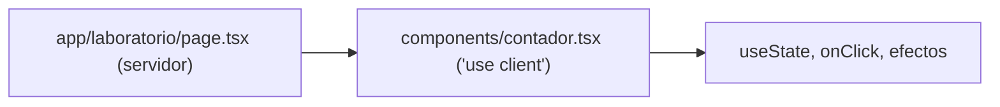

# El proyecto Next de ripopola, desde el día uno

<Tech ids={['nextdotjs', 'react', 'nx', 'typescript', 'tailwindcss', 'pnpm']} />

<Estado tipo="construye">Las apps `apps/web` (puerto 4200) y `apps/panel` (puerto 4300) en Next.js 16, y una página `/laboratorio` en la web para practicar React.</Estado>

## Concepto

Vas a aprender React **dentro** del proyecto real. Para eso alcanza con dos
ideas de Next que vemos a fondo en la sección 6:

1. **Cada carpeta dentro de `app/` es una ruta** y el archivo `page.tsx` es la
   página. `app/laboratorio/page.tsx` se ve en `/laboratorio`.
2. Por defecto los componentes de Next **corren en el servidor**. Si un archivo
   empieza con `'use client'`, es un **componente de cliente**: React "de
   siempre", con estado, eventos y hooks. Las secciones 1 a 5 viven casi todas
   ahí.



## Si venís de Angular

<Angular>

| Angular CLI / Nx Angular | Next en Nx |
| --- | --- |
| `app.routes.ts` con un array de rutas | Carpetas dentro de `app/` (rutas por archivos) |
| `main.ts` + `app.config.ts` | `app/layout.tsx` (layout raíz) y `next.config.ts` |
| `ng serve` en 4200 | `next dev` (lo configuramos en 4200) |
| `@angular/ssr` opcional | Render en servidor por defecto |
| `environment.ts` | Variables de entorno `.env` (`NEXT_PUBLIC_` para el navegador) |

</Angular>

## En ripopola

### 1. Decidir qué pasa con las apps Angular

El monorepo tiene las apps Angular `web` y `panel` de la inicialización, sin
código de negocio. Como el frontend ahora es Next, lo natural es borrarlas y
crear dos apps Next con los mismos nombres. Hacelo en una rama:

```bash
git switch -c feat/web-next
pnpm exec nx g @nx/workspace:remove panel --dry-run
pnpm exec nx g @nx/workspace:remove web --dry-run
```

Si el `--dry-run` muestra lo esperado, corré los mismos comandos sin la bandera.

### 2. Por qué dos apps

ripopola tiene dos frontends con necesidades opuestas:

| App | Dominio | Qué necesita |
| --- | --- | --- |
| `apps/web` | `ripopola.com` | Público: SEO, páginas cacheadas, varios idiomas, carga rápida |
| `apps/panel` | `panel.ripopola.com` | Privado: sesión en cada página, formularios, datos siempre frescos |

Separarlas deja que cada una tenga su configuración, su despliegue y su
escala (la web con instancias siempre encendidas, el panel puede escalar a
cero), y que un cambio del panel no invalide la caché de la web. Lo que
comparten (el cliente de la API, el cliente de Better Auth, componentes de
UI) va en librerías de Nx (sección 13).

### 3. Instalar el plugin y generar las apps

```bash
pnpm add -D -E @nx/next
pnpm exec nx g @nx/next:app apps/web --help        # mirá las opciones de tu versión
pnpm exec nx g @nx/next:app apps/web --appDir=true --src=false --style=tailwind --dry-run
pnpm exec nx g @nx/next:app apps/panel --appDir=true --src=false --style=tailwind --dry-run
```

Revisá en el `--dry-run` que use el App Router con la carpeta `app/` en la
raíz de cada app. Después generalas de verdad y comprobá las versiones:

```bash
pnpm list next react react-dom
```

Si `next` no es 16.x, actualizalo con `pnpm add -E next@latest react@latest react-dom@latest`.

<Alternativa title="create-next-app">
Fuera de un monorepo se usa `pnpm create next-app@latest`. Con `--yes` activa
lo recomendado: TypeScript, ESLint, Tailwind, App Router, Turbopack y **Cache
Components**. Es la forma más común en el mercado; en Nx usamos el generador
para que el proyecto quede integrado (caché de tareas, grafo, límites entre librerías).
</Alternativa>

### 4. Activar lo que Next 16 trae por defecto

En `apps/web/next.config.ts` y `apps/panel/next.config.ts` (dejá lo que puso Nx y agregá esto):

```ts
import type { NextConfig } from 'next';

const nextConfig: NextConfig = {
  cacheComponents: true,     // modelo de caché de Next 16 (sección 7)
  partialPrefetching: true,  // prefetch de la parte estática de cada ruta
  reactCompiler: true,       // memoización automática (sección 3)
};

export default nextConfig;
```

```bash
pnpm add -D -E babel-plugin-react-compiler
```

### 5. Puertos y variables

La API ya usa el 3000 y tiene CORS para 4200 y 4300 (curso de Nest), así que
la web usa el **4200** y el panel el **4300**. En el `project.json` de cada
app poné el puerto del target `dev`, o probá directamente:

```bash
pnpm exec nx dev web --port=4200
pnpm exec nx dev panel --port=4300
```

`apps/web/.env.local` y `apps/panel/.env.local` (no se suben a git):

```bash
# Solo servidor: la usan Server Components, Server Actions y los rewrites
API_INTERNAL_URL=http://localhost:3000
```

### 6. Las carpetas

```
apps/web/               (apps/panel/ tiene la misma forma)
  next.config.ts
  app/
    layout.tsx          ← layout raíz: <html> y <body>
    page.tsx            ← la página "/"
    globals.css         ← Tailwind
  components/           ← componentes de esta app (lo creamos nosotros)
  public/               ← archivos estáticos (/favicon.ico)
libs/frontend/          ← lo que comparten web y panel (sección 4.1 y 13)
```

### 7. Tu primer componente de cliente

`apps/web/components/contador-de-visitas.tsx`:

```tsx
'use client';

import { useState } from 'react';

export function ContadorDeVisitas() {
  const [visitas, setVisitas] = useState(0);

  return (
    <button
      type="button"
      onClick={() => setVisitas(visitas + 1)}
      className="rounded-lg border px-4 py-2"
    >
      Visité {visitas} pueblos
    </button>
  );
}
```

`apps/web/app/laboratorio/page.tsx`:

```tsx
import { ContadorDeVisitas } from '@/components/contador-de-visitas';

export default function LaboratorioPage() {
  return (
    <main className="mx-auto max-w-3xl p-8">
      <h1 className="text-2xl font-bold">Laboratorio de React</h1>
      <ContadorDeVisitas />
    </main>
  );
}
```

Abrí `http://localhost:4200/laboratorio`. La página se renderiza en el
servidor; el botón se **hidrata** en el navegador y responde a los clics.

:::tip La página de laboratorio
Usá `/laboratorio` para los ejercicios de las secciones 1 a 3. Cuando un
componente esté listo, lo movés a su lugar real (el buscador, el mapa, el panel).
:::

### 8. Qué hace cada pieza

- `'use client'` marca la **frontera**: este archivo y lo que importa van al
  navegador. La página que lo usa sigue siendo de servidor.
- `useState(0)` crea estado local; `setVisitas` pide un render nuevo.
- `@/` es el alias a la raíz de la app (`apps/web/`) en su `tsconfig.json`; si el generador no lo creó, agregá `"paths": { "@/*": ["./*"] }`.

## Errores comunes

- **"useState only works in Client Components"**: te faltó `'use client'` arriba
  de todo (antes de los imports).
- **Puerto ocupado**: la API ya está en 3000. Web en 4200, panel en 4300.
- **Copiar tutoriales de Next 13/14**: `middleware.ts`, `getServerSideProps` o
  `params` síncronos ya no son como se explican ahí.
- **Poner `'use client'` en la página entera** "para que funcione": perdés el
  render en servidor. Marcá solo la hoja interactiva.

<Resumen>

- El frontend de ripopola son dos apps Next 16: `apps/web` (4200, pública) y `apps/panel` (4300, privada).
- Carpeta en `app/` = ruta; `page.tsx` = página.
- Por defecto, servidor; `'use client'` = componente de React interactivo.
- Activamos Cache Components, Partial Prefetching y React Compiler.

</Resumen>

## Preguntas de entrevista

**1. ¿Por qué aprender React dentro de Next y no con una app Vite aparte?**
Porque React es el mismo: un componente de cliente en Next es React normal.
Así lo aprendido queda en el producto real y de paso se ve dónde está la
frontera entre servidor y cliente.

**2. ¿Por qué separar el sitio público y el panel en dos apps?**
Porque tienen necesidades opuestas: uno es público, cacheado y con SEO; el
otro es privado, dinámico y con sesión. Separadas, cada una tiene su
configuración, su despliegue y su escala, y comparten código por librerías.

**3. ¿Qué hace `'use client'`?**
Marca un archivo como punto de entrada al bundle del navegador. Ese componente
y lo que importa se envían al cliente y se hidratan; el resto sigue en el servidor.

**4. ¿Qué es la hidratación?**
El paso en el que React, en el navegador, toma el HTML que vino del servidor y
le conecta el estado y los eventos sin volver a crearlo.

**5. ¿Qué activa `cacheComponents` en Next 16?**
El modelo de caché explícito con `'use cache'` y el prerender parcial: todo es
dinámico salvo lo que marcás como cacheado, y lo dinámico se envuelve en Suspense.

## Glosario

| Término | Qué es |
| --- | --- |
| App Router | El sistema de rutas de Next basado en la carpeta `app/`. |
| Componente de cliente | Componente marcado con `'use client'` que corre e interactúa en el navegador. |
| Hidratación | Conectar el HTML del servidor con React en el navegador. |
| Turbopack | El bundler de Next, por defecto en dev y build. |
| `@nx/next` | Plugin de Nx para generar y correr apps Next. |
