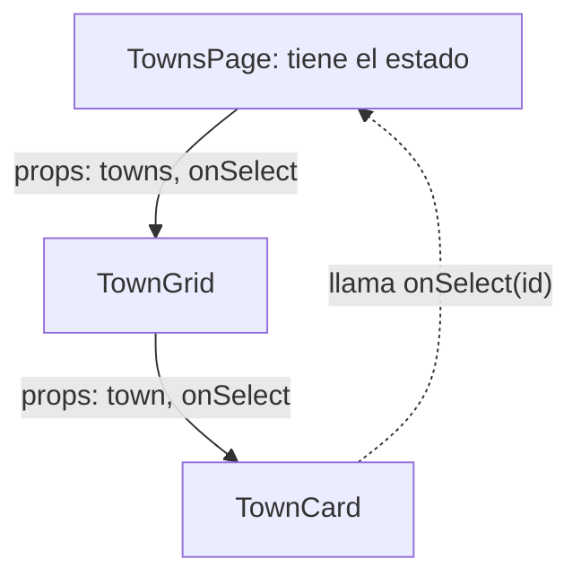

# Componentes, props y composición

<Tech ids={['react', 'typescript']} />

<Estado tipo="construye">`TownGrid` y un `Section` reutilizable que recibe `children`.</Estado>

## Concepto

Un componente recibe **un solo argumento**: el objeto `props`. Las props son
de **solo lectura**: el componente no las cambia, las usa para calcular su UI.
Si algo tiene que cambiar, es estado (del componente o de un padre).

```tsx
type SectionProps = {
  title: string;
  action?: React.ReactNode;     // cualquier cosa dibujable
  children: React.ReactNode;    // lo que va entre las etiquetas
};

export function Section({ title, action, children }: SectionProps) {
  return (
    <section className="my-8">
      <header className="mb-4 flex items-center justify-between">
        <h2 className="text-xl font-bold">{title}</h2>
        {action}
      </header>
      {children}
    </section>
  );
}
```

### Los datos bajan, los eventos suben



El hijo no "emite" nada: el padre le pasa una **función** y el hijo la llama.
Es el flujo de datos unidireccional.

### Composición en vez de herencia

React no usa herencia de componentes. Para reutilizar se **compone**:

- `children` para "hueco" principal (como `ng-content`).
- Props que reciben JSX (`action`, `header`, `empty`) para varios huecos.
- Componentes chicos que se combinan.

### Componentes puros

Un componente tiene que ser **puro**: mismas props y estado, mismo resultado,
sin modificar nada de afuera durante el render. React lo exige porque puede
renderizar de más, interrumpir un render o repetirlo (en desarrollo,
`StrictMode` renderiza dos veces a propósito para que se noten las impurezas).

## Si venís de Angular

<Angular>

| Angular | React |
| --- | --- |
| `name = input.required<string>()` | `{ name }: { name: string }` |
| `size = input<'sm' \| 'lg'>('sm')` | `{ size = 'sm' }` (valor por defecto en la desestructuración) |
| `selected = output<string>()` y `selected.emit(id)` | `onSelect: (id: string) => void` y `onSelect(id)` |
| `<ng-content />` | `{children}` |
| `<ng-content select="[action]" />` | una prop `action: ReactNode` |
| `model()` (two-way binding) | `value` + `onChange` (componente controlado) |

No hay `@Output` ni `EventEmitter`: un "evento" es solo una prop que es función.

</Angular>

## En ripopola: la grilla de pueblos

`apps/web/components/towns/town-grid.tsx`:

```tsx
import { TownCard } from './town-card';

export type TownSummary = {
  id: string;
  slug: string;
  name: string;
  region: string;
  population?: number;
  photoUrl?: string;
};

type TownGridProps = {
  towns: TownSummary[];
  empty?: React.ReactNode;
};

export function TownGrid({ towns, empty = <p>No hay pueblos para mostrar.</p> }: TownGridProps) {
  if (towns.length === 0) return <>{empty}</>;

  return (
    <ul className="grid gap-4 sm:grid-cols-2 lg:grid-cols-3">
      {towns.map((town) => (
        <li key={town.id}>
          <TownCard {...town} />
        </li>
      ))}
    </ul>
  );
}
```

Y en la página:

```tsx
<Section title="Pueblos de Aragón" action={<a href="/pueblos?region=aragon">Ver todos</a>}>
  <TownGrid towns={EJEMPLO} empty={<p>Todavía no hay pueblos en Aragón.</p>} />
</Section>
```

:::tip Tipos de la librería compartida
`TownSummary` acá es local para practicar. En la sección 4 lo reemplazás por
el tipo generado desde el contrato OpenAPI de la API, para que front y back no
se desincronicen.
:::

### Spread de props: con cuidado

`<TownCard {...town} />` es cómodo, pero pasa **todo** lo que tenga `town`. Si
el objeto crece, el componente recibe props que no espera. En componentes de
dominio preferí pasar lo necesario de forma explícita.

## Errores comunes

- **Modificar una prop** (`props.towns.push(...)`): rompe el flujo y React no se entera.
- **Pasar 10 props por tres niveles** ("prop drilling"): señal de que conviene
  composición (pasar el componente ya armado) o Context (tema 2.4).
- **Componentes enormes**: si tiene más de una responsabilidad, partilo.
- **Declarar un componente dentro de otro**: se crea uno nuevo en cada render y
  pierde su estado. Declaralos siempre en el nivel del módulo.

<Resumen>

- Las props son de solo lectura; lo que cambia es estado.
- Los datos bajan por props; los eventos suben con funciones pasadas por props.
- Se reutiliza por composición (`children` y props con JSX), no por herencia.
- Los componentes deben ser puros.

</Resumen>

## Preguntas de entrevista

**1. ¿Qué diferencia hay entre props y estado?**
Las props vienen del padre y son de solo lectura. El estado es del componente y
al cambiar dispara un render. Lo que es prop para un hijo suele ser estado del padre.

**2. ¿Cómo se comunica un hijo con su padre?**
El padre le pasa una función por props y el hijo la llama con los datos. No hay eventos propios.

**3. ¿Por qué React prefiere composición a herencia?**
Porque `children` y las props con JSX cubren los casos de reutilización sin
acoplar jerarquías. Es más flexible y explícito.

**4. ¿Qué es el prop drilling y cómo se evita?**
Pasar props por componentes intermedios que no las usan. Se evita componiendo
(pasando el elemento ya armado), con Context o con un store.

**5. ¿Por qué no hay que declarar componentes dentro de otros?**
Porque en cada render se crea una función nueva, React la ve como otro tipo de
componente, desmonta el anterior y se pierde el estado.

**6. ¿Qué es un componente puro y por qué StrictMode renderiza dos veces?**
Uno que, con la misma entrada, devuelve lo mismo y no tiene efectos en el
render. StrictMode lo llama dos veces en desarrollo para destapar impurezas.

## Glosario

| Término | Qué es |
| --- | --- |
| `children` | Prop especial con el contenido entre las etiquetas. |
| `ReactNode` | Tipo de todo lo que React puede dibujar. |
| Flujo unidireccional | Los datos bajan por props; los cambios suben con callbacks. |
| Prop drilling | Pasar props por niveles que no las usan. |
| StrictMode | Modo de desarrollo que duplica renders y efectos para detectar errores. |
