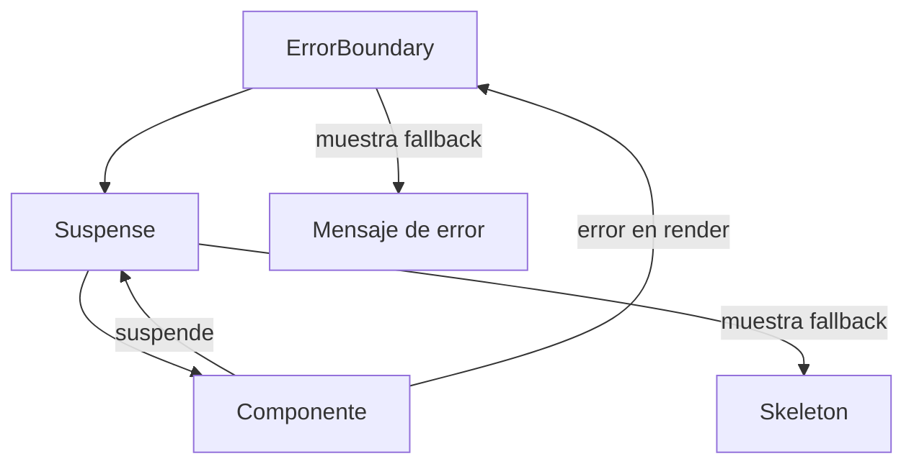

# Suspense, use y error boundaries

<Tech ids={['react', 'nextdotjs']} />

<Estado tipo="construye">Carga diferida del mapa con `lazy` y un error boundary alrededor del mapa para que un fallo de las teselas no rompa la página.</Estado>

## Concepto

### Suspense

`<Suspense>` muestra un **fallback** mientras algo de adentro "no está listo":

```tsx
<Suspense fallback={<MapSkeleton />}>
  <TownsMap />
</Suspense>
```

¿Qué significa "no está listo"? Que un componente **suspende**: durante el
render lee algo que todavía no llegó (una promesa con `use`, un componente
cargado con `lazy`, datos de una librería compatible). React deja de
renderizar ese subárbol, muestra el fallback más cercano y vuelve a intentar
cuando la promesa se resuelve.

La gran idea: **el estado de carga se declara arriba**, no con
`if (loading)` en cada componente.

### `use(promesa)`

```tsx
function TownName({ townPromise }: { townPromise: Promise<Town> }) {
  const town = use(townPromise); // suspende hasta que resuelve
  return <h1>{town.name}</h1>;
}
```

- La promesa tiene que venir **de afuera** (de un Server Component, de una
  caché, de una librería). Si la creás en el render, se crea una nueva cada vez
  y suspende para siempre.
- En Next, el patrón típico es: el Server Component inicia el `fetch` **sin
  `await`** y le pasa la promesa a un componente de cliente que la lee con `use`.

### `lazy`: dividir el código

```tsx
const TownsMap = lazy(() => import('./towns-map'));
```

El código del mapa (MapLibre pesa) se descarga solo cuando se va a mostrar.
Mientras tanto, suspende. En Next también existe `next/dynamic`, que agrega
`ssr: false` para componentes que no pueden correr en el servidor.

### Error boundaries

Si un componente **tira un error durante el render**, React desmonta todo el
árbol... salvo que haya un **error boundary** arriba, que muestra un fallback.

React todavía no tiene un hook para esto: un error boundary se escribe como
**clase** o se usa la librería `react-error-boundary`:

```tsx
import { ErrorBoundary } from 'react-error-boundary';

<ErrorBoundary fallback={<p>No pudimos cargar el mapa.</p>}>
  <Suspense fallback={<MapSkeleton />}>
    <TownsMap />
  </Suspense>
</ErrorBoundary>
```

No capturan errores en manejadores de eventos ni en código asíncrono fuera del
render: esos los manejás con `try/catch`.

En Next, el archivo `error.tsx` de cada ruta **es** un error boundary, y
`loading.tsx` es un `Suspense` (sección 6.5).



## Si venís de Angular

<Angular>

| Angular | React |
| --- | --- |
| `@defer (on viewport) { ... } @loading { ... } @error { ... }` | `lazy` + `Suspense` + `ErrorBoundary` |
| `@if (data(); as d) { ... } @else { cargando }` en cada componente | Un `Suspense` arriba que cubre a todos los hijos |
| `resource()` / `httpResource()` con `isLoading()` | `use(promesa)` o TanStack Query con `useSuspenseQuery` |
| `ErrorHandler` global | Error boundaries por zona + `global-error.tsx` en Next |

`@defer` es lo más parecido: carga diferida con bloques de carga y error. La
diferencia es que en React el `Suspense` también sirve para **datos**, no solo
para código.

</Angular>

## En ripopola: el mapa sin romper la página

```tsx title="apps/web/features/map/towns-map-section.tsx"
'use client';

import { lazy, Suspense } from 'react';
import { ErrorBoundary } from 'react-error-boundary';

const TownsMap = lazy(() => import('./towns-map'));

export function TownsMapSection() {
  return (
    <ErrorBoundary
      fallbackRender={({ resetErrorBoundary }) => (
        <div role="alert" className="rounded border p-4">
          <p>No pudimos cargar el mapa.</p>
          <button onClick={resetErrorBoundary}>Reintentar</button>
        </div>
      )}
    >
      <Suspense fallback={<div className="h-96 animate-pulse rounded bg-slate-100" />}>
        <TownsMap />
      </Suspense>
    </ErrorBoundary>
  );
}
```

```bash
pnpm add -E react-error-boundary
```

Si falla el mapa, la ficha del pueblo, las viviendas y los empleos siguen
funcionando. Ubicá los boundaries donde un fallo **no debería** llevarse puesto
al resto.

## Errores comunes

- **Crear la promesa en el render** y pasarla a `use`: suspende en bucle.
- **Un solo Suspense arriba de todo**: toda la página espera a lo más lento.
- **Esperar que el error boundary capture errores de un `onClick`**: no lo hace.
- **Suspense sin fallback con tamaño**: el contenido "salta" al cargar (CLS). El
  skeleton tiene que ocupar lo mismo que el contenido.

<Resumen>

- Suspense declara el estado de carga de un subárbol.
- Un componente suspende al leer algo que no llegó: `use(promesa)`, `lazy`, librerías compatibles.
- Los error boundaries capturan errores de render; los de eventos van con `try/catch`.
- Ubicá Suspense y boundaries por zonas independientes de la página.

</Resumen>

## Preguntas de entrevista

**1. ¿Cómo funciona Suspense?**
Cuando un componente lee algo que no está listo, suspende; React muestra el
fallback del Suspense más cercano y reintenta el render cuando se resuelve.

**2. ¿Qué hace `use` con una promesa y qué cuidado hay que tener?**
Devuelve el valor resuelto o suspende mientras tanto. La promesa debe ser
estable (venir de afuera o de una caché); si se crea en cada render, nunca termina.

**3. ¿Qué capturan y qué no los error boundaries?**
Capturan errores en el render, en métodos de ciclo de vida y en constructores
del subárbol. No capturan errores de eventos, de código asíncrono suelto ni del propio boundary.

**4. ¿Por qué los error boundaries todavía son clases?**
Porque se basan en `getDerivedStateFromError` y `componentDidCatch`, que no
tienen equivalente en hooks. En la práctica se usa `react-error-boundary`.

**5. ¿Dónde ponés los límites de Suspense?**
Alrededor de zonas que pueden cargar de forma independiente, con fallbacks del
mismo tamaño que el contenido, para mostrar algo útil rápido sin saltos.

## Glosario

| Término | Qué es |
| --- | --- |
| Suspender | Interrumpir el render hasta que algo esté listo. |
| Fallback | Lo que se muestra mientras tanto (o ante un error). |
| Error boundary | Componente que captura errores de render de su subárbol. |
| Code splitting | Partir el JavaScript para descargar solo lo necesario. |
| CLS | Cumulative Layout Shift: cuánto se mueve la página al cargar. |
