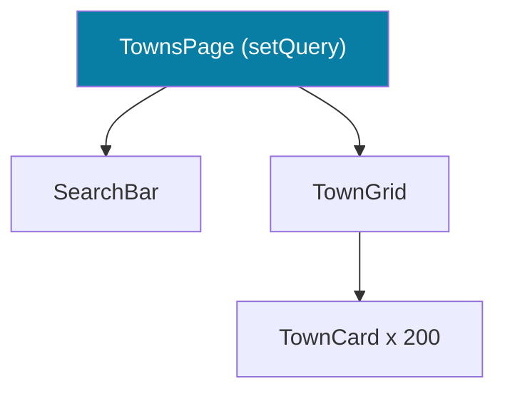

# Render y reconciliación

<Tech ids={['react']} />

<Estado tipo="concepto">Lo que tenés que poder explicar en una pizarra. Se aplica en todo el proyecto.</Estado>

## Concepto

### Qué dispara un render

Un componente se vuelve a renderizar cuando:

1. **Cambia su estado** (`setState`, `dispatch`).
2. **Se re-renderiza su padre** (aunque las props sean iguales).
3. **Cambia un contexto** que lee.

Las props **no** disparan renders por sí mismas: un hijo se renderiza porque
su padre se renderizó. Esto sorprende: si `TownsPage` cambia un estado, por
defecto **todos** sus descendientes se vuelven a llamar.



Que se rendericen no significa que el DOM cambie: si el resultado es igual, no
hay commit. El costo es el **trabajo de llamar a las funciones y comparar**.
Normalmente es barato; se vuelve un problema con árboles grandes o renders caros.

### Reconciliación

Después del render, React compara el árbol nuevo con el anterior
(*diffing*). Comparar dos árboles arbitrarios es O(n³); React usa dos
heurísticas para hacerlo en O(n):

1. **Si el tipo de un elemento cambia** (`div` → `section`, `TownCard` →
   `HousingCard`), React destruye el subárbol viejo y crea uno nuevo (se pierde el estado).
2. **En listas, las `key`** dicen qué hijo es cuál.

Con el mismo tipo, React reutiliza el nodo y solo actualiza los atributos que cambiaron.

### Fiber

Fiber es la implementación interna desde React 16: cada componente es un
nodo ("fiber") con su estado, sus hooks (en una lista enlazada, por eso
importa el orden) y punteros a padre, hijo y hermano. Permite que el render
sea **trabajo divisible**: React procesa fibers de a poco, cede el control al
navegador y retoma, y le da prioridad a lo urgente (las *lanes*). Eso es lo
que hace posibles las transiciones y Suspense.

El commit, en cambio, es **síncrono**: se aplica todo junto para que nunca se
vea una UI a medias.

### Hidratación

Con render en servidor, el navegador recibe HTML ya armado. React hace un
render en el cliente y, en vez de crear nodos, **adopta** los existentes y les
conecta los eventos. Si lo que calcula el cliente no coincide con el HTML
(`Date.now()`, `Math.random()`, `window` en el render, extensiones del
navegador que modifican el DOM), hay un *hydration mismatch*.

Con Suspense la hidratación es **selectiva**: cada zona se hidrata cuando llega
su código, y React prioriza la zona en la que el usuario hace clic.

### Cómo evitar renders de más (en orden)

1. **Mové el estado hacia abajo**: si solo el buscador usa `query`, que viva en el buscador.
2. **Pasá JSX como `children`**: lo que llega como children ya está creado por
   el padre de arriba y no se re-renderiza cuando cambia el estado del intermedio.
3. **Memoización** (`memo`, `useMemo`, `useCallback`), que hoy hace el **React Compiler** (3.2).

```tsx
// ❌ El estado del panel lateral re-renderiza el mapa entero
function Page() {
  const [open, setOpen] = useState(false);
  return (<><Sidebar open={open} onToggle={setOpen} /><HeavyMap /></>);
}

// ✅ El estado vive en un componente que recibe el mapa ya armado
function SidebarLayout({ children }: { children: React.ReactNode }) {
  const [open, setOpen] = useState(false);
  return (<><Sidebar open={open} onToggle={setOpen} />{children}</>);
}
// <SidebarLayout><HeavyMap /></SidebarLayout>
```

## Si venís de Angular

<Angular>

| Angular | React |
| --- | --- |
| Zone.js (o zoneless) + detección de cambios desde la raíz | Render desde el componente que cambió hacia abajo |
| `OnPush`: solo revisa si cambian las referencias de los inputs | `memo`: solo re-renderiza si cambian las props (por referencia) |
| Signals: actualización fina, sin recorrer el árbol | No hay equivalente nativo; React compensa con memoización y el compiler |
| Hidratación incremental con `@defer (hydrate on ...)` | Hidratación selectiva con Suspense |

`OnPush` + inmutabilidad en Angular es la misma disciplina que React te exige
siempre.

</Angular>

## Errores comunes

- **Pensar que cambiar props dispara renders**: lo que dispara es el render del padre.
- **Optimizar sin medir**: primero el Profiler (3.3).
- **Meter estado arriba "por si acaso"**: re-renderiza todo lo de abajo.
- **Leer `window` o la hora en el render** de un componente que se renderiza en servidor.

<Resumen>

- Se renderiza por estado propio, render del padre o contexto.
- Reconciliación O(n): cambio de tipo = subárbol nuevo; listas = keys.
- Fiber divide el render en trabajo interrumpible; el commit es atómico.
- Antes de memoizar: bajar el estado y pasar children.

</Resumen>

## Preguntas de entrevista

**1. ¿Qué dispara el re-render de un componente?**
Un cambio de su estado, el re-render de su padre o un cambio en un contexto que
consume. Las props no lo disparan por sí solas.

**2. ¿Re-render significa que se actualiza el DOM?**
No. Render es llamar al componente; si el resultado no cambia, no hay cambios
en el DOM.

**3. Explicá la reconciliación.**
React compara el árbol nuevo con el anterior usando dos heurísticas: distinto
tipo implica reemplazar el subárbol y las keys identifican hijos en listas. Así el diff es lineal.

**4. ¿Qué es Fiber y qué permitió?**
La arquitectura interna donde cada componente es una unidad de trabajo. Permite
pausar, priorizar y retomar el render: base del modo concurrente, Suspense y transiciones.

**5. ¿Qué causa un error de hidratación y cómo se evita?**
Que el primer render del cliente no coincida con el HTML del servidor (fechas,
aleatorios, `window`). Se evita moviendo esa lógica a efectos o a componentes
solo de cliente, o con `suppressHydrationWarning` en casos puntuales.

**6. ¿Cómo evitás renders innecesarios sin usar `memo`?**
Bajando el estado al componente que lo usa y pasando los componentes caros como
children, para que el padre que cambia no los vuelva a crear.

## Glosario

| Término | Qué es |
| --- | --- |
| Reconciliación | Comparar árboles para calcular los cambios mínimos. |
| Fiber | Nodo interno de React que representa un componente y su trabajo. |
| Lanes | Prioridades de las actualizaciones en React. |
| Hidratación selectiva | Hidratar por zonas de Suspense, priorizando la interacción. |
