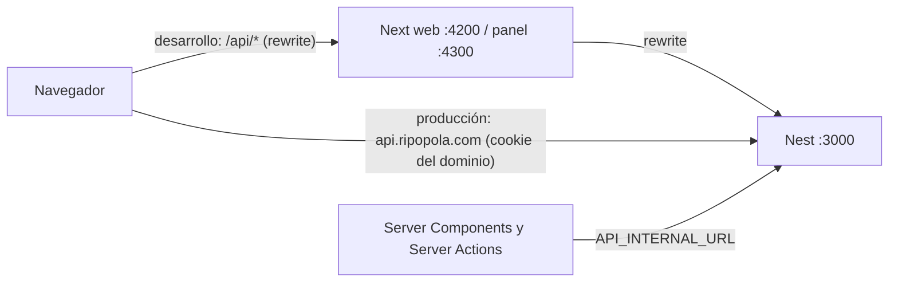

# El cliente tipado de la API de Nest

<Tech ids={['nextdotjs', 'nestjs', 'openapiinitiative', 'typescript', 'nx']} />

<Estado tipo="construye">La librería `libs/frontend/api` (`@ripopola/frontend-api`) con `publicApi`, `serverApi()`, `browserApi` y `ApiError`, usada por la web y el panel.</Estado>

## Concepto

### Quién llama a la API y desde dónde

Hay tres caminos, y cada uno tiene su cliente:



| Cliente | Corre en | Cookie de sesión | Para qué |
| --- | --- | --- | --- |
| `publicApi` | Servidor | No | Datos públicos que se pueden cachear (`'use cache'`, sección 7) |
| `serverApi()` | Servidor | Sí, reenvía la del usuario | Panel: páginas y Server Actions con sesión |
| `browserApi` | Navegador | Sí, con `credentials: 'include'` | TanStack Query en componentes de cliente |

### Desarrollo: mismo origen con rewrites

En tu máquina, cada app reenvía `/api/*` a Nest. Para el navegador todo es
`localhost:4300` (o `4200`): no hay CORS y la cookie de Better Auth queda en
el origen de la app. Es el `proxy.conf.json` de Angular.

### Producción: subdominios del mismo sitio

En producción hay tres servicios: `ripopola.com` (web), `panel.ripopola.com`
y `api.ripopola.com`. Nest emite la cookie de sesión para el dominio
`ripopola.com` (curso de Nest, sección 6), así que las tres la comparten. Al
ser el **mismo sitio**, `SameSite=Lax` funciona, el navegador llama directo a
`api.ripopola.com` con `credentials: 'include'` y la API lo acepta por CORS.

:::warning Previews y dominios ajenos
En una preview (`*.run.app`, `*.vercel.app`) la cookie de `ripopola.com` no
llega. Ahí el navegador vuelve a usar los rewrites (rutas relativas). Lo
vemos en la sección 12.
:::

### Variables de entorno en Next

| Variable | Dónde se lee | Para qué |
| --- | --- | --- |
| `API_INTERNAL_URL` | Solo en el servidor | URL de Nest para Server Components, Server Actions y rewrites |
| `NEXT_PUBLIC_API_URL` | Servidor y navegador (se incrusta en el **build**) | `''` en desarrollo; `https://api.ripopola.com` en producción |
| `NEXT_PUBLIC_SITE_URL` | Servidor y navegador | URL pública de la app (metadatos, enlaces) |

Todo lo que empiece con `NEXT_PUBLIC_` termina en el JavaScript que descarga
cualquiera: **nunca** secretos ahí.

### Tipos generados + `openapi-fetch`

La librería `libs/shared/api-client` ya tiene `schema.ts` generado del
contrato OpenAPI de Nest (curso de Nest, sección 8). En Angular lo usabas con
`HttpClient`; acá lo usamos con **openapi-fetch**, un `fetch` de 6 kB que
tipa rutas, parámetros y respuestas a partir de ese esquema.

## Si venís de Angular

<Angular>

| Angular | Next / React |
| --- | --- |
| `HttpClient` inyectado | `fetch` (nativo) o un cliente fino como openapi-fetch |
| Interceptores (`HttpInterceptorFn`) | Middleware de openapi-fetch o una función envoltorio |
| `withCredentials: true` | `credentials: 'include'` |
| `proxy.conf.json` en `ng serve` | `rewrites` en `next.config.ts` |
| `environment.ts` | `.env` + `process.env` (`NEXT_PUBLIC_` para el navegador) |
| Observables | Promesas (`async/await`) |

</Angular>

## En ripopola

### 1. Los rewrites de desarrollo

En `apps/web/next.config.ts` y `apps/panel/next.config.ts`:

```ts
const nextConfig: NextConfig = {
  // ...
  async rewrites() {
    return [{ source: '/api/:path*', destination: `${process.env.API_INTERNAL_URL}/api/:path*` }];
  },
};
```

Los rewrites reenvían cabeceras y `Set-Cookie` en los dos sentidos, así que
el login de la sección 9 funciona igual que contra la API directa.

### 2. Variables

```bash title="apps/panel/.env.local"
API_INTERNAL_URL=http://localhost:3000
NEXT_PUBLIC_API_URL=
NEXT_PUBLIC_SITE_URL=http://localhost:4300
```

En la web, lo mismo con `4200`. Y un `.env.example` (sí se sube) con las
mismas claves sin valores.

### 3. La librería compartida

```bash
pnpm exec nx g @nx/js:lib libs/frontend/api --importPath=@ripopola/frontend-api --bundler=none --dry-run
pnpm add -E openapi-fetch server-only
```

Tres puntos de entrada, para que el código de servidor nunca se cuele en el
navegador:

```json title="libs/frontend/api/package.json (exports)"
{
  "exports": {
    ".": "./src/index.ts",
    "./server": "./src/server.ts",
    "./browser": "./src/browser.ts"
  }
}
```

Si tu versión de Nx usa `paths` en `tsconfig.base.json` en vez de
`exports`, agregá `@ripopola/frontend-api/server` y
`@ripopola/frontend-api/browser` ahí.

### 4. El cliente base

```ts title="libs/frontend/api/src/client.ts"
import createClient from 'openapi-fetch';
import type { paths } from '@ripopola/api-client';

export function createApi(baseUrl: string, init?: { headers?: HeadersInit; credentials?: RequestCredentials }) {
  return createClient<paths>({ baseUrl, ...init });
}
```

### 5. Los clientes de servidor

```ts title="libs/frontend/api/src/server.ts"
import 'server-only';                       // si un Client Component lo importa, el build falla
import { cookies } from 'next/headers';
import { createApi } from './client';

/** Datos públicos: sin cookies, se puede usar dentro de 'use cache'. */
export const publicApi = createApi(process.env.API_INTERNAL_URL!);

/** Datos del usuario: reenvía su cookie de sesión. Hace dinámica la página. */
export async function serverApi() {
  const cookieStore = await cookies();
  return createApi(process.env.API_INTERNAL_URL!, {
    headers: { cookie: cookieStore.toString() },
  });
}
```

- **Dos clientes a propósito**: `publicApi` no toca `cookies()`, así que las
  páginas públicas de la web se pueden prerenderizar y cachear. `serverApi()`
  lee la cookie del usuario: nunca va dentro de `'use cache'`.
- La URL interna no viaja nunca al navegador.

### 6. El cliente de navegador

```ts title="libs/frontend/api/src/browser.ts"
import { createApi } from './client';

// '' = mismo origen en desarrollo (rewrites); https://api.ripopola.com en producción
export const browserApi = createApi(process.env.NEXT_PUBLIC_API_URL ?? '', {
  credentials: 'include',                   // manda la cookie de sesión a api.ripopola.com
});
```

### 7. Usarlo

```ts
const { data, error, response } = await publicApi.GET('/api/v1/towns/{slug}', {
  params: { path: { slug: 'albarracin' } },
});
```

- La ruta se autocompleta con las del contrato.
- `params.path`, `params.query` y `body` están tipados.
- `data` tiene el tipo de la respuesta 200; `error`, el de las respuestas de error.
- No tira excepción en un 404: lo devuelve en `error` y `response.status`.

### 8. Errores: Problem Details

La API responde siempre **Problem Details** (curso de Nest, sección 8). Una
clase para todos, y una más para los errores de validación por campo:

```ts title="libs/frontend/api/src/errors.ts"
export interface Problem {
  type: string;
  title: string;
  status: number;
  detail?: string;
  errors?: Record<string, string[]>;        // validación: campo → mensajes
}

export class ApiError extends Error {
  constructor(readonly problem: Problem) {
    super(problem.title);
  }
  get status() {
    return this.problem.status;
  }
}

export class ApiValidationError extends ApiError {
  get fieldErrors() {
    return this.problem.errors ?? {};
  }
}

export function unwrap<T>(result: { data?: T; error?: unknown; response: Response }): T {
  if (result.data !== undefined) return result.data;
  const problem = (result.error as Problem | undefined) ?? {
    type: 'about:blank', title: `La API respondió ${result.response.status}`, status: result.response.status,
  };
  throw problem.status === 400 || problem.status === 422 ? new ApiValidationError(problem) : new ApiError(problem);
}
```

```ts title="libs/frontend/api/src/index.ts"
export * from './errors';
```

```ts
const town = unwrap(await publicApi.GET('/api/v1/towns/{slug}', { params: { path: { slug } } }));
```

En un Server Component vas a convertir el 404 en `notFound()` y el 401 en
`redirect('/login')` (6.5 y 9.4).

### 9. Funciones por recurso

No llames al cliente desde los componentes: armá funciones con nombre de dominio
en cada app.

```ts title="apps/web/features/towns/api.ts"
import 'server-only';
import { publicApi } from '@ripopola/frontend-api/server';
import { unwrap } from '@ripopola/frontend-api';

export async function getTown(slug: string) {
  return unwrap(await publicApi.GET('/api/v1/towns/{slug}', { params: { path: { slug } } }));
}
```

<Alternativa title="Axios, ky, Orval y hey-api">
En el mercado vas a ver **Axios** (con interceptores; el curso de referencia
lo usa) o **ky**. Con Next se prefiere `fetch` porque Next lo integra con su
caché y con el streaming. **Orval** y **@hey-api/openapi-ts** generan además
hooks de TanStack Query a partir del OpenAPI: muy cómodos en equipos grandes.
</Alternativa>

## Errores comunes

- **Olvidar `credentials: 'include'`** en el navegador: la petición a
  `api.ripopola.com` sale sin cookie y la API responde 401.
- **Llamar a `http://localhost:3000` desde el navegador en desarrollo**: CORS
  y cookies en otro origen. En desarrollo, rutas relativas (rewrites).
- **Usar rutas relativas en el servidor**: en un Server Component no hay
  "origen"; usá `API_INTERNAL_URL`.
- **Usar `serverApi()` en una página pública**: lee cookies y vuelve dinámica
  la página entera. Para lo público, `publicApi`.
- **Secretos en `NEXT_PUBLIC_`.**
- **Escribir los tipos de respuesta a mano.**

<Resumen>

- Desarrollo: rewrites `/api/*` → Nest, mismo origen. Producción: subdominios de `ripopola.com` con la cookie compartida.
- `publicApi` (servidor, sin cookies, cacheable), `serverApi()` (servidor, con la cookie del usuario), `browserApi` (navegador, `credentials: 'include'`).
- Todo en `libs/frontend/api`, compartido por la web y el panel; lo de servidor protegido con `server-only`.
- openapi-fetch + tipos generados = llamadas tipadas de punta a punta.
- Problem Details → `ApiError` / `ApiValidationError`.

</Resumen>

## Preguntas de entrevista

**1. ¿Para qué sirven los rewrites en desarrollo?**
Para que el navegador hable con un solo origen: sin CORS y con la cookie de
sesión en el mismo origen que la app, como el proxy de Angular.

**2. ¿Cómo comparten la sesión la web, el panel y la API en producción?**
Están bajo el mismo dominio (`ripopola.com`, `panel.` y `api.`): la API emite
la cookie para el dominio padre, el navegador la manda con
`credentials: 'include'` y, al ser el mismo sitio, `SameSite=Lax` alcanza.

**3. ¿Qué diferencia hay entre una variable con y sin `NEXT_PUBLIC_`?**
Las `NEXT_PUBLIC_` se incrustan en el bundle del navegador al compilar; las
otras solo existen en el servidor.

**4. ¿Por qué separar un cliente público de uno que reenvía cookies?**
Porque leer cookies vuelve dinámica la página y los datos de un usuario no se
pueden cachear para todos. Lo público usa un cliente sin cookies y se puede
cachear; lo privado reenvía la sesión.

**5. ¿Para qué sirve `server-only`?**
Para que el build falle si un módulo pensado para el servidor (con URLs
internas o lectura de cookies) se importa desde código de cliente.

**6. ¿Cómo mantenés tipadas las llamadas a la API?**
Generando tipos desde el OpenAPI del backend y usando un cliente que los
aplique a rutas, parámetros y respuestas, como openapi-fetch.

## Glosario

| Término | Qué es |
| --- | --- |
| Rewrite | Reenviar una ruta a otro destino sin que cambie la URL del navegador. |
| Mismo sitio | Mismo dominio registrable (`ripopola.com`), aunque cambie el subdominio. |
| `credentials: 'include'` | Opción de `fetch` para mandar cookies a otro origen. |
| `server-only` | Paquete que impide importar un módulo desde el cliente. |
| openapi-fetch | Cliente `fetch` tipado desde un esquema OpenAPI. |
| Problem Details | Formato estándar de errores HTTP (RFC 9457). |
