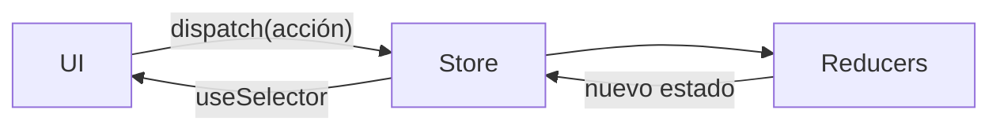

# Redux Toolkit (concepto)

<Tech ids={['redux', 'react', 'zustand', 'reactquery']} />

<Estado tipo="concepto">Ripopola no usa Redux. Lo vas a encontrar en muchísimo código existente y en entrevistas.</Estado>

## Concepto

Redux es un **store global único** donde el estado solo cambia despachando
**acciones** que procesan **reducers** puros. Es el mismo patrón que
`useReducer` (2.3), pero para toda la app, con middleware y DevTools que
permiten "viajar en el tiempo" entre estados.



**Redux Toolkit (RTK)** es la forma oficial y actual de escribir Redux. Elimina
el código repetitivo del Redux clásico (constantes, action creators, `switch`
enormes).

### Un slice

```ts
import { createSlice, type PayloadAction } from '@reduxjs/toolkit';

type FavoritesState = { ids: string[] };

const favoritesSlice = createSlice({
  name: 'favorites',
  initialState: { ids: [] } as FavoritesState,
  reducers: {
    toggled(state, action: PayloadAction<string>) {
      const i = state.ids.indexOf(action.payload);
      if (i >= 0) state.ids.splice(i, 1);   // "muta"... pero es Immer
      else state.ids.push(action.payload);
    },
  },
});

export const { toggled } = favoritesSlice.actions;
export default favoritesSlice.reducer;
```

`createSlice` genera las acciones y el reducer. Adentro podés escribir como si
mutaras porque RTK usa **Immer**, que produce un objeto nuevo.

### El store y los hooks tipados

```ts
import { configureStore } from '@reduxjs/toolkit';
import favorites from './favorites-slice';

export const makeStore = () => configureStore({ reducer: { favorites } });
export type AppStore = ReturnType<typeof makeStore>;
export type RootState = ReturnType<AppStore['getState']>;
export type AppDispatch = AppStore['dispatch'];
```

```tsx
const ids = useAppSelector((s) => s.favorites.ids);
const dispatch = useAppDispatch();
dispatch(toggled('albarracin'));
```

### Redux en Next

La guía oficial de Redux para el App Router pide:
- **Un store por petición** (`makeStore`, no un store de módulo) por la misma
  razón que con TanStack Query y Zustand.
- Un `StoreProvider` de cliente que crea el store una vez (con `useRef`).
- Los Server Components **no** leen ni escriben el store.

### RTK Query

RTK trae su propia capa de datos del servidor, **RTK Query**, equivalente a
TanStack Query (caché por endpoint, invalidación por tags). Si una empresa ya
usa Redux, suele usar RTK Query; si no, TanStack Query.

### Middleware: persistencia y efectos

El curso de referencia guarda favoritos en `localStorage` con un middleware de
Redux. La idea: un middleware ve cada acción antes y después del reducer y
puede hacer efectos (persistir, loguear, analítica). `redux-persist` o un
`listenerMiddleware` resuelven lo mismo que `persist` de Zustand.

## Comparación para la entrevista

| | Redux Toolkit | Zustand | TanStack Query |
| --- | --- | --- | --- |
| Qué maneja | Estado global de cliente (y servidor con RTK Query) | Estado global de cliente | Estado del servidor |
| Ceremonia | Media: slices, store, Provider | Mínima | Mínima |
| DevTools | Excelentes (time travel) | Con middleware `devtools` | Propias |
| Escala de equipos | Muy buena: patrón único y estricto | Buena con convenciones | — |
| Dónde aparece | Apps grandes existentes, empresas | Proyectos nuevos | Casi todos los proyectos nuevos |

Respuesta corta de senior: *"Para datos del servidor uso TanStack Query (o RTK
Query si ya hay Redux). Para el poco estado global que queda, Zustand por
simple; Redux Toolkit si el equipo ya lo usa o si necesito un flujo de eventos
estricto y auditable."*

## Si venís de Angular

<Angular>

Redux es el modelo de **NgRx Store**: acciones, reducers, selectores, efectos
(en RTK, `createAsyncThunk` o `listenerMiddleware`), DevTools. Si sabés NgRx,
sabés Redux: cambian los nombres y que RTK escribe menos código.

| NgRx | Redux Toolkit |
| --- | --- |
| `createAction` + `createReducer` | `createSlice` |
| `createSelector` | `createSelector` (de Reselect, incluido) |
| Effects | `createAsyncThunk` / `listenerMiddleware` |
| `store.select` | `useSelector` |
| NgRx Entity | `createEntityAdapter` |

</Angular>

## Errores comunes

- **Meter todo en Redux**, incluidos los datos del servidor y el estado de formularios.
- **Un store de módulo en Next**: estado compartido entre usuarios en el servidor.
- **Selectores que devuelven objetos nuevos**: re-render en cada acción.
- **Mutar fuera de `createSlice`** creyendo que Immer siempre está.

<Resumen>

- Redux = store único + acciones + reducers puros; RTK es la forma actual.
- `createSlice` con Immer; hooks tipados; un store por petición en Next.
- RTK Query es la alternativa de Redux a TanStack Query.
- Es NgRx con otros nombres.

</Resumen>

## Preguntas de entrevista

**1. ¿Cuáles son los principios de Redux?**
Una sola fuente de verdad, el estado es de solo lectura y solo cambia con
acciones, y los cambios los hacen funciones puras (reducers).

**2. ¿Qué agrega Redux Toolkit al Redux clásico?**
`createSlice` (acciones y reducer juntos), Immer para escribir actualizaciones
inmutables fácilmente, `configureStore` con DevTools y middleware, y RTK Query.

**3. ¿Redux o Zustand?**
Zustand para estado global chico en proyectos nuevos; Redux Toolkit en apps
grandes que ya lo usan o donde se valora un flujo estricto y trazable.

**4. ¿Cómo se integra Redux con el App Router de Next?**
Con un store creado por petición y un Provider de cliente; los Server
Components no acceden al store.

**5. ¿Qué es Immer?**
Una librería que te deja escribir código "mutable" sobre un borrador y produce
un objeto nuevo inmutable con los cambios.

## Glosario

| Término | Qué es |
| --- | --- |
| Slice | Parte del estado con su reducer y sus acciones. |
| Immer | Librería para actualizar inmutablemente con sintaxis mutable. |
| Middleware | Función que intercepta acciones para hacer efectos. |
| RTK Query | Capa de datos del servidor de Redux Toolkit. |
| Time travel | Navegar entre estados pasados con las DevTools. |
