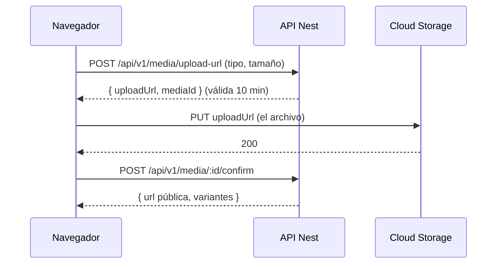

# Subida de fotos

<Tech ids={['react', 'googlecloud', 'nestjs', 'reactquery']} />

<Estado tipo="construye">El selector de fotos de la vivienda: arrastrar o elegir, previsualizar, subir directo a Cloud Storage con progreso y confirmar en la API.</Estado>

## Concepto

### El flujo de subida directa

Subir las fotos **a través** de Nest gasta memoria y CPU de la API. Lo
recomendado (curso de Nest, 7.3) es que el navegador suba **directo** a Cloud
Storage con una **URL firmada** que da la API:



La API decide **qué** se puede subir (tipo, tamaño, quién) al firmar la URL; el
navegador solo hace el `PUT`.

### Previsualizar sin subir

```tsx
const url = URL.createObjectURL(file); // URL local "blob:" al archivo
// ...
URL.revokeObjectURL(url);              // liberar memoria al dejar de usarla
```

Crear y revocar es un efecto: `useEffect` con limpieza (2.1).

### Progreso

`fetch` todavía no da progreso de **subida** de forma práctica. Para la barra
de progreso se usa `XMLHttpRequest` (`xhr.upload.onprogress`).

### Validar antes

En el cliente, por experiencia: tipo (`image/jpeg`, `image/png`, `image/webp`),
tamaño (por ejemplo 10 MB), cantidad. En el servidor, de verdad: la URL firmada
se emite para un tipo y tamaño concretos.

## Si venís de Angular

<Angular>

| Angular | React |
| --- | --- |
| `HttpClient` con `reportProgress: true` y `HttpEventType.UploadProgress` | `XMLHttpRequest` con `upload.onprogress` (o Axios con `onUploadProgress`) |
| `DomSanitizer.bypassSecurityTrustUrl` para previews | No hace falta: React acepta URLs `blob:` en `src` |
| CDK Drag and Drop / directivas propias | Eventos `onDragOver` / `onDrop` o `react-dropzone` |

</Angular>

## En ripopola

### 1. Subir un archivo con progreso

```ts title="apps/panel/features/media/upload.ts"
export function putWithProgress(url: string, file: File, onProgress: (pct: number) => void, signal?: AbortSignal) {
  return new Promise<void>((resolve, reject) => {
    const xhr = new XMLHttpRequest();
    xhr.open('PUT', url);
    xhr.setRequestHeader('Content-Type', file.type);
    xhr.upload.onprogress = (e) => e.lengthComputable && onProgress(Math.round((e.loaded / e.total) * 100));
    xhr.onload = () => (xhr.status < 300 ? resolve() : reject(new Error(`Error ${xhr.status}`)));
    xhr.onerror = () => reject(new Error('Error de red'));
    signal?.addEventListener('abort', () => xhr.abort());
    xhr.send(file);
  });
}
```

### 2. El hook que orquesta

```ts title="apps/panel/features/media/use-photo-upload.ts"
'use client';

import { useMutation } from '@tanstack/react-query';
import { useState } from 'react';
import { browserApi } from '@ripopola/frontend-api/browser';
import { unwrap } from '@ripopola/frontend-api';
import { putWithProgress } from './upload';

export function usePhotoUpload(listingId: string) {
  const [progress, setProgress] = useState(0);

  const mutation = useMutation({
    mutationFn: async (file: File) => {
      const { uploadUrl, mediaId } = unwrap(
        await browserApi.POST('/api/v1/media/upload-url', {
          body: { listingId, contentType: file.type, size: file.size },
        }),
      );
      await putWithProgress(uploadUrl, file, setProgress);
      return unwrap(await browserApi.POST('/api/v1/media/{id}/confirm', { params: { path: { id: mediaId } } }));
    },
    onSettled: () => setProgress(0),
  });

  return { upload: mutation.mutateAsync, progress, ...mutation };
}
```

### 3. El selector con previsualización

```tsx title="apps/panel/features/media/photo-picker.tsx"
'use client';

import { useEffect, useMemo, useState } from 'react';

const ACCEPTED = ['image/jpeg', 'image/png', 'image/webp'];
const MAX_BYTES = 10 * 1024 * 1024;

export function PhotoPicker({ onPick }: { onPick: (files: File[]) => void }) {
  const [files, setFiles] = useState<File[]>([]);
  const [error, setError] = useState<string | null>(null);
  const previews = useMemo(() => files.map((f) => URL.createObjectURL(f)), [files]);

  useEffect(() => () => previews.forEach(URL.revokeObjectURL), [previews]); // liberar al cambiar o desmontar

  function handleFiles(list: FileList | null) {
    const picked = Array.from(list ?? []);
    const invalid = picked.find((f) => !ACCEPTED.includes(f.type) || f.size > MAX_BYTES);
    if (invalid) {
      setError(`"${invalid.name}" no es una imagen válida o pesa más de 10 MB.`);
      return;
    }
    setError(null);
    setFiles(picked);
    onPick(picked);
  }

  return (
    <div
      onDragOver={(e) => e.preventDefault()}
      onDrop={(e) => { e.preventDefault(); handleFiles(e.dataTransfer.files); }}
      className="rounded-xl border-2 border-dashed p-6 text-center"
    >
      <label className="cursor-pointer">
        <span>Arrastrá las fotos o elegilas</span>
        <input type="file" accept={ACCEPTED.join(',')} multiple className="sr-only" onChange={(e) => handleFiles(e.target.files)} />
      </label>
      {error && <p role="alert" className="text-red-700">{error}</p>}
      <ul className="mt-4 grid grid-cols-3 gap-2">
        {previews.map((src, i) => (
          <li key={src}></li>
        ))}
      </ul>
    </div>
  );
}
```

Con el compiler, `useMemo` acá no es por rendimiento: garantiza que las URLs
`blob:` se creen una sola vez por lista de archivos (y se revoquen después).

<Alternativa title="Cloudinary, UploadThing, subir a través de la API">
El curso de referencia sube a **Cloudinary** (almacenamiento + transformaciones
de imagen). **UploadThing** y **Vercel Blob** son populares en el mundo Next.
Subir **a través** de la API con `multipart/form-data` es más simple pero no
escala igual. Ripopola ya tiene Cloud Storage en el backend.
</Alternativa>

## Errores comunes

- **No revocar las URLs `blob:`**: pérdida de memoria con muchas fotos.
- **Confiar en `accept`** del input: es una sugerencia; validá siempre.
- **Mandar el archivo por la API** "porque es más fácil" y saturarla.
- **Olvidar el CORS del bucket**: el `PUT` desde el navegador necesita CORS
  configurado en Cloud Storage para el origen de la web.

<Resumen>

- Subida directa: la API firma, el navegador sube, la API confirma.
- Previsualización con `URL.createObjectURL` y `revokeObjectURL` en la limpieza.
- Progreso con `XMLHttpRequest`.
- Validar en el cliente para la experiencia; en el servidor, de verdad.

</Resumen>

## Preguntas de entrevista

**1. ¿Por qué subir directo al almacenamiento con URL firmada?**
Porque el archivo no pasa por la API: menos memoria, menos CPU y menos tiempo
de petición, y la API sigue controlando qué se puede subir.

**2. ¿Cómo mostrás una vista previa de una imagen antes de subirla?**
Con `URL.createObjectURL(file)` en el `src` de un `img`, revocándola cuando ya no se usa.

**3. ¿Cómo mostrás el progreso de una subida?**
Con `XMLHttpRequest` y el evento `upload.onprogress`, porque `fetch` no lo
expone de forma práctica para subidas.

## Glosario

| Término | Qué es |
| --- | --- |
| URL firmada | URL temporal que autoriza una operación concreta sobre un archivo. |
| `blob:` | URL local que apunta a datos en memoria del navegador. |
| CORS del bucket | Reglas de Cloud Storage sobre qué orígenes pueden subir. |
