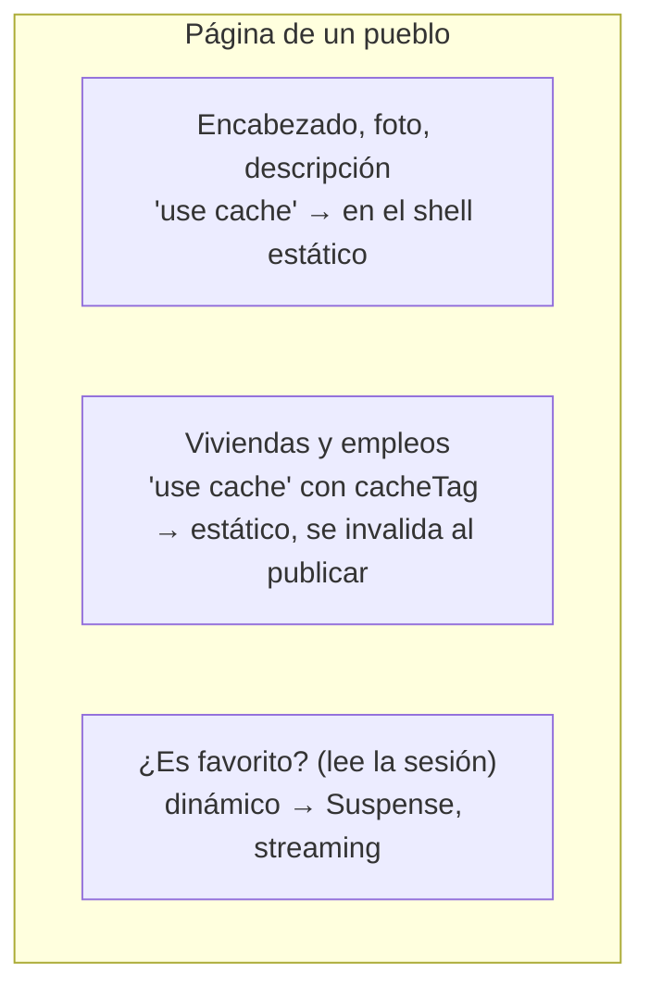

# Qué es Next y las estrategias de render

<Tech ids={['nextdotjs', 'react']} />

<Estado tipo="concepto">El mapa mental de la sección 6 a 8. Cada página de ripopola elige su estrategia (resumen en 13.3).</Estado>

## Concepto

Next.js es un framework de React que agrega **rutas por archivos**, **render
en el servidor**, **caché**, optimización de imágenes y fuentes, y un
**servidor** donde correr código (Server Components, Server Actions, Route
Handlers, proxy).

### Las estrategias clásicas

| Sigla | Qué es | Cuándo se genera el HTML | Ejemplo en ripopola |
| --- | --- | --- | --- |
| **CSR** | Client-Side Rendering | En el navegador, con JS | El mapa interactivo |
| **SSR** | Server-Side Rendering | En el servidor, en cada petición | El panel del municipio (datos del usuario) |
| **SSG** | Static Site Generation | En el build | "Cómo funciona", páginas legales |
| **ISR** | Incremental Static Regeneration | En el build o la primera visita, y se regenera cada X tiempo o al invalidar | La ficha de cada pueblo |

En los cursos de Next 13/14 vas a ver estas siglas como "modos" de cada
página. Hoy conviene pensarlo distinto.

### Next 16: prerender parcial por defecto

Con **Cache Components** (activado en el 1.2) no elegís un modo para toda la
página. Next intenta **prerenderizar todo lo que puede** y lo que no puede
(porque lee cookies, headers, `searchParams` o datos sin caché) lo **transmite
en streaming** dentro de límites de Suspense:

- El **shell estático** sale instantáneo desde un CDN (como SSG/ISR).
- Los **huecos dinámicos** se completan en la misma respuesta (como SSR).
- Vos decidís qué es estático marcándolo con `'use cache'` y cuánto dura con `cacheLife`.

Eso es **Partial Prerendering (PPR)**: lo mejor de estático y dinámico en una
misma página. Lo vemos a fondo en la sección 7.

### Por qué Next para ripopola

- **SEO**: las fichas de pueblos tienen que llegar con todo el contenido en el
  HTML para que Google las indexe y para que se vean bien al compartirlas.
- **Velocidad**: el shell estático sale desde CDN; Core Web Vitals buenos.
- **Una sola app** para sitio público y panel, con React en el cliente donde
  hace falta interactividad.
- **Mercado**: es el framework React más pedido.

### App Router y Pages Router

Next tiene dos routers. El **App Router** (`app/`) es el actual: Server
Components, layouts anidados, streaming, Server Actions. El **Pages Router**
(`pages/`, con `getServerSideProps` y `getStaticProps`) es el anterior; sigue
existiendo y lo vas a ver en código de empresas. Este curso usa solo el App
Router; en el 13.4 hay una tabla de equivalencias.

## Si venís de Angular

<Angular>

| Angular | Next |
| --- | --- |
| CSR por defecto, SSR opcional con `@angular/ssr` | Servidor por defecto, cliente donde marcás `'use client'` |
| Render modes por ruta (`RenderMode.Prerender`, `Server`, `Client`) | Prerender parcial automático; marcás qué se cachea |
| Hidratación incremental con `@defer` | Streaming con Suspense e hidratación selectiva |
| `TransferState` / caché de `HttpClient` para no repetir peticiones | Los Server Components no repiten nada en el cliente: no hay hidratación de datos |

La diferencia de fondo: en Angular SSR la app entera se ejecuta en el
servidor **y** en el cliente. En Next, un Server Component **nunca** llega al
cliente: no hay JavaScript ni datos que hidratar para esa parte.

</Angular>

## Errores comunes

- **Pensar "esta página es SSR o SSG"** con Next 16: pensá por componente.
- **Copiar `getServerSideProps`** de tutoriales viejos en el App Router.
- **Hacer todo `'use client'`**: perdés SEO y mandás JavaScript de más.

<Resumen>

- CSR, SSR, SSG e ISR siguen siendo el vocabulario de entrevista.
- Next 16 con Cache Components prerenderiza lo cacheado y transmite lo dinámico (PPR).
- Next se elige por SEO, velocidad y por tener servidor y cliente en un mismo proyecto.
- App Router es el actual; Pages Router existe en código viejo.

</Resumen>

## Preguntas de entrevista

**1. Explicá CSR, SSR, SSG e ISR.**
CSR arma el HTML en el navegador. SSR lo genera en el servidor en cada
petición. SSG lo genera en el build. ISR lo genera estático y lo regenera cada
cierto tiempo o al invalidarlo.

**2. ¿Qué es Partial Prerendering?**
Servir un shell estático prerenderizado al instante y completar las partes
dinámicas en streaming en la misma respuesta, usando límites de Suspense.

**3. ¿Por qué un sitio con SEO no debería ser una SPA pura?**
Porque el HTML inicial está vacío y depende del JavaScript; los buscadores y
las vistas previas de redes sociales ven menos contenido y la carga es más lenta.

**4. ¿Qué cambió en Next 16 respecto del modelo de caché?**
Con Cache Components todo es dinámico por defecto y se cachea de forma explícita
con `'use cache'`, `cacheLife` y `cacheTag`; lo dinámico va en Suspense.

**5. ¿App Router o Pages Router?**
App Router para proyectos nuevos: Server Components, layouts anidados,
streaming y Server Actions. Pages Router en mantenimiento de código existente.

## Glosario

| Término | Qué es |
| --- | --- |
| Shell estático | La parte de la página prerenderizada que sale al instante. |
| Streaming | Enviar el HTML por partes a medida que está listo. |
| PPR | Partial Prerendering: estático y dinámico en la misma página. |
| CDN | Red de servidores que entrega contenido cerca del usuario. |
