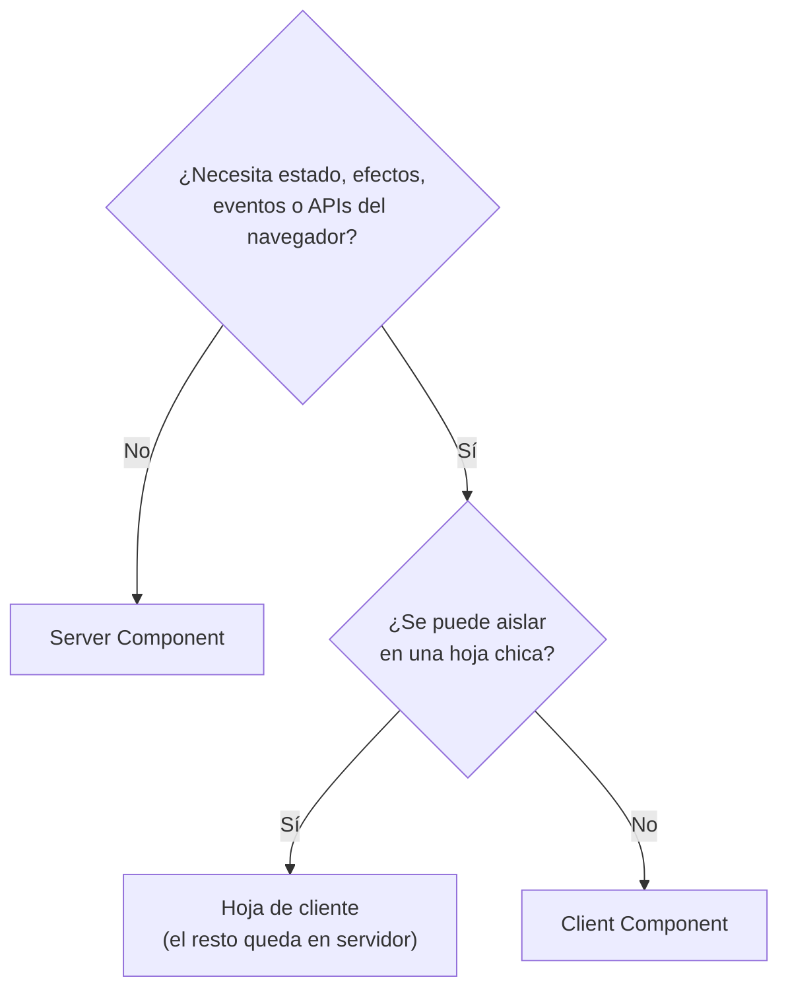

# Server Components y Client Components

<Tech ids={['nextdotjs', 'react']} />

<Estado tipo="construye">La ficha del pueblo como Server Component con islas de cliente (favorito, galería, mapa).</Estado>

## Concepto

### Server Components (por defecto)

Un componente en `app/` sin `'use client'` es un **Server Component**:

- Corre **solo en el servidor** (en el build o en la petición).
- Puede ser `async` y hacer `await` de datos directamente.
- Puede usar secretos, la API interna, el sistema de archivos.
- **Su código no se envía al navegador**: ni el componente ni sus
  dependencias (un parser de Markdown de 80 kB queda en el servidor).
- **No** puede usar estado, efectos, eventos, Context ni APIs del navegador.

Lo que llega al navegador es el **RSC payload**: una descripción serializada
del resultado (el árbol ya renderizado) más referencias a los componentes de
cliente que hay que hidratar.

### Client Components

Con `'use client'` arriba del archivo:

- Se renderizan en el servidor (para el HTML inicial) **y** se hidratan en el cliente.
- Pueden usar estado, efectos, eventos, Context, `window`.
- Su código va al bundle del navegador.

`'use client'` marca una **frontera**: todo lo que ese archivo importa también
es de cliente. No hace falta ponerlo en cada archivo, solo en los puntos de entrada.

### Qué puede cruzar la frontera

Las props de un Server Component a un Client Component tienen que ser
**serializables**: strings, números, booleanos, `null`, arrays y objetos
planos, `Date`, `Map`, `Set`, promesas, JSX ya renderizado... y **Server
Actions**. **No** se pueden pasar funciones normales ni instancias de clases.

### El patrón clave: servidor dentro de cliente vía children

Un Client Component **no puede importar** un Server Component, pero sí
**recibirlo** como children o prop:

```tsx
// ✅ page.tsx (servidor)
<Tabs>                       {/* cliente: maneja qué pestaña se ve */}
  <HousingList townId={id} /> {/* servidor: pide datos, no manda JS */}
</Tabs>
```

`Tabs` recibe el resultado ya renderizado; no sabe ni le importa que vino del servidor.

### Dónde va cada cosa



Regla práctica: **bajá el `'use client'` lo más posible**. La página es de
servidor; el botón de favorito, el carrusel y el mapa son hojas de cliente.

### `server-only` y `client-only`

`import 'server-only'` en un módulo hace que el build falle si se importa desde
el cliente (lo usamos en 4.1 para el cliente de la API). `client-only` es lo
contrario.

## Si venís de Angular

<Angular>

No hay un equivalente real en Angular. Lo más parecido:

| Idea | Angular | Next |
| --- | --- | --- |
| Que una parte no mande JS | No existe: todo componente se hidrata | Server Component |
| Hidratar solo una parte | `@defer (hydrate on interaction)` | La parte es un Client Component |
| Código que solo corre en el servidor | `isPlatformServer` + `TransferState` | El Server Component entero |
| Secretos en el render | No: el código del componente va al cliente | Sí, en Server Components |

Pensalo así: un Server Component es una **plantilla que se ejecuta en el
backend** y devuelve HTML con islas de Angular adentro.

</Angular>

## En ripopola: la ficha del pueblo

```tsx title="app/(sitio)/pueblos/[slug]/page.tsx"
import { notFound } from 'next/navigation';
import { getTown } from '@/features/towns/api';           // server-only
import { FavoriteToggle } from '@/features/favorites/favorite-toggle'; // 'use client'
import { PhotoGallery } from '@/features/towns/photo-gallery';           // 'use client'
import { TownMapSection } from '@/features/map/town-map-section';       // 'use client' + dynamic

export default async function TownPage({ params }: PageProps<'/pueblos/[slug]'>) {
  const { slug } = await params;
  const town = await getTown(slug).catch(() => null);
  if (!town) notFound();

  return (
    <article className="mx-auto max-w-5xl p-6">
      <header className="flex items-center justify-between">
        <h1 className="text-3xl font-bold">{town.name}</h1>
        <FavoriteToggle townId={town.id} townName={town.name} />
      </header>
      <PhotoGallery photos={town.photos} />
      <section className="prose">{town.description}</section>
      <TownMapSection lng={town.location.coordinates[0]} lat={town.location.coordinates[1]} />
    </article>
  );
}
```

Qué llega al navegador: el HTML completo (bueno para SEO) y el JavaScript de
**tres** componentes chicos. El código de `getTown`, el formateo de la
descripción y el layout no se descargan.

## Errores comunes

- **Pasar una función normal** de servidor a cliente: error "Functions cannot be passed directly to Client Components".
- **Importar un Server Component desde uno de cliente**: se convierte en cliente (y falla si usa `async` o secretos).
- **`'use client'` en la página** por un solo `onClick`.
- **Usar `useState` en un Server Component**: error en el build.
- **Creer que un Client Component "no se renderiza en el servidor"**: sí se
  renderiza para el HTML inicial; por eso no puede leer `window` en el render.

<Resumen>

- Server Component por defecto: corre solo en el servidor, puede ser async, no manda JS.
- `'use client'` marca la frontera hacia el bundle del navegador.
- Props a través de la frontera: solo serializables (y Server Actions).
- Servidor dentro de cliente se pasa como children.
- Bajá el `'use client'` a las hojas.

</Resumen>

## Preguntas de entrevista

**1. ¿Qué es un React Server Component?**
Un componente que se ejecuta solo en el servidor, puede acceder a datos
directamente y cuyo código no se envía al cliente; al navegador llega solo su
resultado serializado.

**2. ¿Diferencia entre SSR y Server Components?**
SSR genera HTML en el servidor pero luego hidrata todo en el cliente. Los
Server Components no se hidratan nunca: su JavaScript no se envía. Se combinan:
Next hace SSR de Server y Client Components.

**3. ¿Qué no se puede hacer en un Server Component?**
Usar estado, efectos, eventos, Context ni APIs del navegador.

**4. ¿Cómo usás un Server Component dentro de un Client Component?**
No importándolo, sino pasándolo como `children` o prop desde un componente de servidor padre.

**5. ¿Qué es el RSC payload?**
La representación serializada del árbol renderizado en el servidor, con
referencias a los Client Components, que React usa para armar y actualizar la UI.

**6. ¿Por qué bajar `'use client'` lo más posible?**
Porque todo lo que esté por debajo de la frontera va al bundle del navegador;
cuanto más abajo, menos JavaScript y más contenido renderizado en el servidor.

## Glosario

| Término | Qué es |
| --- | --- |
| Server Component | Componente que corre solo en el servidor. |
| Client Component | Componente marcado con `'use client'`, se hidrata en el navegador. |
| Frontera de cliente | El punto donde empieza el código que va al navegador. |
| RSC payload | El resultado serializado de los Server Components. |
| Serializable | Que se puede convertir a datos y reconstruir del otro lado. |
