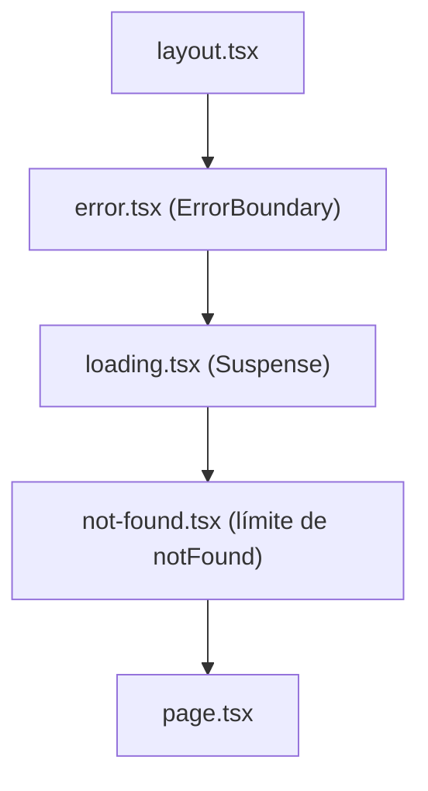

# loading, error y not-found

<Tech ids={['nextdotjs', 'react']} />

<Estado tipo="construye">El esqueleto de la ficha del pueblo, el error del panel con reintento y el 404 de "pueblo no encontrado".</Estado>

## Concepto

Next arma solo los límites de Suspense y de error a partir de archivos
especiales en cada segmento:



| Archivo | Qué es por dentro | Cuándo se muestra |
| --- | --- | --- |
| `loading.tsx` | `<Suspense fallback>` alrededor de la página | Mientras la página (o algo que no tiene su propio Suspense) espera datos |
| `error.tsx` | Error boundary (2.6), **componente de cliente** | Cuando algo tira un error inesperado al renderizar el segmento |
| `not-found.tsx` | Límite para `notFound()` | Cuando llamás a `notFound()` o ninguna ruta coincide |
| `global-error.tsx` | Error boundary del layout raíz | Errores en el propio layout raíz (lleva su `html` y `body`) |

Fijate el orden: `error.tsx` está **debajo** del layout del mismo segmento, así
que no captura errores de ese layout; para eso está el `error.tsx` del segmento padre.

### `loading.tsx`

```tsx title="app/(sitio)/pueblos/[slug]/loading.tsx"
export default function Loading() {
  return <div className="mx-auto max-w-5xl animate-pulse p-6"><div className="h-10 w-1/2 rounded bg-slate-200" /></div>;
}
```

Con Cache Components preferí **`<Suspense>` explícitos** alrededor de cada
parte dinámica (7.2): así el resto de la página aparece al instante y solo
esperan los huecos. `loading.tsx` sirve como red de seguridad y hace que la
navegación muestre algo de inmediato.

### `error.tsx`

```tsx title="apps/panel/app/(privado)/error.tsx"
'use client';

import { useEffect } from 'react';

export default function PanelError({ error, retry }: { error: unknown; retry: () => void }) {
  useEffect(() => {
    console.error(error); // en producción: Sentry (11.6)
  }, [error]);

  return (
    <div role="alert" className="p-6">
      <h2>Algo salió mal al cargar el panel.</h2>
      <button onClick={() => retry()}>Reintentar</button>
    </div>
  );
}
```

- `retry()` vuelve a pedir y renderizar el segmento (estable desde Next 16.3; antes había solo `reset`, que re-renderiza sin volver a pedir).
- En producción, el mensaje de los errores que vienen de Server Components se
  oculta al cliente (solo llega un `digest` para buscarlo en los logs): no
  filtrás detalles internos.

### Errores esperados vs inesperados

| Esperados | Inesperados |
| --- | --- |
| Validación, "no encontrado", sin permiso | Bugs, la API caída |
| Se modelan como **valores de retorno** (`{ error: '...' }`) o con `notFound()` | Se tiran y los captura `error.tsx` |
| El usuario puede corregirlos | El usuario solo puede reintentar |

### `notFound()`

```tsx
import { notFound } from 'next/navigation';

const town = await getTown(slug).catch((e) => (e instanceof ApiError && e.status === 404 ? null : Promise.reject(e)));
if (!town) notFound();
```

Muestra el `not-found.tsx` más cercano y responde con **404** (importante para
SEO: un "pueblo no encontrado" con 200 es un *soft 404*).

## Si venís de Angular

<Angular>

| Angular | Next |
| --- | --- |
| `@defer` con `@loading` / un spinner con `@if (loading)` | `loading.tsx` / `<Suspense>` |
| `ErrorHandler` global + `catchError` | `error.tsx` por segmento + `global-error.tsx` |
| Ruta `**` con un componente 404 | `not-found.tsx` + `notFound()` |
| Resolver que redirige a 404 si no existe | `notFound()` en la página |

</Angular>

## En ripopola

```tsx title="app/(sitio)/pueblos/[slug]/not-found.tsx"
import Link from 'next/link';

export default function TownNotFound() {
  return (
    <div className="mx-auto max-w-xl p-10 text-center">
      <h1 className="text-2xl font-bold">No encontramos ese pueblo</h1>
      <p className="mt-2">Puede que haya cambiado de nombre o que todavía no esté en ripopola.</p>
      <Link href="/pueblos" className="mt-6 inline-block underline">Ver todos los pueblos</Link>
    </div>
  );
}
```

Y un `app/not-found.tsx` general para cualquier URL que no exista.

## Errores comunes

- **`error.tsx` sin `'use client'`**: error de build.
- **Esperar que `error.tsx` capture errores de su propio layout.**
- **Tirar errores para validaciones**: van como valores de retorno.
- **Devolver "no encontrado" con estado 200**: usá `notFound()`.
- **Mostrar `error.message`** al usuario: no es para humanos (y en producción no llega).

<Resumen>

- `loading.tsx` = Suspense; `error.tsx` = error boundary de cliente; `not-found.tsx` = 404.
- `error.tsx` no cubre el layout de su mismo segmento.
- Errores esperados como valores; inesperados, tirados.
- `notFound()` devuelve 404 real.

</Resumen>

## Preguntas de entrevista

**1. ¿Qué son `loading.tsx` y `error.tsx` por dentro?**
`loading.tsx` envuelve la página en un `Suspense` con ese fallback; `error.tsx`
es un error boundary de React (por eso tiene que ser componente de cliente).

**2. ¿Por qué un `error.tsx` no captura errores de su propio layout?**
Porque el boundary está dentro del layout del segmento; el error del layout lo
captura el `error.tsx` del segmento padre o `global-error.tsx`.

**3. ¿Cómo manejás errores esperados en Next?**
Como valores de retorno (por ejemplo desde una Server Action con
`useActionState`) o con `notFound()`, no tirando excepciones.

**4. ¿Qué es un soft 404 y cómo lo evitás?**
Una página de "no encontrado" que responde 200; los buscadores la indexan mal.
Se evita llamando a `notFound()`, que responde 404.

## Glosario

| Término | Qué es |
| --- | --- |
| Archivo especial | Archivo con nombre reservado que Next usa para una función. |
| `digest` | Identificador de un error de servidor para buscarlo en los logs. |
| Soft 404 | Página de error que responde con estado 200. |
