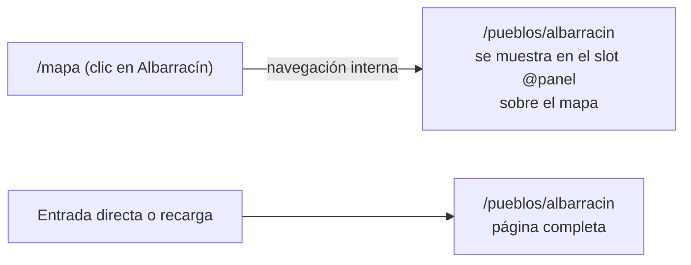

# Rutas paralelas e interceptadas

<Tech ids={['nextdotjs', 'react']} />

<Estado tipo="construye">Desde `/mapa`, al hacer clic en un pueblo se abre su ficha en un panel lateral con URL propia (`/pueblos/albarracin`); si se recarga, se ve la ficha completa.</Estado>

## Concepto

### Rutas paralelas (slots)

Una carpeta `@nombre` es un **slot**: el layout del segmento lo recibe como
prop además de `children`, y cada slot navega por su cuenta.

```
apps/panel/app/(privado)/
  layout.tsx          → recibe { children, stats, activity }
  page.tsx
  @stats/page.tsx
  @activity/page.tsx
```

```tsx
export default function PanelLayout({ children, stats, activity }: LayoutProps<'/'>) {
  return (
    <>
      {children}
      <aside className="grid gap-4 md:grid-cols-2">{stats}{activity}</aside>
    </>
  );
}
```

Cada slot puede tener su propio `loading.tsx` y `error.tsx`: si falla la
actividad, las estadísticas se siguen viendo.

`default.tsx` es lo que se muestra en un slot cuando la URL actual no tiene
página para él (por ejemplo al recargar en una subruta). **En Next 16 es
obligatorio** en cada slot (si no, falla el build); lo habitual es que
devuelva `null` o llame a `notFound()`.

### Rutas interceptadas

Permiten mostrar una ruta **dentro del contexto actual** cuando navegás desde
la app, y la página completa cuando entrás directo por URL:

| Convención | Intercepta |
| --- | --- |
| `(.)carpeta` | Un segmento del mismo nivel |
| `(..)carpeta` | Un nivel arriba |
| `(..)(..)carpeta` | Dos niveles arriba |
| `(...)carpeta` | Desde la raíz de `app` |

(Los niveles cuentan **segmentos de ruta**, no carpetas: los grupos y los slots no cuentan.)

Combinadas con un slot, dan el patrón **modal con URL**: compartible, se cierra
con "atrás", y al recargar muestra la página completa.



## Si venís de Angular

<Angular>

| Angular | Next |
| --- | --- |
| Outlets con nombre (`<router-outlet name="panel">`) y rutas `outlet: 'panel'` | Slots `@panel` |
| URL con `(panel:pueblos/x)` | URL normal: `/pueblos/x` |
| Abrir un `MatDialog` y actualizar la URL a mano | Ruta interceptada + slot |

Las rutas interceptadas no tienen equivalente directo: en Angular el modal con
URL propia se arma a mano.

</Angular>

## En ripopola: la ficha sobre el mapa

```
app/(sitio)/
  mapa/
    layout.tsx                    → recibe { children, panel }
    page.tsx                      → el mapa
    @panel/
      default.tsx                 → null (sin panel)
      (...)pueblos/[slug]/page.tsx → intercepta /pueblos/[slug] desde /mapa
  pueblos/[slug]/page.tsx         → la ficha completa (entrada directa)
```

```tsx title="app/(sitio)/mapa/layout.tsx"
export default function MapLayout({ children, panel }: LayoutProps<'/mapa'>) {
  return (
    <div className="relative">
      {children}
      {panel}
    </div>
  );
}
```

```tsx title="app/(sitio)/mapa/@panel/(...)pueblos/[slug]/page.tsx"
import { getTown } from '@/features/towns/api';
import { SidePanel } from '@/components/side-panel'; // 'use client': cierra con router.back()
import { TownSummaryCard } from '@/features/towns/town-summary-card';

export default async function TownPanel({ params }: { params: Promise<{ slug: string }> }) {
  const town = await getTown((await params).slug);
  return (
    <SidePanel title={town.name}>
      <TownSummaryCard town={town} />
    </SidePanel>
  );
}
```

```tsx title="components/side-panel.tsx"
'use client';

import { useRouter } from 'next/navigation';

export function SidePanel({ title, children }: { title: string; children: React.ReactNode }) {
  const router = useRouter();
  return (
    <aside role="dialog" aria-label={title} className="absolute inset-y-0 right-0 w-full max-w-md overflow-y-auto bg-white shadow-xl">
      <button onClick={() => router.back()} aria-label="Cerrar">✕</button>
      {children}
    </aside>
  );
}
```

En el mapa, el clic en un pueblo hace `router.push('/pueblos/albarracin')`:
como se navega desde `/mapa`, se intercepta y aparece el panel; el mapa sigue
montado con su zoom.

## Errores comunes

- **Olvidar `default.tsx`** en un slot: error en el build de Next 16.
- **Contar mal los niveles** de `(..)`: cuentan segmentos, no carpetas.
- **Usar esto para todo**: para un modal sin URL alcanza un estado local o un `Dialog`.
- **Panel sin foco ni Escape**: usá el `Sheet` o `Dialog` de shadcn para la accesibilidad.

<Resumen>

- `@slot` = ruta paralela que el layout recibe como prop.
- `default.tsx` define el slot cuando no hay coincidencia (obligatorio en Next 16).
- `(.)`, `(..)`, `(...)` interceptan rutas para mostrarlas en contexto.
- Slot + interceptación = modal o panel con URL propia.

</Resumen>

## Preguntas de entrevista

**1. ¿Qué son las rutas paralelas?**
Slots (`@nombre`) que se renderizan al mismo tiempo en un layout, con
navegación, carga y errores independientes.

**2. ¿Qué es una ruta interceptada y para qué se usa?**
Una ruta que, al navegar desde dentro de la app, se muestra en el contexto
actual (por ejemplo un modal), y al entrar directo muestra la página completa.

**3. ¿Para qué sirve `default.tsx`?**
Para definir qué muestra un slot cuando la URL no tiene una página para él,
por ejemplo tras recargar. En Next 16 es obligatorio.

## Glosario

| Término | Qué es |
| --- | --- |
| Slot | Ruta paralela `@nombre`. |
| Ruta interceptada | Ruta mostrada en el contexto de otra al navegar. |
| Modal con URL | Modal cuyo contenido tiene su propia dirección compartible. |
