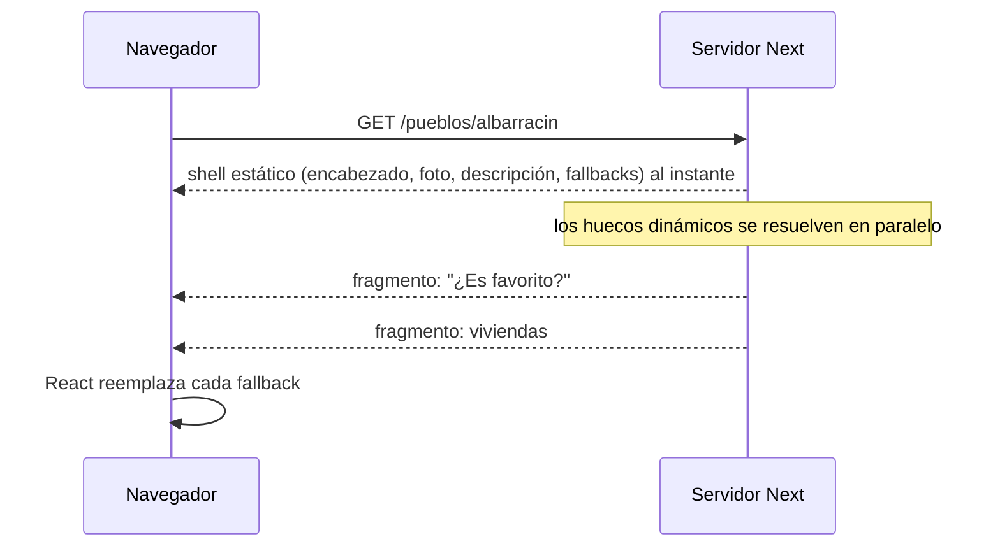

# Streaming y prerender parcial

<Tech ids={['nextdotjs', 'react']} />

<Estado tipo="construye">La ficha del pueblo dividida en shell estático y huecos dinámicos con Suspense.</Estado>

## Concepto

### El modelo de Cache Components

En el build, Next intenta prerenderizar cada ruta. Al recorrer el árbol, cada
componente cae en uno de tres grupos:

| Tipo | Ejemplo | Resultado |
| --- | --- | --- |
| **Síncrono / puro** | El layout, textos fijos | Va al shell estático |
| **Cacheado** (`'use cache'`) | Datos del pueblo | Va al shell estático (con su vida útil) |
| **Dinámico** | Lee `cookies()`, `headers()`, `searchParams`, o pide sin caché | Se ejecuta en cada petición |

Lo dinámico **tiene que estar dentro de un `<Suspense>`**: el fallback entra
en el shell y el contenido real se transmite (streaming) cuando está listo. Si
no hay Suspense, Next no puede armar el shell y te muestra el error
**"blocking route"** en el overlay de desarrollo, con la sugerencia de
envolverlo en Suspense o cachearlo.



Es **una sola respuesta HTTP**: el HTML llega por partes y React reemplaza cada
fallback a medida que llega su contenido.

### Dónde poner los límites

- **Lo más cerca posible** de lo que es dinámico: si una sola línea lee la
  sesión, envolvé esa línea, no la página.
- Fallbacks con el **mismo tamaño** que el contenido (sin CLS).
- Agrupá lo que tiene que aparecer junto: dos Suspense hermanos aparecen en el
  orden que lleguen.
- `loading.tsx` pone un límite en el borde del segmento: útil como red, pero
  oculta toda la página mientras tanto.

### `connection()`

Si un componente tiene que ser dinámico sin leer ninguna API de petición (por
ejemplo usa `Date.now()` o un número aleatorio que debe ser distinto en cada
visita), llamá a `await connection()` de `next/server`: lo marca como dinámico.

### Streaming y SEO

El contenido transmitido viaja en la **misma respuesta HTTP**, así que un
buscador que lee la respuesta completa lo ve. Igual, lo importante para SEO de
la ficha (nombre, descripción, datos) conviene que esté en el shell cacheado:
sale antes, desde CDN, y no depende de nada dinámico. (Para la metadata, Next
tiene una lista de bots, `htmlLimitedBots`, a los que les entrega el `head`
completo sin streaming.)

## Si venís de Angular

<Angular>

Angular SSR también hace streaming con `@defer` e hidratación incremental,
pero el HTML se arma completo antes de enviarse (salvo los bloques diferidos).
En Next el **shell** sale de un CDN sin ejecutar nada, y los huecos se completan
en la misma respuesta. Lo más parecido conceptualmente: `@defer` con
`@placeholder` donde el placeholder ya viene en el HTML estático.

</Angular>

## En ripopola: la ficha en partes

```tsx title="app/(sitio)/pueblos/[slug]/page.tsx"
import { Suspense } from 'react';

export default function TownPage({ params }: PageProps<'/pueblos/[slug]'>) {
  return (
    <article className="mx-auto max-w-5xl p-6">
      <Suspense fallback={<TownHeaderSkeleton />}>
        <TownHeader params={params} />          {/* 'use cache' → shell */}
      </Suspense>

      <Suspense fallback={<FavoriteButtonSkeleton />}>
        <FavoriteForCurrentUser params={params} /> {/* lee la sesión → dinámico */}
      </Suspense>

      <Suspense fallback={<ListingsSkeleton />}>
        <TownListings params={params} />        {/* 'use cache' + tag → shell, se invalida al publicar */}
      </Suspense>
    </article>
  );
}
```

La página no hace `await params`: le pasa la promesa a cada sección, que la
espera **dentro** de su Suspense. Así, para un pueblo que no se prerenderizó
en el build, Next puede servir el shell genérico al instante (7.5).

## Errores comunes

- **"Blocking route"**: algo dinámico sin Suspense o sin cachear.
- **Un Suspense alrededor de toda la página**: el shell queda vacío.
- **Leer `cookies()` en el layout raíz**: todo se vuelve dinámico. Leelo donde se usa.
- **Fallbacks de otro tamaño**: CLS.

<Resumen>

- El shell estático tiene lo síncrono y lo cacheado; lo dinámico se transmite.
- Lo dinámico (cookies, headers, searchParams, datos sin caché) va dentro de Suspense.
- Límites cerca de lo dinámico, con fallbacks del tamaño real.
- Pasá `params` como promesa y esperala dentro del límite.

</Resumen>

## Preguntas de entrevista

**1. ¿Qué es el streaming en Next?**
Enviar el HTML en partes en una misma respuesta: primero el shell con los
fallbacks y después cada parte cuando está lista, que React coloca en su lugar.

**2. ¿Qué vuelve dinámica una parte de la página con Cache Components?**
Leer APIs de la petición (`cookies`, `headers`, `searchParams`, `connection`) o
datos no cacheados. Esas partes tienen que ir dentro de un Suspense.

**3. ¿Qué es el error de "blocking route"?**
Que hay contenido dinámico fuera de un límite de Suspense, así que Next no puede
armar un shell estático; se resuelve envolviéndolo en Suspense o cacheándolo.

**4. ¿Cómo decidís dónde poner los límites de Suspense?**
Cerca de lo dinámico o lento, agrupando lo que debe aparecer junto y con
fallbacks del mismo tamaño que el contenido.

## Glosario

| Término | Qué es |
| --- | --- |
| Shell | La parte prerenderizada de una ruta con sus fallbacks. |
| Hueco dinámico | Parte de la página que se resuelve en cada petición. |
| `connection()` | Marca un componente como dinámico sin leer datos de la petición. |
