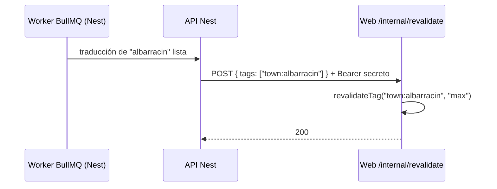
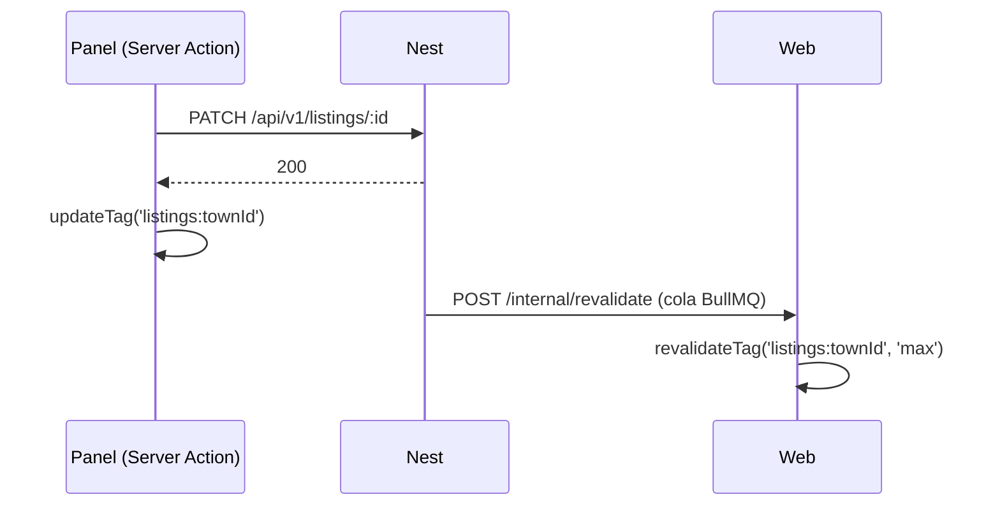

# Revalidación a demanda

<Tech ids={['nextdotjs', 'nestjs']} />

<Estado tipo="construye">Un endpoint `/api/revalidate` en Next que Nest llama al publicar, y el panel que ve sus cambios al instante.</Estado>

## Concepto

Cachear es fácil; lo difícil es **invalidar a tiempo**. Next tiene cuatro herramientas:

| Función | Efecto | Dónde |
| --- | --- | --- |
| `revalidateTag(tag, 'max')` | Marca como vieja la caché con esa etiqueta: se sirve lo viejo y se regenera de fondo | Server Actions y Route Handlers |
| `updateTag(tag)` | **Expira ya**: la próxima lectura espera el dato nuevo (leer lo que uno mismo escribió) | Solo Server Actions |
| `refresh()` | Vuelve a pedir los datos **no cacheados** de la página actual | Solo Server Actions |
| `revalidatePath('/pueblos/x')` | Invalida todo lo de una ruta | Server Actions y Route Handlers |

Preferí **etiquetas** antes que rutas: son precisas (una vivienda nueva
invalida `listings:<townId>` y aparece en la ficha, en el listado y en el
mapa, sin saber qué rutas la muestran).

El segundo argumento de `revalidateTag` es un perfil de `cacheLife`: cuánto
tiempo se puede seguir sirviendo lo viejo mientras se regenera. `'max'` es lo recomendado.

### ¿Quién sabe que algo cambió?

En ripopola los datos cambian por tres caminos:

1. **El panel en Next** (Server Action que llama a Nest) → la propia acción
   llama a `updateTag`.
2. **Otro cliente de la API** (un superadmin, un script, la futura app móvil) →
   Next no se entera.
3. **Un trabajo en segundo plano** (la cola de traducciones con BullMQ termina) →
   Next tampoco se entera.

Para 2 y 3: **Nest avisa a Next** con un webhook después de guardar.



## Si venís de Angular

<Angular>

En Angular SSR con caché propia (CDN o Redis), invalidar era cosa tuya: purgar
el CDN por URL, borrar claves en Redis. Next lo integra: etiquetás al cachear
e invalidás por etiqueta desde el código o con un webhook.

</Angular>

## En ripopola

### 1. El webhook en la web (Route Handler)

Nest es quien sabe cuándo cambió un pueblo o una vivienda, así que es Nest
quien avisa a la web (curso de Nest, sección 12):

```ts title="apps/web/app/internal/revalidate/route.ts"
import { revalidateTag } from 'next/cache';
import { timingSafeEqual } from 'node:crypto';
import { z } from 'zod';

const bodySchema = z.object({ tags: z.array(z.string().regex(/^[a-z]+(:[a-z0-9-]+)?$/)).min(1).max(50) });

function isAuthorized(request: Request) {
  const given = Buffer.from(request.headers.get('authorization') ?? '');
  const expected = Buffer.from(`Bearer ${process.env.REVALIDATE_SECRET}`);
  return given.length === expected.length && timingSafeEqual(given, expected);
}

export async function POST(request: Request) {
  if (!isAuthorized(request)) return new Response(null, { status: 401 });

  const parsed = bodySchema.safeParse(await request.json().catch(() => null));
  if (!parsed.success) return Response.json({ error: 'cuerpo inválido' }, { status: 400 });

  for (const tag of parsed.data.tags) revalidateTag(tag, 'max');
  return Response.json({ revalidated: parsed.data.tags });
}
```

- `timingSafeEqual` compara en tiempo constante: con `===` un atacante podría
  adivinar el secreto midiendo cuánto tarda la respuesta.
- Las etiquetas se validan: nadie puede mandar mil etiquetas inventadas.
- La ruta está **fuera de `/api/*`**, que en desarrollo se reenvía a Nest
  (4.1). Así nunca hay dudas de quién atiende cada URL.

:::tip Más fuerte: firmar el cuerpo
Un secreto en la cabecera alcanza si el tráfico va por HTTPS o por la red
interna. Si el webhook pasara por terceros, firmá el cuerpo con HMAC
(`createHmac('sha256', secreto).update(cuerpo)`) y compará la firma: así
tampoco se puede reutilizar con otro contenido.
:::

### 2. Del lado de Nest

Un listener de los eventos `town.published`, `town.updated` y
`listing.published` encola un trabajo de BullMQ que hace `POST` a
`${WEB_INTERNAL_URL}/internal/revalidate` con el secreto y las etiquetas
(`town:albarracin`, `towns`, `listings:<townId>`). Si la web no responde, BullMQ
reintenta; y si el aviso se pierde del todo, la caché vieja expira igual por
`cacheLife`.

### 3. En una Server Action del panel

El panel es **otra app**, con su propia caché. Cuando el municipio cambia
algo, la acción invalida lo del panel con `updateTag` (lectura de lo que
acaba de escribir), y la web se entera por el webhook de Nest:

```ts title="apps/panel/features/listings/actions.ts"
'use server';
import { updateTag } from 'next/cache';
import { serverApi } from '@ripopola/frontend-api/server';

export async function publishListing(id: string, townId: string) {
  const api = await serverApi();
  await api.PATCH('/api/v1/listings/{id}', { params: { path: { id } }, body: { published: true } });
  updateTag(`listings:${townId}`); // el municipio ve su vivienda publicada al volver al listado
}
```



## Errores comunes

- **Webhook sin secreto**: cualquiera puede vaciar tu caché (y tirarte el sitio por carga).
- **`revalidatePath('/')` "por las dudas"**: invalida todo y pierde el sentido de cachear.
- **`updateTag` en un Route Handler**: solo funciona en Server Actions.
- **Olvidar invalidar los 404 cacheados** cuando algo se publica por primera vez.

<Resumen>

- `revalidateTag(tag, 'max')`: stale-while-revalidate; `updateTag`: expira ya (solo Server Actions).
- `refresh()` re-pide lo no cacheado; `revalidatePath` como último recurso.
- Etiquetas antes que rutas.
- Lo que cambia fuera de Next se avisa con un webhook protegido desde Nest.

</Resumen>

## Preguntas de entrevista

**1. ¿Diferencia entre `revalidateTag` y `updateTag`?**
`revalidateTag` sirve lo viejo y regenera de fondo; `updateTag` expira la
caché al instante para que quien escribió vea su cambio. `updateTag` solo
funciona en Server Actions.

**2. ¿Por qué preferir invalidar por etiqueta que por ruta?**
Porque un mismo dato aparece en varias rutas; la etiqueta las cubre a todas sin
tener que conocerlas, y no invalida de más.

**3. ¿Cómo invalidás la caché de Next cuando el dato cambia en otro servicio?**
Con un Route Handler protegido (firma HMAC o secreto) que el otro servicio
llama después de escribir, y que ejecuta `revalidateTag`.

**4. ¿Qué pasa si se pierde un aviso de invalidación?**
El dato viejo se sirve hasta que venza su `cacheLife`; por eso la vida útil
tiene que ser razonable y el aviso se reintenta.

## Glosario

| Término | Qué es |
| --- | --- |
| Revalidar | Regenerar datos cacheados. |
| Webhook | Petición HTTP que un sistema hace a otro para avisar de un evento. |
| HMAC | Firma con un secreto compartido para verificar origen e integridad. |
| Read-your-own-writes | Que quien escribe vea su cambio inmediatamente. |
