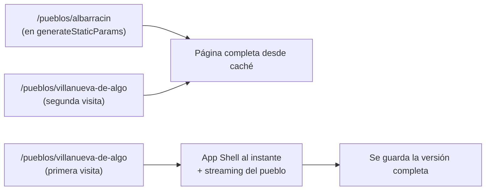

# Páginas estáticas de pueblos (ISR)

<Tech ids={['nextdotjs']} />

<Estado tipo="construye">Las fichas de los pueblos más visitados se generan en el build; el resto se genera en la primera visita y queda estático.</Estado>

## Concepto

Ripopola puede tener miles de pueblos. Generarlos todos en cada build es lento
e inútil (la mayoría casi no recibe visitas). El patrón:

1. **En el build**: prerenderizar los N pueblos más visitados con `generateStaticParams`.
2. **Para el resto**: Next sirve al instante el **App Shell** de la ruta (lo
   que no depende del slug, con los fallbacks), completa el contenido del
   pueblo en streaming y **guarda el resultado**: el siguiente visitante recibe
   la página completa estática.
3. **Cuando algo cambia**: `revalidateTag` (7.4) o el `cacheLife`.

Es el **ISR** de toda la vida (en el Pages Router, `fallback: true` o
`'blocking'`), expresado con Cache Components.

### `generateStaticParams`

```tsx
export async function generateStaticParams() {
  const top = await getTopTownSlugs(200); // los más visitados (endpoint de Nest)
  return top.map((slug) => ({ slug }));
}
```

Con Cache Components tiene que devolver **al menos un** elemento (un array
vacío es error de build): Next usa esos casos para comprobar que la ruta no lee
cosas dinámicas sin Suspense.

### La condición para el App Shell

Para que un pueblo no prerenderizado reciba el shell al instante (y no una
espera en blanco), **`await params` tiene que estar dentro de un `<Suspense>`**,
como hicimos en el 7.2. Si la página hace `await params` arriba de todo, la
primera visita a un pueblo nuevo espera a que se renderice entero.



### Ver lo que hizo el build

```bash
pnpm exec nx build web
```

La salida lista cada ruta con un símbolo: estática, parcialmente
prerenderizada (con huecos dinámicos) o dinámica. Para `/pueblos/[slug]` vas
a ver los slugs generados y el shell de la ruta.

## Si venís de Angular

<Angular>

| Angular SSR | Next |
| --- | --- |
| `getPrerenderParams` en `app.routes.server.ts` (RenderMode.Prerender) | `generateStaticParams` |
| `fallback: PrerenderFallback.Server` (las demás con SSR) | App Shell + streaming, y se guarda para la próxima |
| No hay ISR integrado | ISR con `cacheLife` y etiquetas |

</Angular>

## En ripopola

```tsx title="app/(sitio)/pueblos/[slug]/page.tsx"
import { Suspense } from 'react';
import { notFound } from 'next/navigation';
import { getTopTownSlugs, getTown } from '@/features/towns/api';

export async function generateStaticParams() {
  const slugs = await getTopTownSlugs(200);
  return slugs.map((slug) => ({ slug }));
}

async function TownHeader({ params }: Pick<PageProps<'/pueblos/[slug]'>, 'params'>) {
  const { slug } = await params;           // se espera DENTRO del Suspense
  const town = await getTown(slug);        // 'use cache' + cacheTag(`town:${slug}`)
  if (!town) notFound();
  return (
    <header>
      <h1 className="text-3xl font-bold">{town.name}</h1>
      <p>{town.region}</p>
    </header>
  );
}

export default function TownPage(props: PageProps<'/pueblos/[slug]'>) {
  return (
    <article className="mx-auto max-w-5xl p-6">
      <Suspense fallback={<TownHeaderSkeleton />}>
        <TownHeader params={props.params} />
      </Suspense>
      {/* ...las demás secciones, cada una con su Suspense */}
    </article>
  );
}
```

`getTopTownSlugs` también va con `'use cache'` y `cacheLife('days')`.

<Ejercicio title="Medir la diferencia">

Hacé `build` y `start`. Entrá a un pueblo de la lista y a uno que no esté, con
la pestaña Network abierta. Compará el tiempo hasta el primer byte (TTFB) y
qué llega en el HTML inicial. Volvé a entrar al segundo pueblo.

<details>
<summary>Qué tenés que ver</summary>

El pueblo prerenderizado llega completo y rápido. El nuevo llega con el shell
y el contenido transmitido. En la segunda visita, el nuevo ya llega completo.

</details>
</Ejercicio>

## Errores comunes

- **`generateStaticParams` con todos los pueblos**: builds eternos.
- **Array vacío** con Cache Components: error de build.
- **`await params` fuera de Suspense**: los pueblos no prerenderizados esperan sin shell.
- **Llamar a una API lenta desde `generateStaticParams`** sin caché en cada build.

<Resumen>

- Prerenderizar los más visitados; el resto se genera en la primera visita y se guarda.
- Con Cache Components: al menos un param, y `await params` dentro de Suspense.
- Las páginas se actualizan por `cacheLife` o por etiquetas.
- `next build` muestra cómo quedó cada ruta.

</Resumen>

## Preguntas de entrevista

**1. ¿Qué es ISR?**
Incremental Static Regeneration: páginas estáticas que se generan bajo demanda
la primera vez y se regeneran por tiempo o por invalidación, sin rehacer el build.

**2. ¿Para qué sirve `generateStaticParams`?**
Para listar qué valores de una ruta dinámica se prerenderizan en el build.

**3. ¿Qué pasa con una ruta dinámica que no está en `generateStaticParams`?**
Con Cache Components y Partial Prefetching se sirve el App Shell al instante,
se transmite el contenido y el resultado se guarda para las visitas siguientes.

**4. ¿Por qué no prerenderizar todas las páginas en el build?**
Porque con miles de páginas el build tarda demasiado y la mayoría casi no se
visita; conviene generarlas bajo demanda.

## Glosario

| Término | Qué es |
| --- | --- |
| ISR | Regeneración estática incremental. |
| App Shell | Versión genérica de una ruta dinámica, sin los datos del parámetro. |
| TTFB | Time To First Byte: cuánto tarda en llegar el primer byte. |
