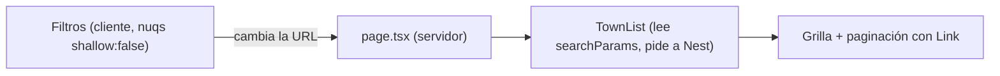

# Paginación y filtros en el servidor

<Tech ids={['nextdotjs', 'react']} />

<Estado tipo="construye">`/pueblos?country=ES&page=2`: listado filtrado y paginado en el servidor, con enlaces de paginación reales (indexables).</Estado>

## Concepto

El listado público es una página de servidor que lee `searchParams` (con los
parsers de nuqs, 4.6), pide a Nest y renderiza. Cambiar de filtro o de página
es **navegar**, y como `searchParams` es dinámico, el listado va dentro de un Suspense.



### Paginación offset o cursor

| | `page` + `pageSize` (offset) | Cursor (`after=...`) |
| --- | --- | --- |
| "Ir a la página 7" | Sí | No |
| Total de páginas | Sí (con un `count`) | No |
| URL indexable | Sí: `/pueblos?page=2` | Poco útil para SEO |
| Rendimiento en tablas enormes | Empeora al avanzar | Constante |
| En ripopola | Listado público | Scroll infinito del mapa o del panel |

(Lo viste del lado de Nest en el curso de Nest, 2.6.)

### Suspense con `key` para ver la carga

Al cambiar de página, Next hace una transición y **mantiene la lista vieja**
hasta que llega la nueva. Si querés mostrar el esqueleto en cada cambio,
dale al Suspense una `key` con los parámetros: al cambiar la key, React lo
trata como uno nuevo y muestra el fallback.

## Si venís de Angular

<Angular>

En Angular harías un componente que escucha `queryParamMap`, llama al servicio
y pinta un `mat-paginator`. Acá el servidor renderiza la lista ya paginada y
la paginación son **enlaces** (`<Link href="?page=3">`): funcionan sin
JavaScript y Google los sigue.

</Angular>

## En ripopola

### La página

```tsx title="app/(sitio)/pueblos/page.tsx"
import { Suspense } from 'react';
import type { SearchParams } from 'nuqs/server';
import { loadSearchParams } from '@/features/search/search-params';
import { SearchFilters } from '@/features/search/search-filters';

export const metadata = { title: 'Pueblos para vivir' };

export default function TownsPage({ searchParams }: { searchParams: Promise<SearchParams> }) {
  return (
    <main className="mx-auto max-w-6xl p-6">
      <h1 className="text-3xl font-bold">Pueblos para vivir</h1>
      <SearchFilters />
      <Suspense fallback={<TownGridSkeleton />}>
        <TownList searchParams={searchParams} />
      </Suspense>
    </main>
  );
}

async function TownList({ searchParams }: { searchParams: Promise<SearchParams> }) {
  const filters = await loadSearchParams(searchParams);
  const result = await listTowns(filters); // publicApi GET /api/v1/towns
  return (
    <>
      <p aria-live="polite">{result.total} pueblos</p>
      <TownGrid towns={result.items} />
      <Pagination page={filters.page} totalPages={Math.ceil(result.total / result.pageSize)} />
    </>
  );
}
```

`SearchFilters` es el componente de cliente del 4.6 con `shallow: false`.

### La paginación

```tsx title="components/pagination.tsx"
'use client';

import Link from 'next/link';
import { usePathname, useSearchParams } from 'next/navigation';

export function Pagination({ page, totalPages }: { page: number; totalPages: number }) {
  const pathname = usePathname();
  const params = useSearchParams();
  if (totalPages <= 1) return null;

  const hrefFor = (p: number) => {
    const next = new URLSearchParams(params);
    if (p === 1) next.delete('page');
    else next.set('page', String(p));
    const qs = next.toString();
    return qs ? `${pathname}?${qs}` : pathname;
  };

  return (
    <nav aria-label="Paginación" className="mt-8 flex gap-2">
      {page > 1 && <Link href={hrefFor(page - 1)} rel="prev">Anterior</Link>}
      {pagesToShow(page, totalPages).map((p, i) =>
        p === '…' ? <span key={`dots-${i}`} aria-hidden>…</span> : (
          <Link key={p} href={hrefFor(p)} aria-current={p === page ? 'page' : undefined}>{p}</Link>
        ),
      )}
      {page < totalPages && <Link href={hrefFor(page + 1)} rel="next">Siguiente</Link>}
    </nav>
  );
}
```

`pagesToShow(7, 40)` devuelve algo como `[1, '…', 6, 7, 8, '…', 40]`
(ejercicio). La página 1 no lleva `?page=1`: una sola URL por contenido.

### SEO del listado

- `/pueblos?page=2` sí se indexa; `/pueblos?country=ES&sort=population&page=3`
  no hace falta: `generateMetadata` pone `robots: { index: false }` cuando hay
  más de un filtro, y canonical a la URL sin orden.

<Ejercicio title="pagesToShow">

Escribí `pagesToShow(current, total)` que devuelva como máximo 7 elementos,
siempre la primera y la última, la actual con una a cada lado y `'…'` donde
haya saltos. Escribí sus pruebas con Vitest (11.1).

<details>
<summary>Casos para probar</summary>

`(1, 1)` → `[1]`; `(1, 5)` → `[1, 2, 3, 4, 5]`; `(7, 40)` → `[1, '…', 6, 7, 8, '…', 40]`;
`(2, 40)` → `[1, 2, 3, '…', 40]`.

</details>
</Ejercicio>

## Errores comunes

- **Paginación con botones y `onClick`** en vez de enlaces: no se indexa ni funciona sin JS.
- **`page=1` y sin `page`** como dos URLs distintas.
- **No resetear la página** al cambiar filtros (4.6).
- **Leer `searchParams` fuera de Suspense**: ruta bloqueante.

<Resumen>

- El listado público se renderiza en el servidor a partir de `searchParams`.
- Paginación con enlaces reales; offset para el listado público, cursor para scroll infinito.
- Suspense alrededor de lo que lee `searchParams`; con `key` si querés el esqueleto en cada cambio.
- Cuidar qué combinaciones se indexan.

</Resumen>

## Preguntas de entrevista

**1. ¿Paginación offset o cursor?**
Offset cuando hace falta saltar a una página y mostrar el total (listados
públicos indexables); cursor para listas enormes o scroll infinito, porque su
rendimiento no empeora al avanzar.

**2. ¿Por qué la paginación debería usar enlaces?**
Porque funciona sin JavaScript, los buscadores la siguen y se puede abrir en
otra pestaña; con Link además se navega del lado del cliente.

**3. ¿Cómo hacés que el fallback de Suspense se vea al cambiar de página?**
Dándole al Suspense una `key` que cambie con los parámetros; si no, Next
mantiene lo anterior durante la transición.

## Glosario

| Término | Qué es |
| --- | --- |
| Offset | Saltar N registros para paginar. |
| Cursor | Marca del último elemento visto para pedir los siguientes. |
| `rel="next"` | Relación que indica la página siguiente. |
