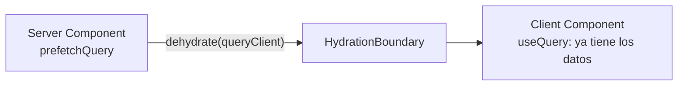

# TanStack Query con Next

<Tech ids={['reactquery', 'nextdotjs']} />

<Estado tipo="construye">El panel de viviendas del municipio: primera carga desde el servidor, después filtros y mutaciones en el cliente con TanStack Query.</Estado>

## Concepto

### ¿Server Component o TanStack Query?

| Server Components | TanStack Query en el cliente |
| --- | --- |
| Contenido público, SEO, se cachea | Pantallas muy interactivas: filtros en vivo, mapa, edición |
| Cambia por navegación o revalidación | Cambia por acciones del usuario, polling, foco de la ventana |
| Sin JavaScript extra | Requiere la librería en el cliente |
| La ficha del pueblo, el listado público | El mapa, el panel con tablas y acciones rápidas |

No es uno u otro: en ripopola conviven. Lo que no conviene es pedir **el
mismo dato** de las dos formas sin coordinarlas.

### Prefetch en el servidor + hidratación

Para que una pantalla de cliente no arranque vacía (con spinner), se piden los
datos **en el servidor**, se meten en un `QueryClient` y se pasan al cliente
"deshidratados":



```tsx
// servidor
const queryClient = new QueryClient();
await queryClient.prefetchQuery(listingQueries.list(filters));

return (
  <HydrationBoundary state={dehydrate(queryClient)}>
    <ListingsTable filters={filters} />   {/* cliente */}
  </HydrationBoundary>
);
```

En el cliente, `useQuery(listingQueries.list(filters))` encuentra los datos
en la caché y no pide nada (si `staleTime` > 0, por eso lo pusimos en 60 s en 4.2).

### Con streaming

Podés **no esperar** el prefetch: TanStack Query 5 permite deshidratar queries
pendientes (configurando `shouldDehydrateQuery` para incluir las `pending`) y
el cliente las recibe cuando resuelven, combinándolo con `useSuspenseQuery`.
Es más avanzado; el `await` simple alcanza para el panel.

### La misma `queryFn` en servidor y cliente

`queryOptions` (4.2) define la `queryFn` con `browserApi` (rutas relativas). En
el servidor eso no sirve. Opciones:

- Una `queryFn` que reciba el cliente como parámetro (`listingQueries.list(filters, api)`).
- O definir las opciones en un archivo compartido y elegir el cliente según
  `isServer` de TanStack Query.

En ripopola usamos la primera: explícita y fácil de testear.

## Si venís de Angular

<Angular>

Es lo que hace `TransferState` (o la caché de `HttpClient` con
`withHttpTransferCacheOptions`) en Angular SSR: lo que se pidió en el servidor
viaja en el HTML y el cliente no lo repite. Acá lo hacés explícito con
`dehydrate` y `HydrationBoundary`.

</Angular>

## En ripopola: el panel de viviendas

```ts title="apps/panel/features/listings/queries.ts"
import { queryOptions } from '@tanstack/react-query';
import type { Client } from 'openapi-fetch';
import type { paths } from '@ripopola/api-client';
import { unwrap } from '@ripopola/frontend-api';

export type ListingFilters = { status?: 'draft' | 'published'; page?: number };

export const listingQueries = {
  list: (municipalityId: string, filters: ListingFilters, api: Client<paths>) =>
    queryOptions({
      queryKey: ['listings', 'list', municipalityId, filters],
      queryFn: async ({ signal }) =>
        unwrap(await api.GET('/api/v1/municipalities/{id}/listings', {
          params: { path: { id: municipalityId }, query: filters },
          signal,
        })),
    }),
};
```

```tsx title="apps/panel/app/(privado)/viviendas/page.tsx"
import { Suspense } from 'react';
import { dehydrate, HydrationBoundary, QueryClient } from '@tanstack/react-query';
import { getPanelContext } from '@/features/municipality/context'; // sesión + municipio (sección 9)
import { listingQueries } from '@/features/listings/queries';
import { ListingsTable } from '@/features/listings/listings-table';

export default function ListingsPage() {
  return (
    <Suspense fallback={<TableSkeleton />}>
      <ListingsWithData />
    </Suspense>
  );
}

async function ListingsWithData() {
  const { municipalityId, api } = await getPanelContext(); // lee cookies → dinámico, por eso el Suspense
  const queryClient = new QueryClient();
  await queryClient.prefetchQuery(listingQueries.list(municipalityId, {}, api));

  return (
    <HydrationBoundary state={dehydrate(queryClient)}>
      <ListingsTable municipalityId={municipalityId} />
    </HydrationBoundary>
  );
}
```

`ListingsTable` (cliente) usa `useQuery(listingQueries.list(municipalityId, filters, browserApi))`,
cambia filtros sin navegar y publica con `useMutation` (4.3).

:::info Datos del panel y caché de Next
Lo del panel es **privado** y cambia seguido: no lleva `'use cache'`. Lo pide
el servidor en cada petición (dinámico, dentro de Suspense) y después lo maneja
TanStack Query en el cliente.
:::

## Errores comunes

- **`staleTime: 0`**: el cliente vuelve a pedir lo que acaba de llegar.
- **Un `QueryClient` global en el servidor**: datos de un municipio visibles para otro.
- **Keys distintas** en el prefetch y en el `useQuery`: no se encuentran.
- **Usar TanStack Query para contenido público con SEO** que podría ser un Server Component cacheado.

<Resumen>

- Server Components para contenido público y cacheable; TanStack Query para pantallas interactivas.
- `prefetchQuery` + `dehydrate` + `HydrationBoundary`: el cliente arranca con datos.
- Mismas keys en servidor y cliente; `staleTime` mayor que 0.
- Datos privados del panel: dinámicos, sin `'use cache'`.

</Resumen>

## Preguntas de entrevista

**1. ¿Cómo combinás TanStack Query con el render en servidor?**
Haciendo `prefetchQuery` en el servidor, deshidratando el `QueryClient` y
envolviendo el componente de cliente en un `HydrationBoundary`, que llena la caché del cliente.

**2. ¿Por qué hace falta `staleTime` con SSR?**
Porque con `staleTime: 0` el dato hidratado se considera viejo al montar y el
cliente lo vuelve a pedir enseguida.

**3. Si ya tenés Server Components, ¿para qué TanStack Query?**
Para pantallas con mucha interacción del lado del cliente: filtros sin navegar,
actualizaciones optimistas, polling, refresco al volver a la pestaña.

## Glosario

| Término | Qué es |
| --- | --- |
| Prefetch | Pedir datos antes de que el componente los necesite. |
| Deshidratar | Serializar la caché de TanStack Query para enviarla al cliente. |
| `HydrationBoundary` | Componente que carga en la caché del cliente lo deshidratado. |
