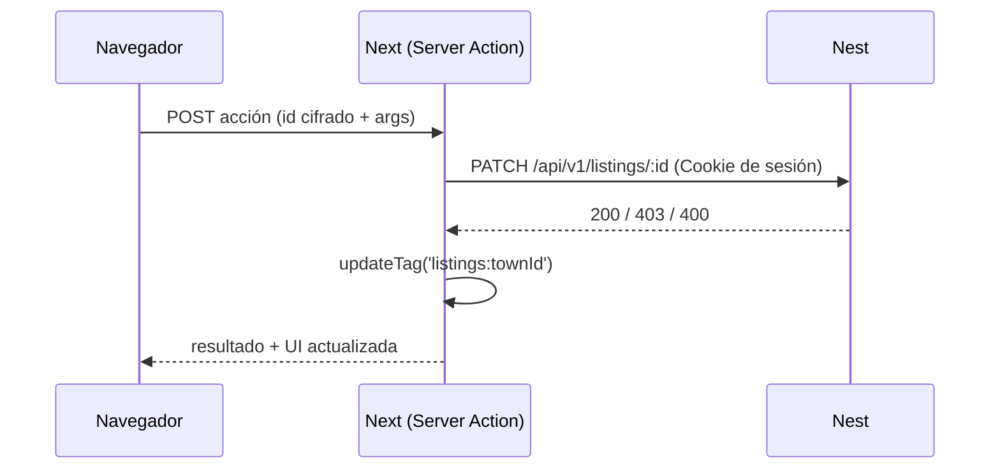

# Server Actions

<Tech ids={['nextdotjs', 'nestjs', 'react']} />

<Estado tipo="construye">Las acciones del panel (publicar, despublicar, borrar una vivienda) como Server Actions que llaman a Nest con la sesión del usuario.</Estado>

## Concepto

Una **Server Action** (o Server Function) es una función async marcada con
`'use server'` que **corre en el servidor** pero se puede llamar desde el
cliente como si fuera local:

```ts title="features/listings/actions.ts"
'use server';

export async function publishListing(listingId: string) {
  // corre en el servidor de Next
}
```

```tsx
'use client';
import { publishListing } from './actions';

<button onClick={() => publishListing(id)}>Publicar</button>
// o en un form: <form action={publishListing.bind(null, id)}>
```

Por debajo, Next crea un **endpoint POST** con un id cifrado; el cliente lo
llama con los argumentos serializados y recibe el resultado (y, si hace falta,
la UI actualizada) en la misma respuesta.

### Es un endpoint público

Aunque parezca una función, **cualquiera puede llamarla** con un POST si
conoce su id. Siempre:

1. **Validá los argumentos** (Zod): llegan del cliente, pueden ser cualquier cosa.
2. **Verificá sesión y permisos** adentro de la acción (o, en ripopola, dejá
   que Nest lo verifique: le reenviamos la sesión y Nest decide).
3. **Devolvé solo lo necesario**: lo que retorna viaja al cliente.

Next ayuda: ids no deterministas, eliminación de acciones no usadas, solo
POST y comprobación de `Origin` contra `Host` (protección CSRF).

### Qué puede hacer al terminar

- `updateTag('listings:...')` / `revalidateTag` / `refresh()` (7.4): la UI se
  actualiza en la **misma respuesta**, sin otra ida y vuelta.
- `redirect('/viviendas')`: navega al terminar.
- Leer y escribir **cookies** (`cookies().set`, 8.5).

### Server Actions en ripopola

El backend es Nest, así que una Server Action de ripopola es una **capa fina**:
recibe del formulario, valida forma, llama a Nest **con la cookie de sesión del
usuario** y revalida la caché de Next. La regla de negocio está en Nest.



¿Por qué no llamar a Nest directo desde el navegador (con `useMutation`)?
Las dos cosas son válidas (4.3). La Server Action gana cuando la pantalla es de
servidor: invalida la caché de Next y devuelve la UI nueva en un solo viaje, y
el formulario funciona sin JavaScript.

## Si venís de Angular

<Angular>

No existe en Angular. Lo más cercano sería un servicio que hace `http.post` a
un endpoint de tu servidor Express de SSR, más la lógica de refrescar la
vista. Acá el "endpoint" lo crea el compilador y la llamada está tipada de punta a punta.

</Angular>

## En ripopola

### 1. El cliente con la sesión del usuario

Ya lo tenés: `serverApi()` de `@ripopola/frontend-api/server` (4.1) reenvía
la cookie del usuario a Nest. Leer `cookies()` vuelve dinámico a quien lo
llama: correcto, son datos del usuario.

### 2. Las acciones

```ts title="apps/panel/features/listings/actions.ts"
'use server';

import { updateTag } from 'next/cache';
import { z } from 'zod';
import { serverApi } from '@ripopola/frontend-api/server';

const idSchema = z.uuid();

export type ActionResult = { ok: true } | { ok: false; error: string };

export async function setListingPublished(listingId: string, published: boolean): Promise<ActionResult> {
  const id = idSchema.safeParse(listingId);
  if (!id.success) return { ok: false, error: 'Vivienda inválida' };

  const api = await serverApi();
  const { data, response } = await api.PATCH('/api/v1/listings/{id}', {
    params: { path: { id: id.data } },
    body: { published },
  });

  if (response.status === 401) return { ok: false, error: 'Tu sesión expiró. Volvé a ingresar.' };
  if (response.status === 403) return { ok: false, error: 'No podés editar esta vivienda.' };
  if (!data) return { ok: false, error: 'No pudimos guardar el cambio.' };

  updateTag(`listings:${data.townId}`);
  return { ok: true };
}
```

Los errores esperados se **devuelven** (no se tiran) para mostrarlos (6.5).

:::info Dos apps, dos cachés
`updateTag` invalida la caché **del panel**, que es donde corre la acción. La
web pública es otra app con su propia caché: a esa la revalida Nest cuando
la vivienda cambia (7.4). Así el panel no necesita saber nada de la web.
:::

:::warning Lo que una Server Action no hace
Si Nest responde con un `Set-Cookie`, esa cookie le llega al **servidor de
Next**, no al navegador. Todo lo que crea o cambia la sesión (login, logout,
2FA) va **desde el navegador** con el cliente de Better Auth (sección 9).
:::

### 3. Llamarla desde un botón con estado

```tsx
'use client';

import { useState, useTransition } from 'react';
import { setListingPublished } from './actions';

export function PublishButton({ id, published }: { id: string; published: boolean }) {
  const [isPending, startTransition] = useTransition();
  const [error, setError] = useState<string | null>(null);

  return (
    <>
      <button
        disabled={isPending}
        onClick={() =>
          startTransition(async () => {
            const result = await setListingPublished(id, !published);
            setError(result.ok ? null : result.error);
          })
        }
      >
        {isPending ? 'Guardando…' : published ? 'Despublicar' : 'Publicar'}
      </button>
      {error && <p role="alert">{error}</p>}
    </>
  );
}
```

## Errores comunes

- **Confiar en que nadie la va a llamar** si no está en la UI.
- **No validar argumentos**: llegan del cliente.
- **Devolver objetos enteros de la API** con datos que el cliente no debería ver.
- **Tirar errores para validaciones**: en producción el mensaje no llega.
- **Usarlas para leer datos**: se ejecutan en serie y por POST; para leer están los Server Components.

<Resumen>

- `'use server'` crea una función que corre en el servidor y se llama desde el cliente.
- Es un endpoint POST público: validar, autorizar, devolver lo mínimo.
- Puede revalidar, redirigir y tocar cookies en la misma respuesta.
- En ripopola es una capa fina que reenvía la sesión a Nest.

</Resumen>

## Preguntas de entrevista

**1. ¿Qué es una Server Action y cómo funciona por debajo?**
Una función con `'use server'` que el compilador expone como un endpoint POST
con un id cifrado; el cliente la llama con argumentos serializados y recibe el
resultado y la UI actualizada.

**2. ¿Qué cuidados de seguridad tiene?**
Es pública: hay que validar los argumentos, verificar autenticación y
autorización adentro y devolver solo lo necesario. Next suma ids cifrados y
chequeo de origen contra CSRF.

**3. ¿Server Action o Route Handler?**
Server Action para mutaciones desde tu propia UI; Route Handler para endpoints
consumidos por terceros (webhooks, apps móviles) o respuestas no React.

**4. ¿Por qué no usarlas para leer datos?**
Porque usan POST, se encolan en serie desde el cliente y no se cachean; para
leer están los Server Components o TanStack Query.

## Glosario

| Término | Qué es |
| --- | --- |
| Server Action | Función de servidor llamable desde el cliente. |
| `'use server'` | Directiva que marca funciones de servidor. |
| `bind` | Fijar argumentos de una acción antes de pasarla a un form. |
| CSRF | Ataque que hace que el navegador de la víctima envíe una petición. |
