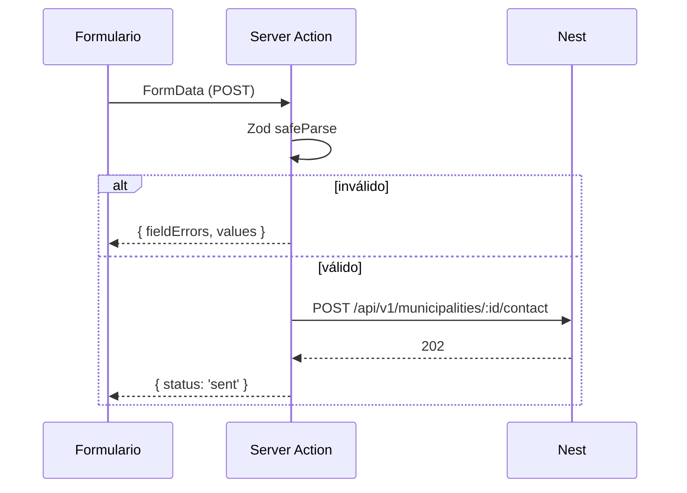

# Formularios con Server Actions

<Tech ids={['nextdotjs', 'react', 'zod']} />

<Estado tipo="construye">El formulario de contacto de la web pasa a una Server Action con Zod en el servidor, y el buscador del header usa `<Form>` de `next/form`.</Estado>

## Concepto

En el 2.8 armaste el formulario de contacto con `useActionState` y una
función que corría **en el navegador**. Si esa función pasa a ser una
**Server Action**, cambian tres cosas:

1. **La validación corre en el servidor**, donde no se puede saltear.
2. **El formulario funciona sin JavaScript** (*progressive enhancement*): el
   `<form action={...}>` hace un POST nativo; cuando el JS carga, React lo
   intercepta y no recarga la página.
3. **El estado viaja serializado**: lo que devuelve la acción tiene que ser
   JSON (sin funciones, sin clases).



### Validar dos veces, con el mismo esquema

| Dónde | Para qué |
| --- | --- |
| Navegador (React Hook Form + Zod, 5.3) | Experiencia: errores al instante, sin ir al servidor |
| Server Action (Zod) | Seguridad de forma: lo que llega puede venir de cualquier lado |
| Nest (class-validator / Zod) | La autoridad: reglas de negocio y base de datos |

El esquema de Zod vive en un archivo sin `'use client'` ni `'use server'`,
así se puede importar desde los dos lados.

### `<Form>` de `next/form`

Para formularios que **navegan** (un buscador que lleva a
`/pueblos?q=teruel`), `next/form` extiende `<form>`: con `action` como
string, hace una navegación de cliente con los campos como `searchParams`,
prefetchea la ruta destino y muestra su `loading.tsx` al instante. Sin JS,
funciona como un GET normal.

## Si venís de Angular

<Angular>

| Angular | Next |
| --- | --- |
| Reactive Forms validando en el cliente | React Hook Form + Zod (5.3) |
| `(ngSubmit)` + `http.post` | `<form action={serverAction}>` |
| No hay equivalente sin JS | Progressive enhancement: el form anda antes de hidratar |
| Validadores repetidos en el back | El mismo esquema de Zod en navegador y servidor |

</Angular>

## En ripopola

### 1. El esquema compartido

```ts title="apps/web/features/contact/contact-schema.ts"
import { z } from 'zod';

export const contactSchema = z.object({
  municipalityId: z.uuid(),
  name: z.string().trim().min(2, 'Decinos tu nombre'),
  email: z.email('Revisá el correo'),
  message: z.string().trim().min(20, 'Contale un poco más al municipio (mínimo 20 caracteres).').max(2000),
});

export type ContactInput = z.infer<typeof contactSchema>;
```

### 2. La acción

```ts title="apps/web/features/contact/actions.ts"
'use server';

import { z } from 'zod';
import { publicApi } from '@ripopola/frontend-api/server';
import { contactSchema } from './contact-schema';

export type ContactState =
  | { status: 'idle' }
  | { status: 'error'; message?: string; fieldErrors?: Record<string, string[]>; values?: Record<string, string> }
  | { status: 'sent' };

export async function sendContact(_prev: ContactState, formData: FormData): Promise<ContactState> {
  const raw = Object.fromEntries(formData) as Record<string, string>;
  const parsed = contactSchema.safeParse(raw);

  if (!parsed.success) {
    return {
      status: 'error',
      fieldErrors: z.flattenError(parsed.error).fieldErrors,
      values: raw,                               // para no vaciar el formulario
    };
  }

  const { municipalityId, ...body } = parsed.data;
  const { response } = await publicApi.POST('/api/v1/municipalities/{id}/contact', {
    params: { path: { id: municipalityId } },
    body,
  });

  if (response.status === 429) return { status: 'error', message: 'Mandaste muchos mensajes. Probá en un rato.' };
  if (!response.ok) return { status: 'error', message: 'No pudimos enviar el mensaje. Probá de nuevo.' };
  return { status: 'sent' };
}
```

Qué mirar:

- **`safeParse`, no `parse`**: un error de validación es un resultado esperado,
  no una excepción.
- **`z.flattenError`** (Zod 4) da `{ fieldErrors: { campo: string[] } }`.
- **`values`**: sin JavaScript, la página se vuelve a renderizar con lo que
  devolvió la acción; sin esto, el usuario pierde lo que escribió.
- **Límite de envíos**: lo hace Nest (curso de Nest, *rate limiting*). Una
  Server Action es un endpoint público más.

### 3. El formulario

```tsx title="apps/web/features/contact/contact-form.tsx"
'use client';

import { useActionState } from 'react';
import { useFormStatus } from 'react-dom';
import { sendContact, type ContactState } from './actions';

export function ContactForm({ municipalityId }: { municipalityId: string }) {
  const [state, formAction] = useActionState<ContactState, FormData>(sendContact, { status: 'idle' });

  if (state.status === 'sent') return <p role="status">¡Listo! El municipio te va a responder por correo.</p>;

  const errors = state.status === 'error' ? state.fieldErrors : undefined;
  const values = state.status === 'error' ? state.values : undefined;

  return (
    <form action={formAction} className="space-y-3" noValidate>
      <input type="hidden" name="municipalityId" value={municipalityId} />
      <Field name="name" label="Tu nombre" defaultValue={values?.name} error={errors?.name?.[0]} />
      <Field name="email" label="Tu correo" type="email" defaultValue={values?.email} error={errors?.email?.[0]} />
      <Field name="message" label="Tu mensaje" multiline defaultValue={values?.message} error={errors?.message?.[0]} />
      {state.status === 'error' && state.message && <p role="alert">{state.message}</p>}
      <SubmitButton />
    </form>
  );
}

function SubmitButton() {
  const { pending } = useFormStatus();
  return <button type="submit" disabled={pending}>{pending ? 'Enviando…' : 'Enviar mensaje'}</button>;
}
```

`Field` es un componente tuyo que pinta `label`, `input` (o `textarea`),
`aria-invalid`, `aria-describedby` y el mensaje (3.5).

:::tip El tercer argumento: permalink
`useActionState(action, initial, permalink)` recibe una URL opcional. Si el
formulario se envía **antes** de que cargue el JavaScript, el navegador va a
esa URL. Sirve cuando el formulario aparece en varias páginas.
:::

Probalo con el JavaScript desactivado (DevTools → *Disable JavaScript*): el
formulario se envía, la página vuelve con los errores o con el mensaje de
éxito.

### 4. Pasar datos extra: `bind`

Si la acción necesita un dato que no está en el formulario, en vez de un
`<input type="hidden">` podés atarlo:

```tsx
const sendToTown = sendContact.bind(null, municipalityId); // (municipalityId, prev, formData)
```

Funciona igual sin JavaScript, y el valor viaja cifrado junto con el id de la
acción... pero **sigue llegando del cliente**: validalo igual.

### 5. El buscador del header con `<Form>`

```tsx title="apps/web/features/search/header-search.tsx"
import Form from 'next/form';

export function HeaderSearch() {
  return (
    <Form action="/pueblos" role="search">
      <label htmlFor="q" className="sr-only">Buscar pueblos</label>
      <input id="q" name="q" placeholder="Buscar un pueblo…" />
      <button type="submit">Buscar</button>
    </Form>
  );
}
```

Es un Server Component: no necesita estado. Al enviar, navega a
`/pueblos?q=...` sin recargar, y la página del listado (7.6) lee
`searchParams`.

### ¿Server Action o React Hook Form?

| Caso | En ripopola |
| --- | --- |
| Formulario corto y público, debe andar sin JS | Server Action + `useActionState` (contacto) |
| Formulario largo, campos dinámicos, validación al escribir | React Hook Form + Zod + `useMutation` (vivienda, 5.3) |
| Formulario largo **y** quiero la Server Action | RHF valida en el cliente y en `handleSubmit` llamás a la acción dentro de `startTransition` |

## Errores comunes

- **Validar solo en el cliente**: la Server Action recibe lo que sea.
- **Devolver el `ZodError` entero**: no es serializable de forma útil y
  expone detalles. Devolvé `fieldErrors`.
- **Olvidar `values`**: sin JS o con un error del servidor, el formulario
  vuelve vacío.
- **`useFormStatus` en el componente que tiene el `<form>`**: va en un hijo.
- **Poner el esquema en `actions.ts`**: un archivo con `'use server'` solo
  puede exportar funciones async. El esquema va aparte.

<Resumen>

- Una Server Action como `action` del form = validación en el servidor y formularios que funcionan sin JS.
- `useActionState` guarda lo que devolvió la acción: errores por campo, valores y estado.
- El mismo esquema de Zod en el navegador, en la acción y (en espíritu) en Nest.
- `next/form` para formularios que navegan con `searchParams`.

</Resumen>

## Preguntas de entrevista

**1. ¿Qué es progressive enhancement en un formulario de Next?**
Que el `<form action={serverAction}>` funciona como un POST nativo antes de
que cargue el JavaScript; cuando React hidrata, intercepta el envío y lo hace
sin recargar la página.

**2. ¿Por qué validar en el servidor si ya validás en el cliente?**
Porque la validación del cliente es experiencia de usuario: se puede saltear
llamando a la acción directamente. La del servidor es la que protege.

**3. ¿Cómo devolvés errores de validación desde una Server Action?**
Con `safeParse` y devolviendo un objeto serializable con los errores por
campo (y los valores enviados), que `useActionState` entrega al componente.

**4. ¿Qué restricciones tiene un archivo con `'use server'`?**
Solo puede exportar funciones async: cada export se convierte en una acción
llamable desde el cliente. Constantes, esquemas o tipos con valor van en otro archivo.

**5. ¿Para qué sirve `next/form`?**
Para formularios que navegan: convierte los campos en `searchParams`, hace
navegación de cliente con prefetch y sigue funcionando como un GET sin JS.

**6. ¿Cuándo usarías React Hook Form en vez de una Server Action con `useActionState`?**
En formularios largos o dinámicos, con validación mientras se escribe y
campos controlados; para formularios cortos y públicos, la acción es más simple.

## Glosario

| Término | Qué es |
| --- | --- |
| Progressive enhancement | Que la funcionalidad básica ande sin JavaScript y mejore cuando carga. |
| `useActionState` | Hook que guarda el resultado de la última ejecución de una acción. |
| `z.flattenError` | Función de Zod 4 que agrupa los errores por campo. |
| `next/form` | Componente `<Form>` que navega con los campos como `searchParams`. |
| Permalink | URL a la que va el formulario si se envía antes de hidratar. |
