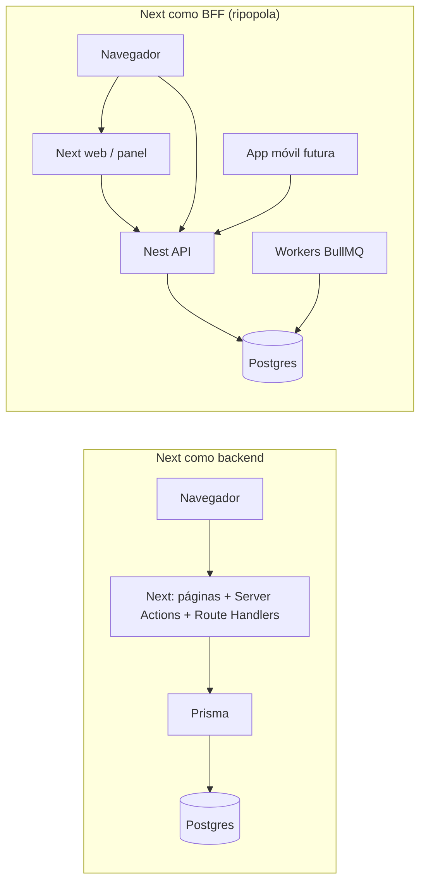

# Next como backend (y por qué ripopola no lo hace)

<Tech ids={['nextdotjs', 'prisma', 'postgresql', 'nestjs']} />

<Estado tipo="concepto">Muy común en el mercado y en el curso de referencia (AdminTodos, TesloShop). Ripopola usa Next como frontend y BFF, con la API en Nest.</Estado>

## Concepto

Next puede ser **todo el backend**: Server Components que leen la base,
Server Actions que escriben, Route Handlers para integraciones. Es lo que hace
el curso de referencia: Prisma dentro de Next, una tienda con órdenes y pagos,
sin otro servidor.



### Cómo se ve "Next con Prisma"

```ts title="lib/dal/towns.ts (proyecto de ejemplo)"
import 'server-only';
import { cache } from 'react';
import { prisma } from '@/lib/prisma';
import { verifySession } from './session';

// Data Access Layer: el único lugar que toca la base, con la autorización adentro
export const getMyListings = cache(async () => {
  const session = await verifySession();                 // tira si no hay sesión
  const rows = await prisma.listing.findMany({ where: { municipalityId: session.municipalityId } });
  return rows.map(toListingDTO);                         // DTO: solo lo que la UI necesita
});
```

```ts title="app/viviendas/actions.ts (proyecto de ejemplo)"
'use server';
export async function createListing(_: unknown, formData: FormData) {
  const session = await verifySession();
  const data = listingSchema.parse(Object.fromEntries(formData));
  await prisma.listing.create({ data: { ...data, municipalityId: session.municipalityId } });
  updateTag('listings');
}
```

Las piezas que la documentación de Next recomienda en este modelo:

- **Data Access Layer (DAL)**: un módulo `server-only` que es el único que
  habla con la base y verifica sesión y permisos.
- **DTOs**: nunca devolver el registro entero a un componente (y menos a uno
  de cliente). Se devuelve un objeto con lo justo.
- **`taintObjectReference` / `taintUniqueValue`** (experimental): marcar
  objetos o valores para que React tire error si alguien intenta pasarlos a
  un Client Component (11.5).

### Órdenes y pagos (TesloShop en el curso de referencia)

El flujo de una tienda hecha solo con Next:

1. El carrito vive en el cliente (Zustand + `localStorage`).
2. Una Server Action crea la **orden** en una transacción de Prisma:
   **recalcula precios y stock en el servidor** (nunca confía en el total del
   cliente) y descuenta el stock.
3. El pago: el cliente abre el checkout de **Stripe** o **PayPal**; al
   terminar, el proveedor avisa con un **webhook** (Route Handler) firmado.
   El webhook, y no la redirección del navegador, es quien marca la orden como
   pagada.
4. Idempotencia: el webhook puede llegar dos veces. Se guarda el id del
   evento y se ignora el repetido.

Si ripopola cobra la suscripción premium a los municipios, ese flujo va en
**Nest** (pagos, webhooks de Stripe, facturas), y el panel solo muestra el
checkout y el estado.

### BFF: Backend for Frontend

Un **BFF** es una capa de servidor hecha a medida de un frontend: junta
llamadas, adapta respuestas, guarda la sesión y oculta servicios internos.
Next es un BFF natural: los Server Components y las Server Actions ya corren
en el servidor. En ripopola, Next hace de BFF: reenvía la sesión, cachea lo
público, revalida y renderiza; **las reglas de negocio están en Nest**.

### Cuándo cada uno

| Next como backend | API aparte (Nest) |
| --- | --- |
| Un solo frontend | Varios clientes: web, panel, móvil, terceros |
| Equipo chico, todo en TypeScript y en un repo | Equipos de back y front, o un back que ya existe |
| Sin procesos en segundo plano pesados | Colas, workers, WebSockets, cron (BullMQ, Socket.IO) |
| Despliegue serverless simple | Servicios con estado, conexiones largas |
| Prototipos y MVPs | Producto que va a crecer en integraciones |

Ripopola cae en la segunda columna por todos lados: dos apps Next, workers de
traducción, WebSockets para mensajes, y una app móvil en el horizonte.

## Si venís de Angular

<Angular>

Angular no tiene esta opción: siempre necesitás una API aparte (que es lo que
hiciste con Nest). Con Next, la tentación de "meter todo en Next" existe; la
pregunta de entrevista es saber cuándo sí y cuándo no.

</Angular>

## Errores comunes

- **Devolver registros de Prisma enteros** a un Client Component: se
  serializan con todos sus campos (hashes, emails, ids internos).
- **Autorizar en el layout y no en la acción o en el DAL**: las acciones son
  endpoints públicos.
- **Confiar en el precio que manda el cliente** al crear una orden.
- **Marcar como pagado al volver de la pasarela** en vez de esperar el webhook.
- **Abrir un cliente de Prisma por petición** en serverless: hay que
  reutilizarlo (patrón `globalThis`) o usar un pooler.

<Resumen>

- Next puede ser el backend completo: Prisma + Server Actions + Route Handlers.
- Si lo es: DAL `server-only`, DTOs, autorización en cada acción, webhooks firmados e idempotentes para pagos.
- Next también es un BFF natural: sesión, caché y render delante de una API.
- Ripopola usa Nest como única API porque tiene varios clientes, workers y WebSockets.

</Resumen>

## Preguntas de entrevista

**1. ¿Usarías Next como backend completo?**
Para un solo frontend, un equipo chico y sin procesos pesados en segundo
plano, sí. Con varios clientes, colas, WebSockets o un backend existente,
prefiero una API aparte y Next como BFF.

**2. ¿Qué es un Data Access Layer en Next?**
Un módulo de servidor que es el único que accede a los datos, verifica sesión
y permisos, y devuelve DTOs con lo justo para la UI.

**3. ¿Qué es un BFF?**
Una capa de servidor a medida de un frontend: agrega y adapta llamadas, maneja
la sesión y oculta servicios internos. Next cumple ese papel con sus Server
Components y Server Actions.

**4. ¿Cómo marcás una orden como pagada de forma segura?**
Con el webhook firmado del proveedor de pagos, verificando la firma y siendo
idempotente; nunca por la redirección del navegador.

**5. ¿Por qué no pasar el objeto de Prisma directo a un componente?**
Porque se serializa entero hacia el cliente, con campos sensibles. Se arma un
DTO con lo necesario.

## Glosario

| Término | Qué es |
| --- | --- |
| BFF | Backend for Frontend: servidor a medida de una interfaz. |
| DAL | Data Access Layer: la única capa que toca los datos, con la autorización adentro. |
| DTO | Objeto con solo los campos que necesita quien lo recibe. |
| Idempotencia | Que repetir una operación no cambie el resultado. |
| Webhook | Llamada HTTP que un servicio externo hace para avisar de un evento. |
