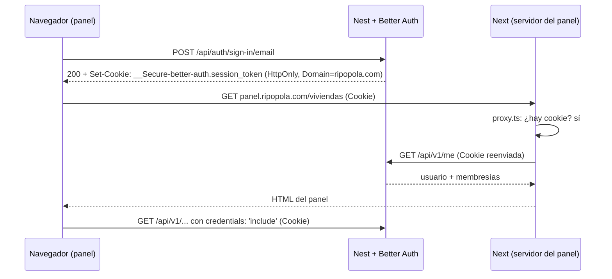

# Cómo funciona la sesión desde el frontend

<Tech ids={['betterauth', 'nestjs', 'nextdotjs']} />

<Estado tipo="concepto">El mapa de la sección: qué hace Nest, qué hace Next y qué hace el navegador.</Estado>

## Concepto

En el curso de Nest (sección 6) montaste **Better Auth dentro de la API**: los
usuarios, las sesiones y las cuentas de Google viven en Postgres, con Prisma.
El frontend **no tiene servidor de autenticación propio**. Su trabajo es:

1. Mostrar los formularios y llamar a Better Auth **desde el navegador**.
2. Saber si hay sesión para decidir qué renderizar.
3. Reenviar la sesión a Nest cuando pide datos desde el servidor.
4. Reaccionar a los 401 y 403 que responde Nest.

### La sesión es una cookie

- La cookie es **`HttpOnly`**: ni tu código ni un script inyectado la pueden
  leer. No hay token que guardar en `localStorage`, renovar ni agregar con un
  interceptor.
- Es del dominio `ripopola.com`: la reciben la web, el panel y la API (8.5).
- La valida **Nest** en cada petición. Next solo la pasa.

### Quién sabe qué, en cada lugar

| Lugar | Cómo sabe si hay sesión | Qué tan confiable |
| --- | --- | --- |
| `proxy.ts` | `getSessionCookie(request)`: ¿existe la cookie? | Optimista (8.4) |
| Server Component / Server Action | `serverApi()` → `GET /api/v1/me` | Real: lo respondió Nest |
| Client Component | `authClient.useSession()` → `GET /api/auth/get-session` | Real, pero llega después de hidratar |
| Nest | `AuthGuard` global | **La autoridad** |

### Por qué el login va desde el navegador

Si el login lo hiciera una Server Action, el `Set-Cookie` de Nest le llegaría
al **servidor de Next**, no al navegador (8.1). Habría que copiarlo a mano y
mantener dos lugares que entienden la sesión. Por eso todo lo que **crea,
cambia o cierra** la sesión (login, registro, Google, 2FA, logout) va desde el
navegador con el cliente de Better Auth. Todo lo que **lee** datos con la
sesión puede ir desde el servidor.

### Autenticación y autorización

- **Autenticación** (¿quién sos?): Better Auth.
- **Autorización** (¿qué podés hacer?): Nest, con el rol de plataforma
  (`USER`, `SUPERADMIN`) y las membresías por ayuntamiento (`ADMIN`,
  `EDITOR`). El panel las usa para **mostrar u ocultar**; Nest para
  **permitir o negar** (9.5).

## Si venís de Angular

<Angular>

| Angular típico | ripopola con Next |
| --- | --- |
| JWT en `localStorage` + interceptor que agrega `Authorization` | Cookie `HttpOnly` que viaja sola |
| Refresh token y lógica de renovación | La sesión se renueva sola en Nest (`updateAge`) |
| `CanActivateFn` que mira el token | `proxy.ts` (optimista) + layout que pregunta a Nest |
| Servicio `AuthService` con un `BehaviorSubject<User>` | `useSession()` en el cliente, `getMe()` en el servidor |
| `withCredentials: true` | `credentials: 'include'` |

</Angular>

<Resumen>

- Better Auth vive en Nest; el frontend usa su cliente.
- La sesión es una cookie `HttpOnly` del dominio `ripopola.com`.
- Crear, cambiar o cerrar la sesión: desde el navegador. Leer con sesión: también desde el servidor.
- Proxy optimista, layout que pregunta a Nest, Nest como autoridad.

</Resumen>

## Preguntas de entrevista

**1. ¿Por qué una cookie `HttpOnly` y no un JWT en `localStorage`?**
Porque un script inyectado (XSS) puede leer `localStorage` y robar el token;
una cookie `HttpOnly` no se puede leer desde JavaScript y viaja sola.

**2. Si la cookie es `HttpOnly`, ¿cómo sabe el frontend si hay sesión?**
En el servidor, reenviando la cookie a la API y preguntando quién es el
usuario; en el cliente, llamando a un endpoint de sesión (`useSession`).

**3. ¿Por qué no hacer el login con una Server Action?**
Porque el `Set-Cookie` de la API le llegaría al servidor de Next y no al
navegador. El login va directo del navegador a la API.

**4. ¿Dónde se decide si un usuario puede hacer algo?**
En el backend, en cada endpoint. El frontend usa los permisos solo para
mostrar u ocultar opciones.

## Glosario

| Término | Qué es |
| --- | --- |
| Sesión | Registro en el servidor que identifica a un usuario logueado; el navegador guarda solo su id en una cookie. |
| Autenticación | Comprobar quién es el usuario. |
| Autorización | Decidir qué puede hacer. |
| Membresía | Relación usuario-ayuntamiento con un rol (`ADMIN`, `EDITOR`). |
