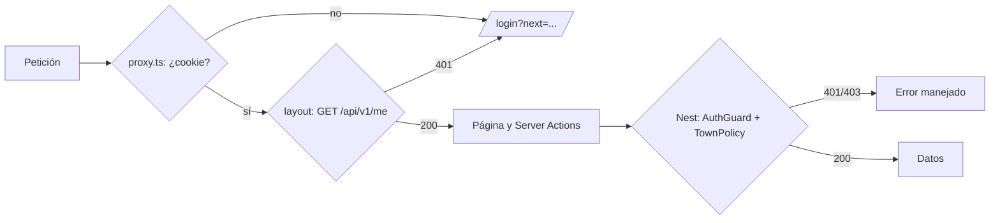

# La sesión en el servidor y las rutas protegidas

<Tech ids={['nextdotjs', 'betterauth', 'nestjs', 'react']} />

<Estado tipo="construye">`getMe()` en el panel, el layout de `(privado)` que exige sesión y el manejo de 401 en páginas y acciones.</Estado>

## Concepto

En el servidor del panel, "¿quién es el usuario?" se responde preguntándole a
Nest con la cookie reenviada. Nest ya tiene `GET /api/v1/me` (curso de Nest,
sección 6), que devuelve al usuario **con sus membresías**: más que la sesión
de Better Auth, que no sabe de ayuntamientos.

### Una sola llamada por petición: `cache` de React

El layout, la página y `generateMetadata` pueden necesitar al usuario en el
mismo render. `cache` de React **memoiza durante una petición**: la primera
llamada va a Nest y las demás reciben el mismo resultado.

| | `cache` de React | `'use cache'` de Next |
| --- | --- | --- |
| Dura | Una petición | Entre peticiones y usuarios |
| Para | Deduplicar dentro de un render | Guardar resultados |
| Datos del usuario | Sí | **Nunca** |

### Las tres capas



1. **Proxy** (8.4): optimista, evita renderizar sin cookie.
2. **Layout de `(privado)`**: verifica la sesión con Nest y da el usuario a la UI.
3. **Nest**: valida en cada endpoint. Es la única capa que cuenta como seguridad.

¿Por qué no alcanza con el layout? Porque **los layouts no se vuelven a
renderizar** al navegar entre páginas hijas (6.2), y las Server Actions se
llaman sin pasar por el layout. Cada página y cada acción que toca datos los
pide a Nest con la cookie, y Nest decide.

## Si venís de Angular

<Angular>

Es un `CanActivateFn` + un resolver que trae al usuario, pero en el servidor:
el HTML del panel nunca llega a alguien sin sesión. Y en vez de un
`AuthService` con estado global, cada render le pregunta a la API (con
`cache` para no repetir).

</Angular>

## En ripopola

### 1. `getMe()`

```ts title="apps/panel/features/auth/me.ts"
import 'server-only';
import { cache } from 'react';
import { redirect } from 'next/navigation';
import { serverApi } from '@ripopola/frontend-api/server';
import type { components } from '@ripopola/api-client';

export type Me = components['schemas']['MeDto'];

/** El usuario de esta petición, o null si no hay sesión válida. */
export const getMe = cache(async (): Promise<Me | null> => {
  const api = await serverApi();
  const { data, response } = await api.GET('/api/v1/me');
  if (response.status === 401) return null;
  if (!data) throw new Error(`/me respondió ${response.status}`);   // lo atrapa error.tsx
  return data;
});

/** Igual, pero redirige al login si no hay sesión. */
export async function requireMe(next = '/'): Promise<Me> {
  const me = await getMe();
  if (!me) redirect(`/login?next=${encodeURIComponent(next)}`);
  return me;
}
```

`MeDto` es el nombre del esquema en el OpenAPI de Nest; usá el que tenga tu
contrato.

### 2. El layout privado

```tsx title="apps/panel/app/(privado)/layout.tsx"
import { Suspense } from 'react';
import { requireMe } from '@/features/auth/me';
import { MeProvider } from '@/features/auth/me-context';
import { PanelSidebar } from '@/components/panel-sidebar';

export default function PrivateLayout({ children }: LayoutProps<'/'>) {
  return (
    <div className="grid min-h-screen grid-cols-[240px_1fr]">
      <Suspense fallback={<SidebarSkeleton />}>
        <SessionGate>{children}</SessionGate>
      </Suspense>
    </div>
  );
}

async function SessionGate({ children }: { children: React.ReactNode }) {
  const me = await requireMe();            // lee cookies → dinámico, por eso el Suspense
  return (
    <MeProvider me={me}>
      <PanelSidebar />
      <main>{children}</main>
    </MeProvider>
  );
}
```

- Con Cache Components, leer cookies fuera de un `<Suspense>` impide el
  prerender de la ruta y Next da error en el build. Dentro, el *shell* (la
  grilla y el skeleton) se prerenderiza y lo demás se transmite.
- `MeProvider` es un Context de cliente (2.4) con el usuario y sus
  membresías, para que los componentes de cliente no tengan que pedirlo.

```tsx title="apps/panel/features/auth/me-context.tsx"
'use client';

import { createContext, use } from 'react';
import type { Me } from './me';

const MeContext = createContext<Me | null>(null);

export function MeProvider({ me, children }: { me: Me; children: React.ReactNode }) {
  return <MeContext value={me}>{children}</MeContext>;
}

export function useMe() {
  const me = use(MeContext);
  if (!me) throw new Error('useMe fuera de MeProvider');
  return me;
}
```

`import type { Me }` desde un archivo `server-only` está bien: los tipos se
borran al compilar y no arrastran el módulo.

### 3. Páginas: 401 y 403

Una página que pide datos con `serverApi()` puede recibir:

```tsx
const { data, response } = await api.GET('/api/v1/listings/{id}', { params: { path: { id } } });
if (response.status === 401) redirect(`/login?next=/viviendas/${id}`);   // la sesión venció en el medio
if (response.status === 403 || response.status === 404) notFound();       // no es suya: no confirmar que existe
```

Responder 404 a un 403 en una URL con id evita confirmar que el recurso existe.

`forbidden()` y `unauthorized()` de `next/navigation` (con `forbidden.tsx` y
`unauthorized.tsx`) son otra opción, todavía experimental
(`experimental.authInterrupts`).

### 4. Server Actions: la sesión adentro

Las acciones del 8.1 ya devuelven un error legible con 401 y 403. Un detalle
más: si la sesión venció, la acción no puede redirigir el navegador con una
cookie nueva, pero sí puede usar `redirect('/login')`, que Next convierte en
una navegación del cliente.

### 5. Cerrar sesión en todos lados

El `UserMenu` del 9.2 hace `authClient.signOut()`, `router.replace('/login')`
y `router.refresh()`. Como la cookie es del dominio `ripopola.com`, cerrar
sesión en el panel también la cierra en la web.

### 6. En la web pública

La web no tiene páginas privadas. Si algún día muestra "Hola, Ana" en el
header, se hace con `authClient.useSession()` en un componente de cliente:
así las páginas siguen cacheadas para todos y solo ese pedacito depende del
usuario.

## Errores comunes

- **Proteger solo en el layout** y no en cada página o acción.
- **Leer la sesión en un componente con `'use cache'`**: o falla, o peor,
  cachea los datos de un usuario para todos.
- **`cookies()` fuera de `<Suspense>`** con Cache Components: error de build.
- **Llamar a `/api/v1/me` varias veces por render**: `cache` de React.
- **Responder 403 con detalles** en una URL con id: confirma que existe.
- **Pasar el usuario entero a un componente de cliente**: solo lo que la UI
  necesita (nombre, membresías), no datos internos.

<Resumen>

- `getMe()` pregunta a Nest con la cookie; `cache` de React lo deduplica por petición.
- Layout de `(privado)`: `requireMe()` dentro de `<Suspense>`, y un Context con el usuario.
- Cada página y cada acción manejan 401 (login) y 403 (no encontrado o mensaje).
- Tres capas: proxy, layout, Nest. Solo Nest es seguridad.

</Resumen>

## Preguntas de entrevista

**1. ¿Cómo sabés quién es el usuario en un Server Component si la cookie es `HttpOnly`?**
El servidor sí recibe la cookie: la reenvío a la API, que valida la sesión y
devuelve el usuario.

**2. ¿Para qué sirve `cache` de React en el servidor?**
Para deduplicar llamadas dentro de un mismo render: varios componentes piden
al usuario y solo una llamada llega a la API.

**3. ¿Por qué no alcanza con verificar la sesión en el layout?**
Porque los layouts no se vuelven a renderizar en cada navegación y las Server
Actions no pasan por ellos. Cada acceso a datos se autoriza por separado.

**4. ¿Qué diferencia hay entre `cache` de React y `'use cache'`?**
`cache` dura una petición y sirve para deduplicar; `'use cache'` guarda
resultados entre peticiones y nunca debe tener datos de un usuario.

**5. ¿Por qué a veces conviene responder 404 en vez de 403?**
Para no confirmar que un recurso existe a alguien que no tiene permiso.

## Glosario

| Término | Qué es |
| --- | --- |
| `cache` (React) | Memoización de una función durante un render en el servidor. |
| `requireMe` | Helper que devuelve el usuario o redirige al login. |
| Shell | La parte estática de una ruta que se prerenderiza. |
| `authInterrupts` | Opción experimental de Next para `forbidden()` y `unauthorized()`. |
