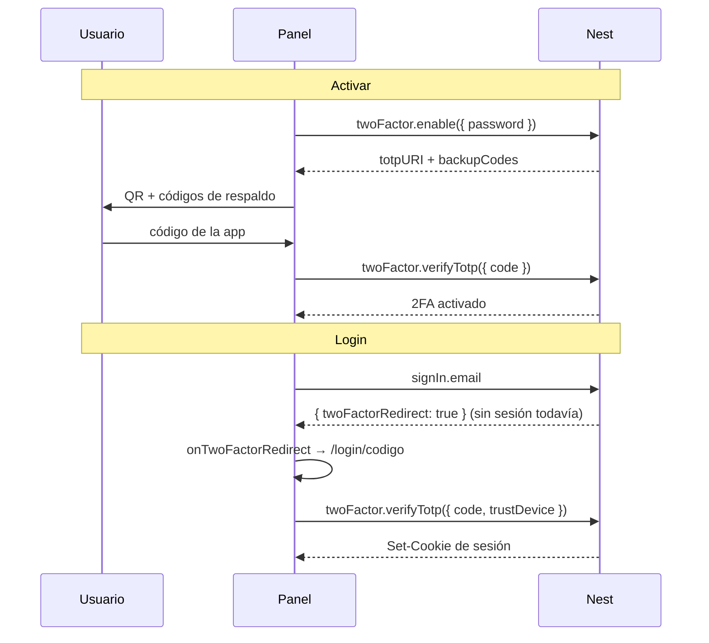

# Verificación en dos pasos y sesiones abiertas

<Tech ids={['betterauth', 'react', 'nextdotjs']} />

<Estado tipo="construye">La pantalla `/seguridad/dos-pasos` para activar el 2FA con QR, la página `/login/codigo` y la lista de sesiones abiertas.</Estado>

## Concepto

**TOTP** (*Time-based One-Time Password*): el servidor y la app del usuario
(Google Authenticator, 1Password, Authy) comparten un secreto. Cada 30
segundos, los dos calculan el mismo código de 6 dígitos a partir del secreto
y la hora. El secreto viaja una sola vez, dentro de un **QR** con una URI
`otpauth://totp/ripopola:ana@...?secret=...&issuer=ripopola`.

El plugin `twoFactor` ya está en Nest (curso de Nest, sección 6). En el
front hacen falta tres pantallas:



- Al activar, la contraseña se pide **otra vez**: una sesión robada no
  alcanza para cambiar la seguridad de la cuenta.
- Los **códigos de respaldo** se muestran una sola vez. Son la salida si el
  usuario pierde el teléfono.
- **`trustDevice`**: no pide el código en ese navegador por 30 días.

## Si venís de Angular

<Angular>

No cambia nada de fondo: son formularios y llamadas. Lo distinto es que el
paso intermedio del login no lo manejás vos con un estado en un servicio:
Better Auth deja una cookie temporal y el plugin de cliente llama a
`onTwoFactorRedirect`.

</Angular>

## En ripopola

### 1. Activar: contraseña, QR y códigos

```bash
pnpm add -E react-qr-code --filter panel      # o agregalo al package.json del panel
```

```tsx title="apps/panel/app/(privado)/seguridad/dos-pasos/enable-two-factor.tsx"
'use client';

import { useState } from 'react';
import { useRouter } from 'next/navigation';
import QRCode from 'react-qr-code';
import { authClient, authErrorMessage } from '@ripopola/frontend-auth';

type Step = { name: 'password' } | { name: 'scan'; totpURI: string; backupCodes: string[] } | { name: 'done' };

export function EnableTwoFactor() {
  const router = useRouter();
  const [step, setStep] = useState<Step>({ name: 'password' });
  const [error, setError] = useState<string | null>(null);

  async function start(formData: FormData) {
    const { data, error } = await authClient.twoFactor.enable({ password: String(formData.get('password')) });
    if (error) return setError(authErrorMessage(error));
    setStep({ name: 'scan', totpURI: data.totpURI, backupCodes: data.backupCodes });
  }

  async function confirm(formData: FormData) {
    const { error } = await authClient.twoFactor.verifyTotp({ code: String(formData.get('code')) });
    if (error) return setError(authErrorMessage(error));
    setStep({ name: 'done' });
    router.refresh();                     // el layout vuelve a leer me.twoFactorEnabled
  }

  if (step.name === 'password') {
    return (
      <form action={start}>
        <label>Tu contraseña <input name="password" type="password" autoComplete="current-password" required /></label>
        {error && <p role="alert">{error}</p>}
        <button>Continuar</button>
      </form>
    );
  }

  if (step.name === 'scan') {
    return (
      <div className="space-y-6">
        <p>Escaneá el código con tu app de autenticación.</p>
        <div className="w-fit bg-white p-4"><QRCode value={step.totpURI} size={180} /></div>
        <details>
          <summary>No puedo escanearlo</summary>
          <code className="break-all">{new URL(step.totpURI).searchParams.get('secret')}</code>
        </details>
        <section aria-labelledby="backup-title">
          <h2 id="backup-title">Códigos de respaldo</h2>
          <p>Guardalos en un lugar seguro. Cada uno sirve una sola vez y no los vas a ver de nuevo.</p>
          <ul className="grid grid-cols-2 font-mono">{step.backupCodes.map((c) => <li key={c}>{c}</li>)}</ul>
        </section>
        <form action={confirm}>
          <label>Código de 6 dígitos <input name="code" inputMode="numeric" autoComplete="one-time-code" pattern="\d{6}" required /></label>
          {error && <p role="alert">{error}</p>}
          <button>Activar</button>
        </form>
      </div>
    );
  }

  return <p role="status">Listo: la verificación en dos pasos está activa.</p>;
}
```

Qué mirar:

- Las funciones como `action` del form son **acciones de cliente** (2.8): no
  hay Server Action, todo va del navegador a Better Auth.
- `autoComplete="one-time-code"` + `inputMode="numeric"`: el teclado numérico
  en el móvil y el autocompletado del código.
- Los códigos de respaldo **no se guardan** en ningún estado persistente ni se
  mandan a analytics.
- El 2FA queda activo recién cuando `verifyTotp` confirma que la app
  funciona: si el usuario abandona en el QR, no queda bloqueado.

### 2. El paso del código en el login

El `twoFactorClient` del 9.2 ya redirige a `/login/codigo` cuando el login
responde `twoFactorRedirect`.

```tsx title="apps/panel/app/(auth)/login/codigo/two-factor-form.tsx"
'use client';

import { useState } from 'react';
import { useRouter } from 'next/navigation';
import { authClient, authErrorMessage } from '@ripopola/frontend-auth';

export function TwoFactorForm() {
  const router = useRouter();
  const [useBackup, setUseBackup] = useState(false);
  const [error, setError] = useState<string | null>(null);

  async function submit(formData: FormData) {
    const code = String(formData.get('code')).trim();
    const trustDevice = formData.get('trust') === 'on';
    const { error } = useBackup
      ? await authClient.twoFactor.verifyBackupCode({ code, trustDevice })
      : await authClient.twoFactor.verifyTotp({ code, trustDevice });
    if (error) return setError(authErrorMessage(error));
    router.replace('/');
    router.refresh();
  }

  return (
    <form action={submit} className="space-y-4">
      <label>
        {useBackup ? 'Código de respaldo' : 'Código de tu app'}
        <input name="code" autoComplete="one-time-code" inputMode={useBackup ? 'text' : 'numeric'} autoFocus required />
      </label>
      <label><input type="checkbox" name="trust" /> Confiar en este dispositivo por 30 días</label>
      {error && <p role="alert">{error}</p>}
      <button>Verificar</button>
      <button type="button" onClick={() => setUseBackup(!useBackup)}>
        {useBackup ? 'Usar la app' : 'Usar un código de respaldo'}
      </button>
    </form>
  );
}
```

`/login/codigo` es pública (está en el grupo `(auth)` y `/login` está en las
rutas públicas del proxy). Si alguien entra sin haber pasado por el login,
`verifyTotp` falla porque no existe la cookie temporal del 2FA.

### 3. Desactivar y regenerar códigos

```ts
await authClient.twoFactor.disable({ password });
const { data } = await authClient.twoFactor.generateBackupCodes({ password }); // invalida los anteriores
```

Para un admin de ayuntamiento, desactivarlo lo deja sin acceso a lo que exige
2FA (el guard de Nest): mostralo antes de confirmar.

### 4. Sesiones abiertas

```tsx title="apps/panel/app/(privado)/seguridad/sesiones/sessions-list.tsx (lo importante)"
const { data: sessions } = await authClient.listSessions();
const { data: current } = await authClient.getSession();

// por cada sesión: navegador (userAgent), IP, fecha, y si es la actual
await authClient.revokeSession({ token: session.token });   // cerrar una
await authClient.revokeOtherSessions();                     // todas menos esta
```

Envolvelo en TanStack Query (`useQuery` + `useMutation` con invalidación,
4.2 y 4.3) para tener carga, errores y recarga de la lista.

## Errores comunes

- **Activar el 2FA sin verificar un primer código**: si el QR se escaneó mal,
  el usuario queda afuera.
- **Mostrar los códigos de respaldo de nuevo** o guardarlos en el cliente.
- **No ofrecer códigos de respaldo** en el paso del login.
- **`autoComplete` incorrecto** en el campo del código.
- **Exigir 2FA solo en el front**: la regla está en el guard de Nest.

<Resumen>

- TOTP: secreto compartido por QR, códigos de 30 segundos.
- Activar: contraseña → QR y códigos de respaldo → verificar un código.
- Login con 2FA: `twoFactorRedirect` → `/login/codigo` → `verifyTotp` o `verifyBackupCode`.
- `trustDevice` para no pedirlo cada vez; `listSessions` y `revokeSession` para cerrar sesiones.

</Resumen>

## Preguntas de entrevista

**1. ¿Cómo funciona TOTP?**
El servidor y la app comparten un secreto; los dos calculan un código a partir
del secreto y la hora en ventanas de 30 segundos. El servidor acepta el código
si coincide.

**2. ¿Por qué pedir la contraseña para activar o desactivar el 2FA?**
Para que una sesión robada no alcance para cambiar la seguridad de la cuenta
(re-autenticación para acciones sensibles).

**3. ¿Para qué son los códigos de respaldo?**
Para entrar si se pierde el dispositivo con la app. Se muestran una vez y
cada uno sirve una sola vez.

**4. ¿Por qué el 2FA se activa recién después de verificar un código?**
Para comprobar que la app quedó bien configurada; si no, el usuario podría
quedar bloqueado.

## Glosario

| Término | Qué es |
| --- | --- |
| 2FA | Segundo factor: algo que tenés además de algo que sabés. |
| TOTP | Contraseña de un solo uso basada en el tiempo (RFC 6238). |
| `otpauth://` | URI con el secreto que lee la app de autenticación. |
| Código de respaldo | Código de un solo uso para entrar sin la app. |
| Re-autenticación | Pedir la contraseña otra vez antes de una acción sensible. |
