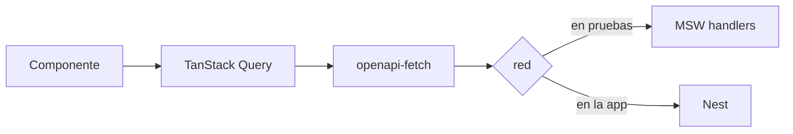

# Simular la API con MSW

<Tech ids={['mswjs', 'vitest', 'testinglibrary', 'reactquery', 'reacthookform']} />

<Estado tipo="construye">Los handlers de MSW de la API de pueblos y viviendas, y las pruebas del buscador y del formulario de vivienda.</Estado>

## Concepto

**MSW** (*Mock Service Worker*) intercepta las peticiones **a nivel de red**:
tu código hace un `fetch` real a `/api/v1/towns` y MSW responde en lugar de
Nest. En Node lo hace parcheando el módulo de red; en el navegador, con un
Service Worker.

¿Por qué no mockear `browserApi` con `vi.mock`? Porque así no probás la URL,
los parámetros, la serialización ni el manejo de errores de verdad. Con MSW el
componente, TanStack Query y openapi-fetch corren completos; solo cambia
quién responde.



## Si venís de Angular

<Angular>

Es el reemplazo de `HttpTestingController` (`expectOne`, `flush`), con una
diferencia: no está atado a `HttpClient`. Simula la red para cualquier
cliente, y los mismos handlers sirven en pruebas, en Storybook y en desarrollo.

</Angular>

## En ripopola

### 1. Instalar y los handlers

```bash
pnpm add -D -E msw
```

```ts title="libs/frontend/testing/src/handlers.ts"
import { http, HttpResponse } from 'msw';
import type { components } from '@ripopola/api-client';

type TownSummary = components['schemas']['TownSummaryDto'];

export const towns: TownSummary[] = [
  { slug: 'albarracin', name: 'Albarracín', region: 'Aragón', population: 1018 },
  { slug: 'civita-di-bagnoregio', name: 'Civita di Bagnoregio', region: 'Lazio', population: 11 },
] as TownSummary[];

export const handlers = [
  http.get('*/api/v1/towns', ({ request }) => {
    const q = new URL(request.url).searchParams.get('q')?.toLowerCase() ?? '';
    const items = towns.filter((t) => t.name.toLowerCase().includes(q));
    return HttpResponse.json({ items, total: items.length, page: 1 });
  }),
];
```

- `*/api/...` matchea con cualquier origen (relativo en desarrollo, absoluto
  en el servidor).
- Los datos usan los **tipos generados del OpenAPI**: si el contrato cambia,
  los handlers no compilan.
- Viven en una librería (`libs/frontend/testing`) para usarlos en las dos apps.

```ts title="apps/web/vitest.setup.ts (agregado)"
import { setupServer } from 'msw/node';
import { afterAll, afterEach, beforeAll } from 'vitest';
import { handlers } from '@ripopola/frontend-testing';

export const server = setupServer(...handlers);

beforeAll(() => server.listen({ onUnhandledRequest: 'error' }));   // una petición sin handler es un error
afterEach(() => server.resetHandlers());                           // borra los overrides de cada prueba
afterAll(() => server.close());
```

### 2. El buscador: carga, resultados y error

```tsx title="apps/web/features/search/town-search.test.tsx"
import { screen } from '@testing-library/react';
import userEvent from '@testing-library/user-event';
import { http, HttpResponse } from 'msw';
import { expect, it } from 'vitest';
import { server } from '../../vitest.setup';
import { renderWithProviders } from '@/test/render';
import { TownSearch } from './town-search';

it('busca y muestra los pueblos que coinciden', async () => {
  const user = userEvent.setup();
  renderWithProviders(<TownSearch />);

  await user.type(screen.getByRole('searchbox', { name: /buscar/i }), 'alba');

  expect(await screen.findByRole('link', { name: /albarracín/i })).toBeInTheDocument();
  expect(screen.queryByRole('link', { name: /civita/i })).not.toBeInTheDocument();
});

it('muestra un error si la API falla', async () => {
  server.use(http.get('*/api/v1/towns', () => HttpResponse.json({ title: 'Error' }, { status: 500 })));
  const user = userEvent.setup();
  renderWithProviders(<TownSearch />);

  await user.type(screen.getByRole('searchbox', { name: /buscar/i }), 'x');

  expect(await screen.findByRole('alert')).toHaveTextContent(/no pudimos/i);
});
```

- **`server.use`** cambia la respuesta solo para esa prueba.
- El *debounce* (5.1) se respeta: `findBy` espera hasta 1 s por defecto. Si
  el debounce es largo, usá `vi.useFakeTimers({ shouldAdvanceTime: true })`.

### 3. El formulario de vivienda con errores del servidor

```tsx title="apps/panel/features/listings/listing-form.test.tsx"
it('muestra en cada campo los errores de validación de Nest', async () => {
  server.use(
    http.post('*/api/v1/towns/:townId/listings', () =>
      HttpResponse.json(
        { type: 'validation', title: 'Datos inválidos', status: 400, errors: { title: ['Ya existe una vivienda con ese título'] } },
        { status: 400 },
      ),
    ),
  );
  const user = userEvent.setup();
  renderWithProviders(<ListingForm townId="t1" onCreated={() => {}} />);

  await user.type(screen.getByLabelText('Título'), 'Casa de piedra');
  await user.type(screen.getByLabelText('Precio'), '450');
  await user.click(screen.getByRole('button', { name: /guardar/i }));

  expect(await screen.findByText('Ya existe una vivienda con ese título')).toBeInTheDocument();
  expect(screen.getByLabelText('Título')).toHaveAttribute('aria-invalid', 'true');
});
```

Y otra prueba para la validación del cliente: enviar vacío y comprobar que
**no** sale ninguna petición (con `onUnhandledRequest: 'error'`, una petición
inesperada hace fallar la prueba).

### 4. Hooks propios

```ts title="apps/web/hooks/use-debounced-value.test.ts"
import { act, renderHook } from '@testing-library/react';
import { expect, it, vi } from 'vitest';
import { useDebouncedValue } from './use-debounced-value';

it('devuelve el valor recién después del retraso', () => {
  vi.useFakeTimers();
  const { result, rerender } = renderHook(({ value }) => useDebouncedValue(value, 300), {
    initialProps: { value: 'a' },
  });

  rerender({ value: 'alba' });
  expect(result.current).toBe('a');

  act(() => vi.advanceTimersByTime(300));
  expect(result.current).toBe('alba');
  vi.useRealTimers();
});
```

Probá un hook solo cuando tiene lógica propia; si es un envoltorio fino de
`useQuery`, probalo a través del componente que lo usa.

### 5. MSW en desarrollo (opcional)

Con `setupWorker(...handlers)` en el navegador, podés trabajar en una pantalla
antes de que exista el endpoint en Nest. Activalo solo con una variable
(`NEXT_PUBLIC_API_MOCKING=enabled`) y nunca en producción.

<Alternativa title="nock, vi.mock y Mirage">
`vi.mock` del módulo de API es más rápido de escribir pero prueba menos.
**nock** intercepta solo en Node. **Mirage** simula un backend con base de
datos en memoria; MSW es hoy el estándar.
</Alternativa>

## Errores comunes

- **No resetear los handlers** entre pruebas: una prueba contamina a la siguiente.
- **`onUnhandledRequest: 'warn'`**: peticiones inesperadas pasan desapercibidas.
- **Handlers con datos sin tipar** que divergen del contrato real.
- **Reintentos de TanStack Query** activos en pruebas: lentitud y falsos verdes.
- **Probar `useQuery` mockeándolo**: no probás nada de la integración.

<Resumen>

- MSW simula la API en la red: el código corre completo.
- Handlers tipados con el OpenAPI, compartidos en `libs/frontend/testing`.
- `server.use` para casos de error en una prueba; `resetHandlers` después de cada una.
- Formularios: validación del cliente sin peticiones y errores del servidor por campo.
- `renderHook` para hooks con lógica propia.

</Resumen>

## Preguntas de entrevista

**1. ¿Por qué MSW en vez de mockear el cliente HTTP?**
Porque intercepta a nivel de red: el código de la app (cliente, caché,
serialización, manejo de errores) corre igual que en producción.

**2. ¿Cómo probás el estado de error de una consulta?**
Sobrescribiendo el handler en esa prueba para que responda un error y
esperando el mensaje con `findBy`, con los reintentos desactivados.

**3. ¿Cuándo probás un hook por separado?**
Cuando tiene lógica propia (tiempos, cálculos). Si solo envuelve otra
librería, a través del componente.

## Glosario

| Término | Qué es |
| --- | --- |
| MSW | Librería que intercepta peticiones de red y responde con handlers. |
| Handler | Función que define la respuesta para una ruta y un método. |
| `renderHook` | Utilidad para ejecutar un hook fuera de un componente. |
| Fake timers | Relojes simulados para controlar `setTimeout` en pruebas. |
