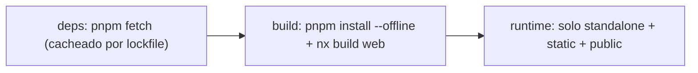

# Next en Docker

<Tech ids={['docker', 'nextdotjs', 'pnpm', 'nx']} />

<Estado tipo="construye">El Dockerfile de `apps/web` (y el mismo para `apps/panel`), probado en local con Docker Compose junto a la API.</Estado>

## Concepto

Un **Dockerfile multi-etapa** separa construir de ejecutar:



La imagen final no tiene el código fuente, ni pnpm, ni las dependencias de
desarrollo: solo Node, el `server.js` y lo que este usa. Más chica, arranca
más rápido (importante en Cloud Run, que escala a cero) y con menos
superficie de ataque.

Es el mismo esquema que la imagen de la API en el curso de Nest; cambia lo
que se copia a la etapa final.

## Si venís de Angular

<Angular>

Una app Angular sin SSR se sirve con nginx copiando `dist/`. Con SSR, la
imagen corre `node dist/app/server/server.mjs`. Next siempre es el segundo
caso: un proceso Node (salvo `output: 'export'`, que genera estáticos como una
SPA y pierde todo lo del servidor).

</Angular>

## En ripopola

### 1. El Dockerfile

```dockerfile title="apps/web/Dockerfile"
# syntax=docker/dockerfile:1
ARG NODE_VERSION=26

# 1. Dependencias: solo cambia si cambia el lockfile
FROM node:${NODE_VERSION}-slim AS deps
RUN corepack enable
WORKDIR /repo
COPY pnpm-lock.yaml pnpm-workspace.yaml ./
RUN --mount=type=cache,id=pnpm,target=/root/.local/share/pnpm/store pnpm fetch

# 2. Build
FROM deps AS build
COPY . .
RUN --mount=type=cache,id=pnpm,target=/root/.local/share/pnpm/store pnpm install --offline --frozen-lockfile
ARG APP_VERSION=dev
ARG NEXT_PUBLIC_SITE_URL
ARG NEXT_PUBLIC_API_URL
ARG NEXT_PUBLIC_SENTRY_DSN
ENV APP_VERSION=$APP_VERSION NEXT_TELEMETRY_DISABLED=1
RUN --mount=type=secret,id=sentry_auth_token,env=SENTRY_AUTH_TOKEN \
    pnpm nx build web --skip-nx-cache

# 3. Runtime
FROM node:${NODE_VERSION}-slim AS runtime
ENV NODE_ENV=production PORT=8080 HOSTNAME=0.0.0.0 NEXT_TELEMETRY_DISABLED=1
WORKDIR /app
COPY --from=build --chown=node:node /repo/apps/web/.next/standalone ./
COPY --from=build --chown=node:node /repo/apps/web/.next/static ./apps/web/.next/static
COPY --from=build --chown=node:node /repo/apps/web/public ./apps/web/public
USER node
EXPOSE 8080
CMD ["node", "apps/web/server.js"]
```

Qué mirar:

- **`pnpm fetch`** descarga los paquetes solo con el lockfile: si cambiás
  código pero no dependencias, Docker reusa esa capa.
- **`--mount=type=cache`**: el almacén de pnpm persiste entre builds.
- **`ARG NEXT_PUBLIC_*`**: se pasan en el build porque se incrustan en el JS (12.1).
- **El token de Sentry como secreto de build** (`--mount=type=secret`): sube
  los source maps sin quedar en ninguna capa de la imagen. Un `ARG` sí queda
  en el historial: nunca para secretos.
- **`HOSTNAME=0.0.0.0`**: si no, el `server.js` de standalone escucha solo en
  `localhost` y Cloud Run no le llega.
- **`PORT=8080`**: el puerto que espera Cloud Run.
- **`USER node`**: no correr como root.
- **`-slim` (Debian) y no `-alpine`**: `sharp`, que optimiza las imágenes de
  `next/image`, trae binarios para glibc; en Alpine (musl) suele dar
  problemas o consumir más memoria. Next incluye `sharp` en standalone si está
  en las dependencias: `pnpm add -E sharp --filter web`.

### 2. `.dockerignore`

```text title=".dockerignore"
**/node_modules
**/.next
**/dist
**/.env*.local
.git
.nx
coverage
**/test-results
**/playwright-report
.auth
```

Sin esto, `COPY . .` manda gigas al daemon de Docker y puede colar tu
`.env.local` en la imagen.

### 3. Construir y probar en local

```bash
docker build -f apps/web/Dockerfile -t ripopola-web:local \
  --build-arg NEXT_PUBLIC_SITE_URL=http://localhost:8080 \
  --build-arg NEXT_PUBLIC_API_URL= \
  .
```

Para probarla con la API, sumala al `docker-compose.yml` del monorepo (el
del curso de Nest):

```yaml title="docker-compose.yml (agregado)"
  web:
    image: ripopola-web:local
    ports: ['8080:8080']
    environment:
      API_INTERNAL_URL: http://api:3000          # por la red de Compose, como en Cloud Run
      REVALIDATE_SECRET: secreto-local
    depends_on: [api]
```

Abrí `http://localhost:8080/es`. Si la página carga sin estilos, revisá que
`static` quedó en `apps/web/.next/static` dentro de la imagen
(`docker run --rm -it ripopola-web:local ls apps/web/.next`).

### 4. El panel

`apps/panel/Dockerfile` es el mismo cambiando `web` por `panel`. Si querés
uno solo, parametrizalo con `ARG APP=web` y usá `${APP}` en las rutas.

<Alternativa title="Buildpacks y nixpacks">
`gcloud run deploy --source .` usa **buildpacks** de Google: detectan Next y
construyen la imagen sin Dockerfile. Railway usa **nixpacks**. Son cómodos
para empezar, pero en un monorepo con pnpm y Nx un Dockerfile propio da
control sobre la caché, los secretos y qué entra en la imagen.
</Alternativa>

## Errores comunes

- **Olvidar `HOSTNAME=0.0.0.0`**: el contenedor arranca pero no responde.
- **No copiar `static` o `public`**: HTML sin CSS, JS ni imágenes.
- **Secretos en `ARG` o `ENV` del build**: quedan en la imagen.
- **Alpine con `sharp`**: errores de memoria o de binarios.
- **Correr como root.**
- **Sin `.dockerignore`.**

<Resumen>

- Multi-etapa: dependencias (por lockfile), build con Nx, runtime con solo standalone + static + public.
- `NEXT_PUBLIC_*` como `ARG` de build; secretos con `--mount=type=secret`.
- `HOSTNAME=0.0.0.0`, `PORT=8080`, `USER node`, imagen `-slim` con `sharp`.
- `.dockerignore` siempre; probar la imagen con Compose junto a la API.

</Resumen>

## Preguntas de entrevista

**1. ¿Por qué un Dockerfile multi-etapa?**
Para que la imagen final tenga solo lo necesario para ejecutar: más chica,
más rápida de arrancar y con menos superficie de ataque.

**2. ¿Cómo aprovechás la caché de capas con pnpm?**
Copiando primero solo el lockfile e instalando (`pnpm fetch`), y después el
código. Un cambio de código no invalida la capa de dependencias.

**3. ¿Cómo pasás un secreto al build sin que quede en la imagen?**
Con secretos de BuildKit (`--mount=type=secret`), que solo existen durante ese
`RUN`. Ni `ARG` ni `ENV`.

**4. ¿Qué tenés que copiar además de `.next/standalone`?**
`.next/static` (JS y CSS) y `public/`, que standalone no incluye.

## Glosario

| Término | Qué es |
| --- | --- |
| Multi-etapa | Dockerfile con varias etapas donde la final copia solo lo necesario. |
| BuildKit | Motor de build de Docker con caché montada y secretos. |
| `pnpm fetch` | Descarga dependencias a partir del lockfile, sin el código. |
| sharp | Librería nativa que usa Next para optimizar imágenes. |
