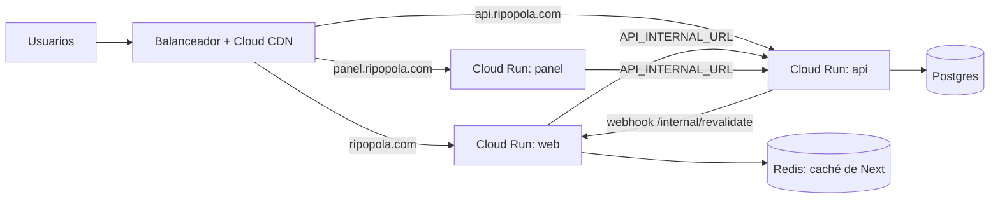

# Desplegar en Cloud Run (y las alternativas)

<Tech ids={['googlecloud', 'docker', 'nextdotjs', 'vercel', 'firebase']} />

<Estado tipo="construye">Los servicios `web` y `panel` en Cloud Run, en la misma región que la API, con dominios propios, secretos y la caché de `'use cache'` compartida en Redis.</Estado>

## Concepto

### La arquitectura en producción



Todo en la **misma región** que la API (`europe-southwest1`, Madrid, como en
el curso de Nest): menos latencia entre la web y la API, que está en el
camino de cada render.

### Qué necesita cada app

| | web | panel |
| --- | --- | --- |
| Tráfico | Público, picos (Google, redes) | Pocos usuarios, en horario laboral |
| `--min-instances` | 1: sin arranque en frío para Google ni para el primer visitante | 0: puede esperar un segundo |
| Caché de `'use cache'` | Importante: compartida en Redis | Casi todo es dinámico: la de memoria alcanza |
| CDN delante | Sí, para `/_next/static` y las imágenes | No hace falta |

### El problema de la caché con varias instancias

La caché de `'use cache'` vive **en la memoria de cada instancia** (7.3).
Con dos instancias de la web:

1. Cada una calcula y guarda su copia de la ficha de Albarracín.
2. Nest manda `POST /internal/revalidate`; el balanceador lo entrega a **una**.
3. La otra sigue sirviendo la versión vieja hasta que venza su `cacheLife`.

La solución es un **cache handler compartido**: `cacheHandlers` en
`next.config.ts` apunta a un módulo que guarda las entradas y las etiquetas
en Redis, así una revalidación en cualquier instancia vale para todas.

## Si venís de Angular

<Angular>

Una SPA de Angular se sube a un bucket o a Firebase Hosting y listo. Con SSR,
el servidor Express de Angular necesita el mismo tipo de hosting que Next:
un proceso Node. Lo nuevo con Next es la caché del servidor y cómo
compartirla entre instancias.

</Angular>

## En ripopola

### 1. Secretos y cuenta de servicio

```bash
printf '%s' "$(openssl rand -hex 32)" | gcloud secrets create revalidate-secret --data-file=-
gcloud iam service-accounts create ripopola-web
gcloud secrets add-iam-policy-binding revalidate-secret \
  --member=serviceAccount:ripopola-web@ripopola-prod.iam.gserviceaccount.com \
  --role=roles/secretmanager.secretAccessor
```

El mismo secreto lo lee la API (para mandarlo) y la web (para verificarlo).

### 2. Desplegar la web

```bash
gcloud run deploy web \
  --image=$REGISTRY/web:$SHA \
  --region=europe-southwest1 \
  --service-account=ripopola-web@ripopola-prod.iam.gserviceaccount.com \
  --min-instances=1 --max-instances=10 \
  --cpu=1 --memory=1Gi --concurrency=80 \
  --set-env-vars='APP_ENV=production,API_INTERNAL_URL=https://api-xxxxx.europe-southwest1.run.app,REDIS_URL=…' \
  --set-secrets='REVALIDATE_SECRET=revalidate-secret:latest,SENTRY_DSN=sentry-dsn-web:latest' \
  --startup-probe=httpGet.path=/internal/health \
  --allow-unauthenticated
```

- **`API_INTERNAL_URL`**: la URL de Cloud Run de la API. Para que el tráfico
  no salga a internet, la API puede aceptar solo tráfico interno y del
  balanceador (`--ingress=internal-and-cloud-load-balancing`) y la web salir
  por la VPC (*Direct VPC egress*).
- **`--startup-probe`** con el health check del 8.3.
- **`--memory=1Gi`**: Next con caché en memoria y `sharp` necesita más que la API.

El panel, igual con `panel`, `--min-instances=0` y su propia cuenta de servicio.

### 3. Dominios bajo el mismo sitio

`ripopola.com`, `panel.ripopola.com` y `api.ripopola.com` detrás de un
**balanceador de carga HTTPS** con certificados gestionados. Es la condición
para que la cookie de Better Auth (`Domain=ripopola.com`) funcione en los tres
(9.1). El balanceador también:

- Sirve `/_next/static/*` con **Cloud CDN** (archivos inmutables con hash en
  el nombre: se cachean un año).
- Puede bloquear `/internal/*` desde internet (8.3).
- Da Cloud Armor (WAF y límites por IP) si hace falta.

### 4. Caché compartida con Redis

```ts title="apps/web/next.config.ts (fragmento)"
const nextConfig: NextConfig = {
  // ...
  cacheHandlers: {
    default: require.resolve('./cache-handlers/redis.mjs'),   // lo usa 'use cache'
  },
};
```

Un `cacheHandlers` implementa cinco métodos (`get`, `set`, `refreshTags`,
`getExpiration`, `updateTags`) con el tipo `CacheHandler` de `next/cache`. Lo
importante de una implementación para producción:

- **Guardar el valor** (un `ReadableStream` que se lee una sola vez) y sus
  metadatos (`tags`, `timestamp`, `revalidate`, `expire`).
- **Las etiquetas en Redis**, con la fecha de su última revalidación, para
  que `revalidateTag` en una instancia invalide en todas.
- **Timeouts y errores**: si Redis no responde, devolver "no está" (y
  renderizar) en vez de colgar la página.
- **TTL** en cada clave según `expire`, para no llenar Redis.

No lo escribas desde cero: partí del handler por defecto de Next (enlazado en
la documentación de `cacheHandlers`) o de un handler comunitario mantenido, y
probalo con dos instancias. Es el mismo Redis gestionado que usa BullMQ, con
otro prefijo de claves.

:::tip Empezar simple
Con `--max-instances=1` el problema no existe. Para el lanzamiento, una
instancia de la web con `--min-instances=1` aguanta mucho tráfico (las fichas
salen de la caché). Agregá Redis cuando necesites escalar.
:::

### 5. Imágenes

`next/image` optimiza en el servidor de Next con `sharp`: cada tamaño de cada
foto se calcula una vez por instancia y se guarda en disco local (que en Cloud
Run es memoria y se pierde al reiniciar). Opciones:

| Opción | Cuándo |
| --- | --- |
| Optimización de Next + Cloud CDN delante de `/_next/image` | Para empezar: el CDN absorbe la mayoría |
| Las variantes las genera Nest al subir (curso de Nest) y `next/image` con `unoptimized` o un `loader` | Cuando el costo de CPU de la web importa |
| Un CDN de imágenes (Cloudinary, imgix) con `loader` | Si se quiere transformación al vuelo sin servidor propio |

### 6. Las alternativas

| | Cloud Run (ripopola) | Vercel | Firebase App Hosting |
| --- | --- | --- | --- |
| Qué es | Tu contenedor | La plataforma de los creadores de Next | Next gestionado por Google, sobre Cloud Run |
| Caché compartida y revalidación | La armás vos (Redis) | Incluida | Incluida con su adaptador |
| Imágenes | `sharp` + CDN, o un loader | Incluidas (se paga por uso) | Incluidas |
| Previews por PR | A mano (un servicio por rama) | Automáticas, con comentario en el PR | Por rama |
| Red interna con la API | Sí | No (la API por internet) | Sí, mismo proyecto |
| Cookies bajo `ripopola.com` | Sí | Sí con dominio propio; las previews `*.vercel.app` no | Sí con dominio propio |
| Costo | Por uso, junto a la API | Gratis chico; por usuario y uso después | Por uso de Cloud Run y CDN |

**Vercel** es lo más usado en el mercado para Next y lo más cómodo; si la
caché compartida en Cloud Run se complica, es el plan B (y en el curso de
referencia se despliega ahí). **Firebase App Hosting** es la opción de Google
"sin pensar en contenedores", buena si querés lo de Vercel dentro de GCP.
Ripopola elige Cloud Run para tener web, panel, API y workers en un mismo
proyecto, región y factura.

## Errores comunes

- **La web en otra región que la API**: latencia en cada render.
- **Varias instancias sin cache handler compartido**: revalidaciones a medias.
- **`--min-instances=0` en la web pública**: el primer visitante (o Googlebot) espera.
- **Dominios fuera de `ripopola.com`** (por ejemplo `*.run.app` en producción): la cookie de sesión no llega.
- **Secretos como variables en texto plano** en vez de Secret Manager.

<Resumen>

- Web y panel como servicios de Cloud Run en la región de la API, con su cuenta de servicio.
- Dominios `ripopola.com`, `panel.` y `api.` detrás de un balanceador: cookie compartida, CDN y bloqueo de `/internal/*`.
- Web con `--min-instances=1`; panel puede escalar a cero.
- Varias instancias: `cacheHandlers` con Redis para que la revalidación llegue a todas.
- Vercel y Firebase App Hosting resuelven caché e imágenes por vos, con otros costos y límites.

</Resumen>

## Preguntas de entrevista

**1. ¿Qué cambia al correr Next en varias instancias?**
La caché del servidor es por instancia: hay que compartirla (un cache handler
en Redis) para que las revalidaciones lleguen a todas y no se sirvan
versiones distintas.

**2. ¿Vercel o un contenedor propio?**
Vercel resuelve caché, imágenes y previews sin configurar, a cambio de costo
y de estar fuera de tu nube. Un contenedor da control y todo en el mismo
lugar que el backend, a cambio de armar esas piezas.

**3. ¿Por qué importa la región?**
Porque Next llama a la API durante el render: la latencia entre los dos suma
al tiempo de cada página.

**4. ¿Qué hace un CDN delante de Next?**
Sirve los archivos estáticos con hash (cacheables para siempre) y las
imágenes optimizadas desde el borde, sin llegar al servidor.

## Glosario

| Término | Qué es |
| --- | --- |
| Cloud Run | Servicio de Google que ejecuta contenedores y escala por tráfico. |
| Cold start | Tiempo de arranque de una instancia nueva. |
| Cache handler | Módulo que define dónde guarda Next su caché. |
| Cloud CDN | CDN de Google detrás del balanceador de carga. |
| Direct VPC egress | Salida de Cloud Run por la red privada. |
