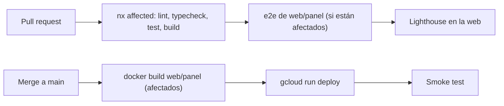

# CI y despliegue continuo con GitHub Actions

<Tech ids={['githubactions', 'nx', 'playwright', 'docker', 'googlecloud']} />

<Estado tipo="construye">El workflow que, en cada PR, prueba solo lo afectado del frontend y, al mergear a `main`, construye y despliega la web y el panel.</Estado>

## Concepto

El curso de Nest ya armó el pipeline de la API (sección 14): `nx affected`,
caché de pnpm, Workload Identity Federation. El frontend se suma al **mismo
workflow**: es un monorepo, y un cambio en `libs/shared/api-client` puede
afectar a la API, a la web y al panel a la vez.



### Qué bloquea un merge

| Chequeo | Por qué |
| --- | --- |
| Lint (ESLint con reglas de hooks y de Next) | Reglas de React que el compilador no ve |
| `tsc --noEmit` | Contrato con la API (tipos generados) |
| Vitest | Lógica y componentes |
| Build | Que compile y que las rutas sean lo esperado (12.1) |
| Playwright + axe | Caminos críticos y accesibilidad |
| Lighthouse | Que el rendimiento no empeore |

## Si venís de Angular

<Angular>

Es el mismo pipeline que tendrías con Nx y Angular (`nx affected -t lint test
build`). Cambia el destino: una imagen con un servidor Node en vez de
estáticos en un bucket.

</Angular>

## En ripopola

### 1. El job de calidad

```yaml title=".github/workflows/ci.yml (jobs del frontend)"
jobs:
  quality:
    runs-on: ubuntu-latest
    steps:
      - uses: actions/checkout@v5
        with: { fetch-depth: 0 }                       # nx affected necesita el historial
      - uses: pnpm/action-setup@v4
      - uses: actions/setup-node@v5
        with: { node-version-file: .nvmrc, cache: pnpm }
      - run: pnpm install --frozen-lockfile
      - uses: nrwl/nx-set-shas@v4                      # base y head para affected
      - run: pnpm nx affected -t lint typecheck test build --parallel=3

  e2e:
    needs: quality
    runs-on: ubuntu-latest
    steps:
      - uses: actions/checkout@v5
        with: { fetch-depth: 0 }
      - uses: pnpm/action-setup@v4
      - uses: actions/setup-node@v5
        with: { node-version-file: .nvmrc, cache: pnpm }
      - run: pnpm install --frozen-lockfile
      - uses: nrwl/nx-set-shas@v4
      - run: docker compose up -d db redis mailpit      # la base y servicios del curso de Nest
      - run: pnpm nx run api:migrate-and-seed           # usuarios y pueblos de prueba
      - run: pnpm exec playwright install --with-deps chromium
      - run: pnpm nx affected -t e2e
        env:
          E2E_PASSWORD: ${{ secrets.E2E_PASSWORD }}
      - uses: actions/upload-artifact@v4
        if: failure()
        with: { name: playwright-report, path: 'apps/*-e2e/playwright-report', retention-days: 7 }
```

- **`nx affected -t e2e`**: si el PR solo toca el panel, no corre las e2e de la web.
- El target `e2e` de cada proyecto levanta la API y la app con `webServer` (11.3).
- **El reporte de Playwright** (con trazas) se sube solo si algo falla.
- `api:migrate-and-seed` es un target que definís en la API: migraciones y
  datos de prueba conocidos.

### 2. Lighthouse en la web

```yaml
  lighthouse:
    needs: quality
    if: contains(needs.quality.outputs.affected, 'web')   # o un paso que lo calcule
    runs-on: ubuntu-latest
    steps:
      # ... checkout, pnpm, build de la web, API levantada ...
      - run: pnpm dlx @lhci/cli autorun --config=apps/web-e2e/lighthouserc.json
```

Para saber si la web está afectada: `pnpm nx show projects --affected` y
filtrar. Lo más simple al principio es correrlo siempre en PRs que tocan
`apps/web/**` o `libs/frontend/**` con `paths` en el `on:`.

### 3. Desplegar al mergear

```yaml title=".github/workflows/deploy.yml (frontend)"
on:
  push:
    branches: [main]

permissions:
  contents: read
  id-token: write                                   # Workload Identity Federation

jobs:
  deploy-web:
    runs-on: ubuntu-latest
    environment: production                         # aprobación manual si la configurás
    steps:
      - uses: actions/checkout@v5
      - uses: google-github-actions/auth@v2
        with:
          workload_identity_provider: ${{ vars.GCP_WIF_PROVIDER }}
          service_account: ${{ vars.GCP_DEPLOY_SA }}
      - uses: google-github-actions/setup-gcloud@v2
      - run: gcloud auth configure-docker europe-southwest1-docker.pkg.dev --quiet
      - name: Build
        env:
          IMAGE: europe-southwest1-docker.pkg.dev/ripopola-prod/ripopola/web:${{ github.sha }}
        run: |
          printf '%s' "${{ secrets.SENTRY_AUTH_TOKEN }}" > /tmp/sentry_token
          docker build -f apps/web/Dockerfile -t $IMAGE \
            --build-arg APP_VERSION=${{ github.sha }} \
            --build-arg NEXT_PUBLIC_SITE_URL=https://ripopola.com \
            --build-arg NEXT_PUBLIC_API_URL=https://api.ripopola.com \
            --build-arg NEXT_PUBLIC_SENTRY_DSN=${{ vars.SENTRY_DSN_WEB }} \
            --secret id=sentry_auth_token,src=/tmp/sentry_token .
          docker push $IMAGE
      - name: Deploy
        run: |
          gcloud run deploy web --region=europe-southwest1 \
            --image=europe-southwest1-docker.pkg.dev/ripopola-prod/ripopola/web:${{ github.sha }} \
            --update-env-vars=APP_VERSION=${{ github.sha }}
      - name: Smoke test
        run: |
          curl -fsS https://ripopola.com/internal/health
          curl -fsS -o /dev/null https://ripopola.com/es/pueblos/albarracin
```

- **Sin llaves de servicio**: GitHub obtiene un token de corta duración con
  Workload Identity Federation (curso de Nest).
- **La imagen con el SHA** como etiqueta: se sabe qué está desplegado y el
  rollback es volver a una imagen anterior.
- **Smoke test**: dos peticiones reales después del deploy. Si fallan, el job
  falla y avisa.
- `deploy-panel` es igual. Con `nx affected` (o filtros por `paths`) solo se
  despliega lo que cambió.

### 4. Rollback

Cloud Run guarda las revisiones:

```bash
gcloud run revisions list --service=web --region=europe-southwest1
gcloud run services update-traffic web --region=europe-southwest1 --to-revisions=web-00042-abc=100
```

Para cambios riesgosos, desplegá con `--no-traffic --tag=canary`, probá la URL
de la etiqueta y movés el tráfico de a poco (`--to-tags=canary=10`).

### 5. Previews (opcional)

Una preview por PR en Cloud Run: `gcloud run deploy web --tag=pr-123
--no-traffic` da una URL propia. Como esa URL está en `*.run.app`, la cookie
de `ripopola.com` no llega (9.1): en la preview el navegador habla con la API
a través de los rewrites (rutas relativas), y la API de staging acepta ese
origen. Si las previews se vuelven centrales para el equipo, es un buen
argumento para Vercel o Firebase App Hosting.

## Errores comunes

- **Correr todo en cada PR** en vez de `nx affected`: CI lento.
- **`fetch-depth: 1`** con `nx affected`: no puede calcular qué cambió.
- **Llaves JSON de cuentas de servicio** en los secretos de GitHub.
- **Imágenes con la etiqueta `latest`**: no se sabe qué hay desplegado.
- **Desplegar sin smoke test.**
- **Las e2e contra producción.**

<Resumen>

- Un solo workflow para el monorepo; `nx affected` decide qué probar, construir y desplegar.
- PR: lint, tipos, Vitest, build, Playwright + axe y Lighthouse.
- `main`: imagen con el SHA, `NEXT_PUBLIC_*` como build args, secretos de build y deploy con Workload Identity.
- Smoke test después de desplegar; rollback moviendo el tráfico a una revisión anterior.

</Resumen>

## Preguntas de entrevista

**1. ¿Qué es `nx affected` y por qué importa?**
Calcula qué proyectos cambió un commit (y cuáles dependen de ellos) y corre
las tareas solo en esos. En un monorepo, mantiene el CI rápido.

**2. ¿Cómo hacés un rollback en Cloud Run?**
Moviendo el tráfico a una revisión anterior, que sigue existiendo con su imagen.

**3. ¿Qué es un smoke test?**
Una prueba mínima contra el entorno recién desplegado para confirmar que
responde lo básico.

**4. ¿Por qué Workload Identity Federation y no una llave de servicio?**
Porque GitHub obtiene credenciales temporales en cada ejecución; no hay una
llave permanente que pueda filtrarse.

## Glosario

| Término | Qué es |
| --- | --- |
| `nx affected` | Comando que ejecuta tareas solo en los proyectos afectados por un cambio. |
| Smoke test | Verificación mínima después de desplegar. |
| Revisión | Versión inmutable de un servicio de Cloud Run. |
| Canary | Desplegar una versión a una parte del tráfico antes de pasarla a todo. |
| Workload Identity Federation | Autenticación sin llaves entre GitHub y Google Cloud. |
