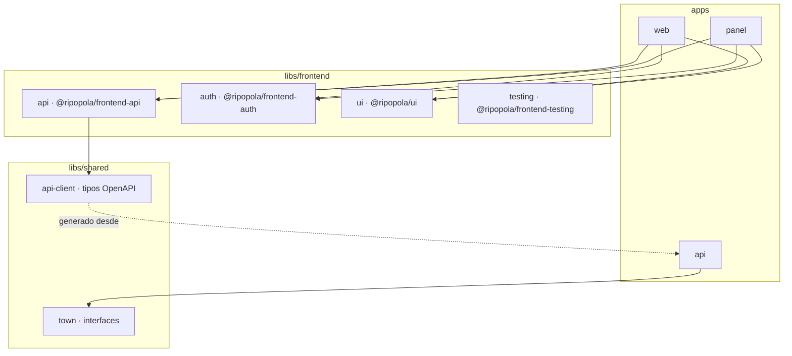

# El monorepo: librerías compartidas, contratos y límites

<Tech ids={['nx', 'openapiinitiative', 'typescript', 'nestjs', 'nextdotjs']} />

<Estado tipo="construye">El mapa final de librerías del frontend, sus etiquetas y las reglas que impiden, por ejemplo, que la web importe código del panel.</Estado>

## Concepto

### Qué hay en el monorepo



| Librería | Qué tiene | La usan |
| --- | --- | --- |
| `libs/shared/api-client` | Tipos generados del OpenAPI de Nest | Todo el frontend |
| `libs/frontend/api` | `publicApi`, `serverApi`, `browserApi`, `ApiError` (4.1) | web, panel |
| `libs/frontend/auth` | `authClient`, `safeRedirect`, mensajes (9.2) | panel (y la web si muestra la sesión) |
| `libs/frontend/ui` | Componentes de shadcn/ui, `Field`, tokens de Tailwind | web, panel |
| `libs/frontend/testing` | Handlers de MSW, `renderWithProviders` | Pruebas |

### El contrato es la frontera

El frontend **no importa código de Nest**. Lo que comparten es el contrato
OpenAPI:

1. Nest expone `/api/docs-json` (curso de Nest, sección 8).
2. `openapi-typescript` genera `libs/shared/api-client/src/schema.ts`.
3. El frontend usa esos tipos con openapi-fetch.

Si alguien cambia un DTO en Nest y no regenera, el CI lo detecta: un target
`api-client:check` regenera y falla si el resultado difiere de lo
versionado. Si regenera y el front usa un campo que ya no existe, `tsc` falla.

¿Por qué no importar directamente los DTO de Nest? Porque arrastra
decoradores, `class-validator` y dependencias del servidor al bundle del
navegador, y acopla los despliegues. El contrato es más estable que el código.

### Límites entre proyectos

Nx etiqueta cada proyecto y una regla de ESLint impide dependencias que no
corresponden:

| Etiqueta | Puede depender de |
| --- | --- |
| `scope:web` | `scope:web`, `scope:frontend`, `scope:shared` |
| `scope:panel` | `scope:panel`, `scope:frontend`, `scope:shared` |
| `scope:frontend` | `scope:frontend`, `scope:shared` |
| `scope:api` | `scope:api`, `scope:shared` |
| `scope:shared` | `scope:shared` |

Así, la web no puede importar algo del panel (y meter su código en el sitio
público), y el frontend no puede importar la API.

## Si venís de Angular

<Angular>

Es exactamente lo que hacías en Nx con Angular: librerías por tipo
(`feature`, `ui`, `data-access`, `util`) y `enforce-module-boundaries` con
etiquetas. Lo que cambia es la frontera con el backend: con Nest y Angular a
veces se compartían interfaces TypeScript a mano; acá el contrato se genera.

</Angular>

## En ripopola

### 1. Etiquetas

```json title="apps/web/project.json (fragmento)"
{ "name": "web", "tags": ["scope:web", "type:app"] }
```

```json title="libs/frontend/ui/project.json (fragmento)"
{ "name": "ui", "tags": ["scope:frontend", "type:ui"] }
```

### 2. La regla

```js title="eslint.config.mjs (raíz)"
import nx from '@nx/eslint-plugin';

export default [
  ...nx.configs['flat/base'],
  {
    files: ['**/*.{ts,tsx}'],
    rules: {
      '@nx/enforce-module-boundaries': ['error', {
        depConstraints: [
          { sourceTag: 'scope:web', onlyDependOnLibsWithTags: ['scope:web', 'scope:frontend', 'scope:shared'] },
          { sourceTag: 'scope:panel', onlyDependOnLibsWithTags: ['scope:panel', 'scope:frontend', 'scope:shared'] },
          { sourceTag: 'scope:frontend', onlyDependOnLibsWithTags: ['scope:frontend', 'scope:shared'] },
          { sourceTag: 'scope:api', onlyDependOnLibsWithTags: ['scope:api', 'scope:shared'] },
          { sourceTag: 'scope:shared', onlyDependOnLibsWithTags: ['scope:shared'] },
          { sourceTag: 'type:ui', notDependOnLibsWithTags: ['type:data-access'] },   // la UI no pide datos
        ],
      }],
    },
  },
];
```

`pnpm nx graph` muestra el grafo: es la mejor forma de explicar la
arquitectura en una entrevista o a alguien nuevo.

### 3. La librería de UI

Con shadcn/ui, los componentes son **código tuyo** (1.8). Para compartirlos:

```bash
pnpm exec nx g @nx/react:lib libs/frontend/ui --importPath=@ripopola/ui --bundler=none --dry-run
```

- `components.json` de shadcn apuntando a esa librería, para que
  `pnpm dlx shadcn@latest add dialog` escriba ahí.
- El CSS de Tailwind de cada app tiene que **escanear la librería**: en
  Tailwind 4, `@source "../../../libs/frontend/ui/src";` en el `globals.css`.
- Storybook (opcional) sobre esta librería: un catálogo visual y pruebas de
  interacción y accesibilidad por componente.

### 4. Cuándo extraer a una librería

| Señal | Acción |
| --- | --- |
| Lo usan las dos apps | Librería en `libs/frontend/` |
| Lo usa una sola app | Se queda en `features/` de esa app |
| Es dominio puro sin React (validaciones, cálculos) | `libs/shared/` si también lo usa Nest |
| "Por si algún día..." | No |

<Alternativa title="Microfrontends y Module Federation">
Partir el frontend en apps desplegadas por separado que se componen en el
navegador (Module Federation, *multi-zones* de Next). Tiene sentido con
varios equipos independientes sobre un mismo producto. Ripopola ya separa web
y panel como apps con dominios distintos, que es la forma simple de lo mismo;
microfrontends serían complejidad sin beneficio.
</Alternativa>

## Errores comunes

- **Importar código de Nest en el frontend** en vez de usar el contrato.
- **Olvidar regenerar los tipos** al cambiar la API: el CI lo tiene que atrapar.
- **Una librería "common" con todo adentro.**
- **Tailwind que no escanea la librería de UI**: los estilos de esos componentes no aparecen.
- **Límites sin forzar**: a los seis meses la web importa del panel.

<Resumen>

- web, panel y api comparten librerías y un contrato OpenAPI generado.
- `libs/frontend`: api, auth, ui y testing; `libs/shared`: tipos y dominio.
- Etiquetas + `enforce-module-boundaries` impiden dependencias indebidas.
- El contrato, no el código, es la frontera con el backend; el CI verifica que esté al día.
- Extraer a librería cuando dos apps lo necesitan, no antes.

</Resumen>

## Preguntas de entrevista

**1. ¿Qué ventajas tiene un monorepo para front y back?**
Cambios atómicos entre API y frontend, tipos compartidos, herramientas y CI
comunes, y ejecutar solo lo afectado. A cambio, necesita reglas de límites
y herramientas como Nx.

**2. ¿Cómo mantenés sincronizados los tipos del frontend con la API?**
Generándolos del contrato OpenAPI y verificando en CI que estén al día; el
compilador marca lo que cambió.

**3. ¿Cómo evitás que un monorepo se vuelva una bola de barro?**
Con etiquetas y reglas de dependencias forzadas por lint, y librerías con una
responsabilidad clara.

**4. ¿Cuándo usarías microfrontends?**
Con varios equipos autónomos que necesitan desplegar partes de la misma
interfaz por separado. Para un equipo chico, el costo supera el beneficio.

## Glosario

| Término | Qué es |
| --- | --- |
| Monorepo | Un repositorio con varios proyectos relacionados. |
| `enforce-module-boundaries` | Regla de Nx que restringe dependencias entre proyectos por etiquetas. |
| Contrato | Descripción formal de la API (OpenAPI) que comparten cliente y servidor. |
| Microfrontends | Partes de una interfaz desarrolladas y desplegadas de forma independiente. |
