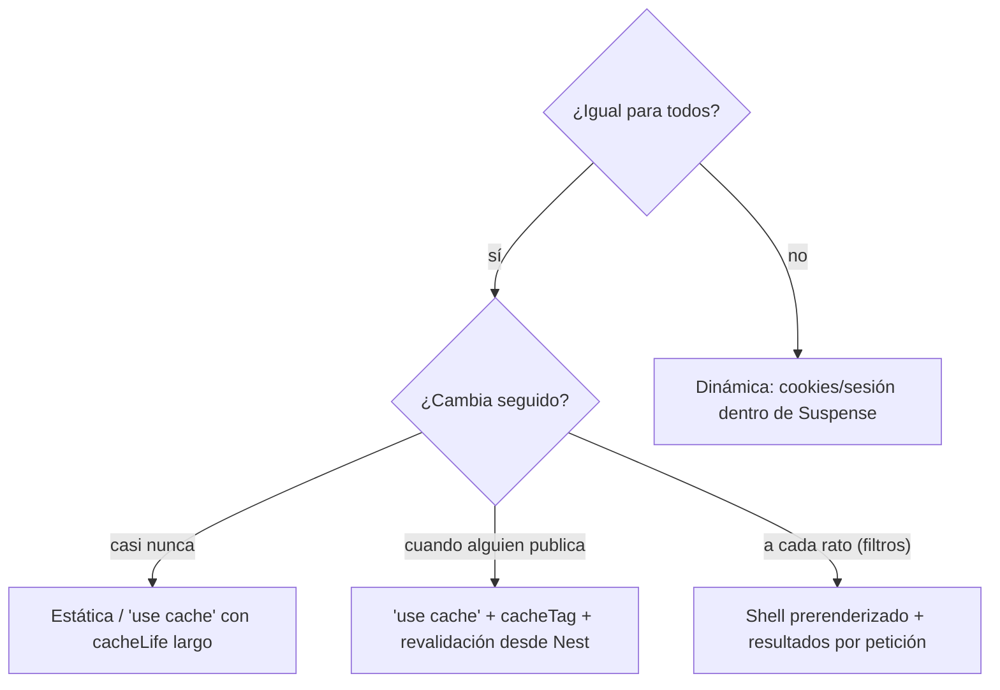

# Decisiones de render, página por página

<Tech ids={['nextdotjs', 'reactquery', 'zustand']} />

<Estado tipo="concepto">El repaso de todo el curso en una tabla: es la pregunta de diseño que te van a hacer en una entrevista de senior.</Estado>

## Concepto

Para cada página hay que responder cinco preguntas:

1. **¿Es igual para todos?** Si sí, se puede cachear.
2. **¿Cada cuánto cambia y quién lo sabe?** Define `cacheLife` y quién revalida.
3. **¿Qué parte depende del usuario o de la petición?** Va dentro de `<Suspense>`.
4. **¿Qué es interactivo?** Esas hojas son Client Components.
5. **¿Dónde vive el estado en el navegador?** URL, TanStack Query, Zustand o local.

## La web (`ripopola.com`)

| Página | Estrategia | Caché y revalidación | Interactivo (cliente) | Estado en el cliente |
| --- | --- | --- | --- | --- |
| `/[locale]` (home) | Prerender completo | `'use cache'`, `cacheLife('days')`, etiqueta `towns` (destacados) | Buscador del header (`next/form`), favoritos | — |
| `/[locale]/pueblos` | Prerender parcial | Shell estático; la lista depende de `searchParams` y se transmite. `'use cache'` por combinación de filtros con `cacheLife('minutes')` | Filtros | **URL** (nuqs, 4.6) |
| `/[locale]/pueblos/[slug]` | Prerender parcial; `generateStaticParams` con los más visitados, el resto bajo demanda | `'use cache'` + `cacheTag('town:slug')`, revalidada por Nest al publicar o traducir | Favorito, galería, mapa diferido | Favoritos en **Zustand** + `localStorage` |
| `.../pueblos/[slug]` bloque "cerca tuyo" | Dinámico dentro de `<Suspense>` | Lee la cookie de unidades (8.5) | — | — |
| `.../pueblos/[slug]/viviendas` | Prerender parcial | `cacheTag('listings:townId')`, revalidada por Nest | Filtros | URL |
| `/[locale]/mapa` | Shell estático | Los pueblos del área visible no se prerenderizan | Todo el mapa (`ssr: false`) | **TanStack Query** por `bbox` (5.2) |
| `/[locale]/privacidad` | Estática | Sin revalidación: cambia con un deploy | — | — |
| `sitemap.xml` | `'use cache'` | Etiqueta `towns` | — | — |
| `/internal/*` | Route Handlers | — | — | — |

## El panel (`panel.ripopola.com`)

| Página | Estrategia | Datos | Interactivo | Estado en el cliente |
| --- | --- | --- | --- | --- |
| `/login`, `/registro`, `/recuperar` | Estáticas | — | Formularios (Better Auth desde el navegador) | Formulario (RHF) |
| Layout `(privado)` | Shell estático + sesión en `<Suspense>` | `getMe()` con `cache` de React | Menú de usuario, selector de ayuntamiento | Context (`MeProvider`) |
| `/` (resumen) | Dinámica | `serverApi()` | Gráficos | — |
| `/viviendas` | Dinámica | Prefetch en el servidor + `HydrationBoundary` (7.7) | Tabla con filtros y paginación | **TanStack Query**; filtros en la URL |
| `/viviendas/nueva`, `/[id]` | Dinámica | Valores iniciales desde el servidor | Formulario largo, subida de fotos | RHF + Zod; `useMutation` |
| Publicar / despublicar | Server Action | `updateTag` en el panel; Nest revalida la web | Botón con `useTransition` | — |
| `/seguridad/*` | Dinámica | `authClient` | 2FA, sesiones | TanStack Query |

### Las preguntas de "por qué"

- **¿Por qué la ficha no es SSR puro?** Porque es igual para todos y cambia
  solo cuando el ayuntamiento publica: cachearla y revalidar a demanda da
  HTML instantáneo para Google sin pegarle a la API en cada visita.
- **¿Por qué el mapa no se renderiza en el servidor?** WebGL solo existe en el
  navegador, y los datos dependen del área visible. El SEO lo cubren las fichas
  y el sitemap, no el mapa.
- **¿Por qué el panel no usa `'use cache'`?** Todo depende del usuario y debe
  estar fresco. La caché que importa ahí es la de TanStack Query en el cliente.
- **¿Por qué los filtros en la URL y no en Zustand?** Para compartir, volver
  atrás e indexar. Zustand queda para lo que no es de la URL ni del servidor
  (favoritos sin cuenta, preferencias de la interfaz).
- **¿Por qué TanStack Query en el panel y no solo Server Components?** Por la
  interactividad: paginar, filtrar y mutar sin recargar la página, con caché,
  reintentos y actualizaciones optimistas.

## Si venís de Angular

<Angular>

En Angular SSR la decisión era casi binaria: SSR o no, y transfer state para
no pedir dos veces. En Next la decisión es **por componente**: una misma
página tiene partes estáticas, cacheadas, dinámicas e interactivas.

</Angular>

<Resumen>

- Cinco preguntas por página: igual para todos, cada cuánto cambia, qué depende del usuario, qué es interactivo, dónde vive el estado.
- Web: prerender y `'use cache'` con etiquetas; Nest revalida; lo del usuario en `<Suspense>`.
- Panel: dinámico con sesión; TanStack Query para la interactividad.
- URL para lo compartible, TanStack Query para datos del servidor, Zustand para estado de UI global, `useState` para lo local.

</Resumen>

## Preguntas de entrevista

**1. Diseñá el render de una página de producto que cambia cuando alguien la edita.**
Cachearla con una etiqueta, prerenderizar las más visitadas, generar el resto
bajo demanda, y revalidar la etiqueta desde el backend al editar. Lo
personalizado, en un `<Suspense>` dinámico.

**2. ¿Dónde guardás cada tipo de estado en una app Next?**
Datos del servidor: Server Components o TanStack Query. Lo compartible
(filtros, página): la URL. Estado global de interfaz: Zustand o Context.
Lo local: `useState`. La sesión: una cookie `HttpOnly`.

**3. ¿Cuándo usarías TanStack Query si ya tenés Server Components?**
Cuando la pantalla es muy interactiva: paginación y filtros sin recargar,
mutaciones optimistas, sondeo o datos que cambian mientras el usuario mira.

**4. ¿Por qué no renderizar todo dinámico y listo?**
Porque cada visita espera a la API y a renderizar; con caché la mayoría de
las visitas reciben HTML listo, más rápido y más barato.

## Glosario

| Término | Qué es |
| --- | --- |
| Shell | La parte estática de una ruta que se sirve al instante. |
| Revalidación a demanda | Invalidar la caché cuando cambia el dato, no por tiempo. |
| Estado del servidor | Datos cuya fuente de verdad está en el backend. |
| Estado de la interfaz | Datos que solo existen en el navegador (un modal abierto, un filtro). |
