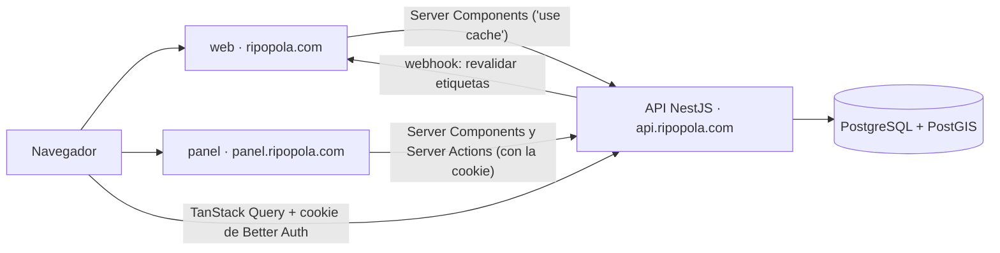

# Cómo usar este curso

Este curso es para aprender **React y Next.js construyendo el frontend de
ripopola**, y para que te quede como material de repaso antes de una
entrevista de senior. Venís de ser senior de Angular, así que no empezamos de
cero: cada concepto se compara con lo que ya sabés y se va directo a lo que
cambia.

No reemplaza a la documentación oficial: la sigue, la ordena y la aterriza en
un proyecto real. Las fuentes son [react.dev](https://react.dev) y
[nextjs.org/docs](https://nextjs.org/docs) (Next trae la misma documentación
dentro del paquete, en `node_modules/next/dist/docs/`, siempre de tu versión
exacta).

## Las decisiones que ya están tomadas

| Tema | En ripopola | Como concepto o alternativa |
| --- | --- | --- |
| Framework | **Next.js 16** (App Router, Cache Components), dos apps: web y panel | Vite + React Router, Astro, TanStack Start |
| Dónde se aprende React | Dentro del proyecto Next, desde el día 1 | Ninguna app de ejemplo aparte |
| Backend | La **API de NestJS** de ripopola | Route Handlers y Prisma dentro de Next |
| Autenticación | **Better Auth** integrado en Nest, con su cliente en Next | Firebase Auth, Auth.js, Clerk |
| Datos del servidor en el cliente | **TanStack Query** | SWR, RTK Query |
| Estado de la interfaz | **Zustand** | Redux Toolkit, Context |
| Formularios | **React Hook Form + Zod** | Formik, TanStack Form |
| Estilos | **Tailwind CSS + shadcn/ui** | CSS Modules, MUI |
| Mapas | **MapLibre** con `react-map-gl` | Leaflet, Mapbox |
| Idiomas | **next-intl** | react-i18next, Lingui |
| Pruebas | **Vitest + Testing Library**, MSW y **Playwright** | Jest, Cypress |
| Despliegue | **Docker en Cloud Run** | Firebase App Hosting, Vercel |

## Cómo está armado cada tema

1. **Concepto**: qué es, qué problema resuelve y cómo funciona por dentro.
2. **Si venís de Angular**: la comparación con lo que ya conocés.
3. **En ripopola**: paso a paso, con el código y qué hace cada parte.
4. **Errores comunes**: lo que suele fallar y cómo darte cuenta.
5. **Preguntas de entrevista**: con respuestas cortas, para decirlas en voz alta.
6. **Glosario**: los términos nuevos del tema.

Cada tema arranca con una marca:

<Estado tipo="construye">Se escribe de verdad en el frontend de ripopola.</Estado>

<Estado tipo="concepto">Se entiende y se practica para la entrevista, pero ripopola no lo usa.</Estado>

:::tip Cómo estudiarlo
Leé el concepto, escribí vos el código en ripopola (sin copiar y pegar si
podés), rompelo a propósito para ver el error, y al final tapá las respuestas
de las preguntas de entrevista e intentá contestarlas. El
[repaso para entrevistas](./entrevistas.md) junta todas las preguntas.
:::

## Qué vas a construir

El frontend de ripopola son **dos apps Next** en el monorepo Nx, igual que en
el curso de Nest:

| App | Dominio | Rutas | Qué necesita |
| --- | --- | --- | --- |
| `apps/web` | `ripopola.com` | `/es/pueblos`, `/es/pueblos/albarracin`, el mapa | SEO, carga rápida, páginas cacheadas, varios idiomas |
| `apps/panel` | `panel.ripopola.com` | `/viviendas`, `/login`... | Sesión, formularios, subida de fotos, datos siempre frescos |

Lo que comparten (el cliente tipado de la API, el cliente de Better Auth,
componentes de UI) va en librerías de `libs/frontend/`.

El orden del curso es el que vas a seguir al construirlo:

1. **React** (secciones 1 a 5): aprendés React escribiendo los componentes de
   cliente de ripopola dentro del proyecto Next. Todavía no hace falta
   entender Next: alcanza con saber que un archivo con `'use client'` es React
   "de siempre".
2. **Next.js** (secciones 6 a 8): rutas, Server Components, datos, caché,
   SEO, Server Actions.
3. **Lo que hace real a la app** (secciones 9 a 13): autenticación,
   idiomas, pruebas, rendimiento, producción y arquitectura.

## Los cursos de referencia

La lista de temas sale de dos cursos de Fernando Herrera en Udemy: *React: De
cero a experto* y *Next.js: El framework de React para producción*. Se usan
solo como checklist; el contenido se escribe desde cero con la documentación
oficial y con ejemplos de ripopola. Esta tabla dice dónde quedó cada parte:

| En el curso de referencia | Acá |
| --- | --- |
| Hooks, componentes, pruebas, React Router | Secciones 1 a 3 y 11 (sin apps de ejemplo: todo con ripopola) |
| Formularios, TanStack Query, Zustand, carga de archivos (TesloShop) | Secciones 4 y 5 |
| Redux y el calendario MERN, backend con Express y Mongo | Redux como concepto en 4.5; el backend ya lo tenés en el curso de Nest |
| Introducción a Next, layouts, `Link`, rutas activas | Sección 6 |
| SSR, SSG, ISR, rutas dinámicas, caché y revalidación | Secciones 6 y 7 |
| Estado global con Redux y localStorage (favoritos) | 4.4 (Zustand con persistencia) y 4.5 |
| API Routes, Prisma dentro de Next, AdminTodos | 8.3 y 8.6, como concepto |
| Server Actions y actualizaciones optimistas | 2.8, 8.1 y 8.2 |
| Cookies del lado del servidor y del cliente | 8.5 |
| Auth.js (sección archivada) y Better Auth (con 2FA y proxy) | Sección 9, con Better Auth en Nest |
| TesloShop: diseño, base de datos, paginación, órdenes, pagos, panel | Secciones 4, 5 y 7 con el panel del municipio |
| Despliegues en Vercel y con Docker | Sección 12 |

:::info Secciones que no se pudieron ver
La página pública del curso de Next muestra solo 10 de sus 27 secciones. El
resto salió de tus capturas. Lo que pudo faltar (por ejemplo pagos con PayPal
o tarjeta, el panel de administración de la tienda o la subida de imágenes a
Cloudinary) está cubierto con el equivalente de ripopola o, si ripopola no lo
necesita todavía, como concepto.
:::

## El punto de partida

Lo que ya existe en ripopola cuando empezás:

- Monorepo **Nx** con la API **NestJS 11** en `apps/api`, PostgreSQL + PostGIS
  en Docker y Prisma.
- La librería de interfaces `@ripopola/town` (`libs/shared/town`).
- Endpoints de pueblos: `GET /api/towns` (con filtros y paginación),
  `GET /api/towns/:slug`, `GET /api/towns/nearby`, `GET /api/towns/map?bbox=...`.
- El contrato OpenAPI y los tipos generados con `openapi-typescript` en
  `libs/shared/api-client` (curso de Nest, sección 8).

Si algún endpoint todavía no existe, el tema te dice qué devolver a mano para
poder seguir.

## Versiones de referencia

Next.js 16.4 · React 19.3 · TypeScript · Tailwind CSS 4 · TanStack Query 5 ·
Zustand 5 · Zod 4 · React Hook Form 7 · next-intl 4 · react-map-gl 8 con
maplibre-gl · Better Auth 1.7 · Vitest · Playwright.

:::warning Next cambia rápido
Next 16 trajo cambios grandes: Cache Components por defecto, `middleware.ts`
pasó a llamarse `proxy.ts`, `params` y `cookies()` son asíncronos. Mucho de lo
que vas a encontrar en internet (y en los cursos grabados con Next 13 o 14) ya
no aplica. Ante la duda, mirá `node_modules/next/dist/docs/`.
:::
